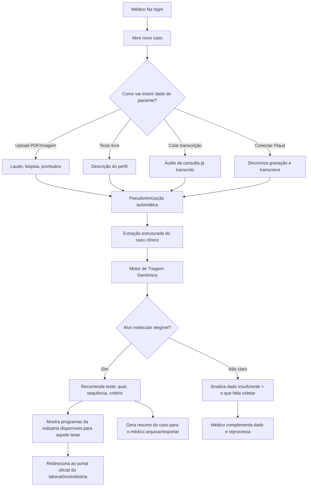

# OncoGenYX — Arquitetura Conceitual

> Desenho de produto para uma ferramenta de **triagem multimodal no ponto de cuidado**: o médico sobe dados brutos do paciente (PDF, imagem, texto, áudio) e recebe direcionamento sobre qual teste molecular pedir e onde pedir de graça, com apoio de um Hub de Acesso (catálogo de programas da indústria) e de um assistente conversacional (OncoBot) como via alternativa de entrada.

---

## 1. O que essa ferramenta É e NÃO É

**É:**
- Uma ferramenta de **triagem e direcionamento** — "existe alvo molecular relevante nesse caso? Qual teste pedir? Onde pedir de graça?"
- Um tradutor entre **dado clínico bruto e desfecho acionável**: perfil do paciente → biomarcador elegível → programa de acesso da indústria.
- Um **facilitador de logística e literacia clínica** no momento da decisão (o gargalo real, conforme os dados SGO/Labcorp-Illumina que você trouxe).

**NÃO é:**
- Uma ferramenta de **decisão terapêutica** (não sugere droga, dose ou linha de tratamento).
- Um **repositório de dados de pacientes** (não hospeda, não cruza dados entre médicos, não é banco retrospectivo).
- Um substituto de **aconselhamento genético** (sempre encaminha para especialista quando indicado, ex.: critérios de síndrome hereditária).

Essa distinção é a base regulatória e de MLR: o produto orienta *processo de solicitação de exame*, não *conduta terapêutica*. Isso muda a régua de risco (mais perto de "suporte administrativo/educacional" do que "software as medical device" de decisão terapêutica) — mas ainda exige disclaimers e trilha de auditoria, porque toca decisão clínica indiretamente.

---

## 2. Jornada do médico (fluxo ponta a ponta)



---

## 3. Arquitetura em camadas

### Camada 1 — Ingestão multimodal
Responsável por receber o dado bruto, seja qual for o formato.

| Fonte | Mecanismo | Observação |
|---|---|---|
| PDF (laudo anatomopatológico, prontuário) | Upload + parsing (texto nativo ou OCR se digitalizado) | Extrai texto, tenta localizar campos-chave (diagnóstico, estadiamento, IHQ) |
| Imagem (foto de laudo, lâmina, prescrição) | Upload + OCR | Mesma pipeline do PDF escaneado |
| Texto livre | Campo de descrição | Médico descreve o caso em linguagem natural |
| Ditado clínico por voz | Gravação de áudio no próprio app + transcrição automática (speech-to-text) | O médico dita o caso em vez de digitar; a transcrição alimenta a mesma extração da Camada 3. Diferente da transcrição colada: a gravação acontece dentro da sessão, não é importada de outro app |
| Transcrição de áudio colada | Campo de texto | Médico cola transcrição já pronta (de qualquer gravador) |
| Plaud (cartão gravador) | Integração via API/webhook do Plaud, se disponível, ou export manual do arquivo de transcrição | **Ver seção 7 — depende de disponibilidade de API pública do Plaud** |

Todo dado bruto (PDF, imagem, áudio) é **processado e descartado** — não fica retido além do necessário para gerar o resumo estruturado do caso (ver seção 5, retenção de dados).

### Camada 2 — Pseudonimização (LGPD by design)

> ## ⚠️ DESENHADO — NÃO IMPLEMENTADO (marcado em 19/10/2026)
>
> **Esta camada não existe no código.** O texto abaixo descreve uma intenção de
> projeto, escrita no presente do indicativo, e foi lida por auditoria externa
> como descrição do que o produto faz. Não é.
>
> **O que o código faz hoje, verificado linha a linha:** o material anexado
> (PDF original, foto, texto digitado) é enviado **íntegro** ao modelo, sem
> nenhuma redação. O schema de extração declara `nome_paciente` como campo
> **obrigatório** (`server/extracao.js:44` e `:78`, `required:
> Object.keys(properties)`), ou seja, o modelo é instruído a **localizar** o
> nome. Um mesmo caso pode cruzar a fronteira até três vezes (leitura inicial,
> segunda leitura dirigida, plano B de PDF recusado).
>
> **O que de fato existe:** `ROTULO_PROIBIDO` (`server/index.js:632`) filtra
> rótulos identificadores do bloco de contexto enviado à Gena — e **só dele**
> (usado uma única vez, em `:674`, no fluxo de chat). Não tem efeito algum
> sobre a extração, que é o caminho por onde o dado efetivamente sai do país.
>
> **E em um ponto a implementação é melhor que este desenho:** não há tabela de
> reidentificação, porque não há retenção nenhuma no servidor — `server/store.js`
> cria apenas `users`, `sessions`, `resets` e `plaud_tokens`. Nenhum caso,
> laudo ou documento é gravado. A §5 abaixo, que prevê retenção, também está
> desatualizada **a favor do produto**.
>
> **Por que esta marcação importa mais que a dívida técnica:** este documento
> circula. Se chegar a um hospital em due diligence, a uma operadora, a um
> departamento de MLR ou à ANPD, a divergência entre arquitetura declarada e
> arquitetura real deixa de ser pendência e vira risco de declaração inexata —
> agravado pelo fato de a interface ser honesta (`index.html:568` diz "a
> plataforma não os remove") enquanto este documento não era.
>
> **Alvo correto de engenharia:** redação no navegador **antes do upload**.
> Remover `nome_paciente` do schema não reduz a transferência em um byte,
> porque o laudo integral sobe de qualquer forma.

Executa **antes** de qualquer outro processamento, inclusive antes de qualquer chamada a modelo de IA externo.

- Nome completo → iniciais + identificador sequencial gerado pela plataforma (ex.: "Renan Lourenço Vidal" → `R.L.V. — Caso #0142`).
- Nenhum CPF, data de nascimento completa, endereço, telefone ou nome de familiar é mantido em texto pleno — campos sensíveis são mascarados ou removidos na extração.
- A tabela de correspondência **nome real ↔ código do caso** fica isolada, criptografada, e só é visível para o médico dono do caso (nunca trafega para o motor de triagem nem para qualquer chamada de IA/terceiro).
- Esse desenho segue o princípio de **minimização de dados** da LGPD (Art. 6º, III) — a IA e qualquer processamento downstream só enxergam o caso pseudonimizado.

### Camada 3 — Extração e estruturação do caso clínico
Converte o dado bruto (já pseudonimizado) em um **objeto clínico estruturado**:

```
CasoClinico {
  codigo_caso: "R.L.V.-0142"
  sexo, idade
  subtipo_oncologico: enum [Ginecológico, Geniturinário, Mama, Pulmão, ...]
  histologia, grau, estadiamento
  biomarcadores_ja_conhecidos: []
  historico_familiar: { presente: bool, detalhes_relevantes }
  tratamentos_previos: []
  fonte_dados: [PDF, texto, áudio-Plaud, ...]
  dados_insuficientes: []   // o que falta para triagem completa
}
```

Aqui entra o parsing de PDF/OCR + um modelo de linguagem para extrair essas entidades do texto livre/transcrição. Idade e sexo viram faixas/categorias sempre que possível, para reduzir ainda mais a identificabilidade.

### Camada 4 — Motor de Triagem Genômica
O coração do produto. Uma árvore de decisão **por subtipo oncológico**, baseada em diretrizes NCCN/ESMO, que responde três perguntas:

1. Existe alvo molecular relevante para esse subtipo/perfil?
2. Qual(is) teste(s) pedir (germinativo, somático, HRD, painel amplo) e em que ordem?
3. Que critério de elegibilidade o caso já cumpre ou ainda precisa documentar?

Ver seção 6 para o desenho por subtipo.

### Camada 4-B — OncoBot (via conversacional, mesmo motor)
Alternativa à ingestão por formulário/upload: o médico conversa com um assistente que faz perguntas dirigidas ("qual a histologia?", "há histórico familiar?", "já foi feito algum teste?") até reunir os mesmos campos do `CasoClinico` estruturado (Camada 3). Não é um motor de decisão paralelo — é **outra porta de entrada para a mesma Camada 4**: as perguntas do bot são geradas a partir das lacunas do objeto estruturado, e a resposta final passa pelas mesmas regras versionadas e citáveis por diretriz.

- Útil quando o médico não tem laudo/arquivo em mãos e quer só descrever o caso rapidamente entre consultas.
- Pode ser usado em conjunto com upload (ex.: sobe o laudo, o bot só pergunta o que ficou faltando — histórico familiar, testes prévios).
- Mesma régua de pseudonimização da Camada 2 se aplica à conversa: o bot nunca pede nome, CPF ou dado que identifique o paciente: só dado clínico.
- Mesmo disclaimer da Camada 7: o bot direciona qual exame pedir, não sugere conduta terapêutica.

### Camada 5 — Base de Programas da Indústria (o "Hub" de acesso)
Catálogo pesquisável por **patologia × biomarcador × empresa** (`Catálogo de Programas`, Fase 1). Para cada teste elegível identificado na Camada 4, a plataforma:
- Lista quais indústrias oferecem aquele teste gratuitamente/patrocinado naquele subtipo.
- Mostra critérios de elegibilidade do programa (podem ser mais restritos que o critério clínico puro).
- Redireciona para o **portal oficial** de cada laboratório/indústria parceira — a plataforma nunca processa a solicitação em si (é facilitador, não gestor do processo).

Essa base precisa de **manutenção contínua** (programas mudam, critérios mudam) — é dado curado, não gerado por IA.

### Camada 6 — Output / Resumo do caso
Gera um resumo que o médico pode salvar/exportar:
- Caso pseudonimizado (`R.L.V.-0142`)
- Alvo(s) molecular(es) elegível(is) e por quê (critério aplicado)
- Teste(s) recomendado(s) e sequência
- Programas de acesso disponíveis + link oficial
- Disclaimer: "Esta é uma ferramenta de triagem e direcionamento, não substitui julgamento clínico nem aconselhamento genético."

### Camada 7 — Compliance, auditoria e disclaimers

> ⚠️ **O log de auditoria abaixo é DESENHO, NÃO IMPLEMENTADO** (marcado em
> 19/10/2026). Nem a tela de resultado nem o documento assinado citam diretriz,
> ano ou versão do motor: `server/public/tumors.js` menciona NCCN/ASCO/ESMO
> oito vezes, **nenhuma** em texto visível ao médico. O código de caso existe
> (`app.js:748`) mas é `Math.random()` de quatro dígitos, não persistido e
> **não impresso no documento**. Assimetria que um auditor nota em trinta
> segundos: a camada comercial carrega `verificadoEm` e o mostra na tela
> ("Via conferida em 16/10/2026"); a camada clínica não carrega data nenhuma.
> Requisito próprio, escrito, consciente e não cumprido — o que retira
> qualquer defesa de desconhecimento. Ver §80 do plano de correção.

- Log de auditoria: quem gerou qual triagem, quando, com base em qual versão da diretriz (importante para defensibilidade médico-legal e para eventual submissão a Medical/Regulatory).
- Disclaimer fixo em toda tela de recomendação.
- Trilha de decisão explicável: a recomendação sempre aponta a regra/diretriz que a gerou (não é "caixa-preta" de IA generativa pura — a IA ajuda a extrair dado, mas a lógica de triagem é regras auditáveis mapeadas a NCCN/ESMO).

### Camada 8 — Geração do documento de solicitação
Este é o segundo gargalo que você identificou, e é tão importante quanto o primeiro: o médico pode saber exatamente qual teste pedir e ainda assim não pedir, porque não tem staff para preencher o formulário certo do jeito certo para cada laboratório/programa. Esta camada fecha esse hiato — gera o **documento de solicitação já preenchido**, pronto para revisar, assinar e enviar.

- **Entrada isolada de nome real**: até aqui, todo o pipeline (Camadas 2 a 7) trabalha só com o caso pseudonimizado (`A.F.M.-0231`). O nome completo do paciente só é **usado** (exibido, preenchido no documento) **nesta camada**, num campo separado — nunca entra no motor de triagem, nunca fica salvo junto do histórico de casos, nunca aparece nas telas de revisão/resultado. É reidentificação pontual e local, controlada pelo médico, no exato momento em que ele precisa do documento final.
  - **Atualização v0.4**: quando o material de origem é um PDF/foto de laudo (que já contém o nome do paciente no cabeçalho, inevitavelmente visível ao modelo que lê o documento para extrair o dado clínico), o motor de extração da Camada 3 também captura esse nome — como campo isolado (`nome_paciente`), nunca combinado com o objeto clínico estruturado. Ele só é usado para pré-preencher o campo desta camada, poupando o médico de digitar de novo algo que a IA já viu. Continua nunca aparecendo nas telas 2 e 3 (revisão/resultado), continua nunca influenciando a triagem. Quando a entrada é só texto digitado (sem nome mencionado), o campo simplesmente vem vazio para preenchimento manual, como antes.
- **Templates por parceiro**: cada laboratório/indústria tem seu próprio formulário de solicitação (campos, layout, texto de justificativa exigido). Assim como a base de programas (Camada 5), esses templates são **dado curado**, mantido e validado por você — não gerado livremente por IA.
- **Preenchimento automático**: nome do paciente, dados do médico (CRM, instituição), diagnóstico, teste solicitado e a **justificativa clínica já redigida**, citando a diretriz que embasa a indicação (o mesmo texto rastreável da Camada 7).
- **Múltiplos documentos por caso**: quando a triagem recomenda teste pareado (ex.: HRD tumoral + BRCA germinativo, ver seção 10), a plataforma gera um documento para cada um — cada teste pode ter parceiro, laboratório e formulário diferentes.
- **Saída**: PDF para download, com aviso de que a responsabilidade pela solicitação final é do médico assistente (a plataforma preenche, não decide nem envia em nome dele).

**Atualização v0.4**: o fluxo real (`server/public/index.html`) juntou as telas de Programas de acesso e Modelo de solicitação num único passo 4 — cada card de teste indicado já mostra, na sequência, o(s) programa(s)/portal(is) e o documento de solicitação pré-preenchido daquele mesmo teste, em vez de duas telas separadas. Ver `mockup/oncogyn-flow.html` (versão anterior, 5 passos, sem backend) para o histórico do desenho original.

---

## 4. Estrutura de telas (informação, não visual ainda)

1. **Login/Cadastro do médico** (CRM, especialidade, instituição) — acesso seguro ao Hub.
2. **Dashboard** — casos recentes, catálogo de programas.
3. **Novo Caso** — tela de ingestão multimodal: formulário/upload (texto, PDF, imagem, áudio, Plaud) **ou** conversa com o OncoBot (ver Camada 4-B).
4. **Revisão do Caso Estruturado** — médico confirma/corrige o que foi extraído antes de rodar a triagem (humano no loop, reduz risco de erro de extração).
5. **Resultado da Triagem** — alvo(s), teste(s), critério, programas disponíveis, botão para portal oficial.
6. **Histórico de Casos** — lista de `R.L.V.-0142`, `R.L.V.-0143`... só o médico logado enxerga a tabela de correspondência real.
7. **Área de Educação** (Fase 3).
8. **Analytics/Dashboard agregado** (Fase 3, para parceiros da indústria — sempre agregado e anonimizado).

---

## 5. Retenção e segurança de dados (LGPD)

- **Dado bruto** (PDF/imagem/áudio original): processado em memória/storage temporário, descartado após extração (ou retido criptografado por prazo curto definido em política, só se o médico optar por manter o anexo original).
- **Caso estruturado pseudonimizado**: retido enquanto o médico mantiver a conta, para consulta de histórico.
- **Tabela de reidentificação** (código ↔ nome real): armazenada separadamente, criptografada em repouso, acesso restrito ao médico dono do caso — nem a equipe de produto acessa em operação normal.
- Base legal LGPD: execução de serviço solicitado pelo próprio médico (controlador dos dados do paciente) + apoio a cuidado de saúde — o produto atua como **operador** dos dados do médico, que segue sendo controlador em relação ao paciente dele.

> ⚠️ **Os três itens acima e esta alocação de controladoria estão
> DESATUALIZADOS** (marcado em 19/10/2026), em direções opostas:
>
> **Melhor que o descrito:** não há retenção nenhuma. Nenhum caso, laudo ou
> documento é gravado — `server/store.js` cria apenas `users`, `sessions`,
> `resets` e `plaud_tokens`. Não existe "caso estruturado retido" nem "tabela
> de reidentificação". O pilar de retenção zero é real e é o ponto mais forte
> do produto em privacidade.
>
> **Pior que o descrito:** "pseudonimizado" não se aplica a nada (ver Camada 2),
> e a base legal correta para o dado do paciente é o **art. 11, II, "f"**
> (tutela da saúde em procedimento realizado por profissional de saúde), não
> "execução de serviço".
>
> **E a alocação "o produto atua como operador" não se sustenta.** Operador
> trata **conforme instruções** do controlador (art. 5º, VII). A plataforma
> decide sozinha, sem instrução do médico e sem que ele possa alterar: que o
> material vai a um modelo nos EUA, qual modelo, que o modelo deve localizar o
> nome do paciente, e que o material pode ser reenviado até três vezes. Quem
> define finalidade e **meios essenciais** é controlador (art. 5º, VI). A
> configuração real é de **controladoria conjunta quanto à transferência
> internacional** — e disso decorrem obrigações próprias que não se transferem
> por termo de uso: arts. 33-36 (transferência), 37 (registro das operações),
> 38 (RIPD), 48 (incidente) e 42 (responsabilidade solidária).
>
> **Pendência vencida:** as cláusulas-padrão contratuais da ANPD (Res. CD/ANPD
> 19/2024) tinham prazo de incorporação até **23/08/2025**. Não há período de
> transição em curso.
>
> A qualificação final dos agentes e a redação das cláusulas exigem **advogado
> habilitado em proteção de dados**. O que se afirma aqui com segurança é o
> negativo: atribuir toda a controladoria ao médico não é defensável.
- Necessário: Termo de Uso + Aviso de Privacidade explícitos, e — dado que se trata de dado de saúde (dado sensível, Art. 11 LGPD) — atenção redobrada a criptografia em trânsito/repouso e a não usar esses dados para treinar modelos de terceiros sem anonimização irreversível.

---

## 6. Base de diretrizes — critérios de indicação (Ginecológico · Ovário)

**Processo obrigatório daqui pra frente**: antes de qualquer regra entrar no motor de triagem, ela precisa estar documentada nesta seção, com a fonte (diretriz + ano/versão) e o critério exato de histologia/grau/estágio que a aciona. O motor de código (Camada 4 do mockup) só pode implementar o que estiver aqui — nunca o contrário. Isso evita o erro que já aconteceu uma vez: a primeira versão do protótipo só reconhecia "seroso de alto grau" e deixava de fora "endometrioide de alto grau em estágio III/IV", que segundo a NCCN tem exatamente a mesma indicação.

### Sociedades de referência usadas nesta triagem

- **NCCN** — Ovarian Cancer Guidelines (versão vigente)
- **ASCO** — "Germline and Somatic Tumor Testing in Epithelial Ovarian Cancer: ASCO Guideline" (*Journal of Clinical Oncology*, 2020; PMID 32074015)
- **ESMO** — Clinical Practice Guideline para câncer epitelial de ovário, incluindo a adaptação Pan-Ásia (ESMO Open, 2025) que reforça HRD tanto em histologia serosa quanto não-serosa
- **SGO** — Society of Gynecologic Oncology, referência de prática clínica específica para oncologia ginecológica, usada como checagem cruzada para os critérios acima

### Regra 1 — Teste germinativo (BRCA1/2 + painel ampliado)

**Indicado para toda histologia epitelial não-borderline de ovário, independente de grau ou estágio**: seroso, endometrioide, células claras, mucinoso, carcinossarcoma, indiferenciado.

> Fonte: ASCO (JCO 2020) — recomenda oferecer teste germinativo a toda mulher diagnosticada com câncer epitelial de ovário, independente de histórico familiar. Histologias não-serosas (endometrioide, células claras, baixo grau, carcinossarcoma) têm taxa de mutação germinativa BRCA próxima à do seroso de alto grau (~28%); mucinoso tem o menor rendimento para BRCA, mas ainda é ofertado — e tem indicação adicional de considerar teste somático de dMMR.

### Regra 2 — Teste somático tumoral (HRD)

**Indicado quando histologia é seroso OU endometrioide, de alto grau, em estágio III ou IV** (qualquer subestágio A/B/C) — orienta elegibilidade a terapia de manutenção com inibidor de PARP.

> Fonte: NCCN Ovarian Cancer Guidelines — teste somático de HRD recomendado para doença avançada (estágio III/IV) de histologia serosa **ou endometrioide** de alto grau. O erro corrigido nesta versão: a regra anterior só cobria "seroso", excluindo endometrioide — que a NCCN trata com o mesmo critério.
>
> **Nomenclatura (v0.4)**: os ensaios comerciais de HRD (ex.: myChoice CDx, FoundationOne CDx HRD) já incluem a análise de mutação BRCA1/2 tumoral como parte do mesmo teste/laudo — não são dois exames separados. Por isso a UI e os documentos de solicitação usam só "HRD Somático" (não mais "HRD + BRCA1/2 tumoral"), evitando parecer dois pedidos quando é um único teste.

### Regra 3 (referência, ainda não implementada no motor) — dMMR/MSI (Lynch)

Considerar teste somático de dMMR/MSI para histologia de células claras, endometrioide ou mucinoso.

> Fonte: ASCO (JCO 2020).

### Tabela-resumo

| Perfil do caso | Germinativo | Somático (HRD) |
|---|---|---|
| Seroso ou endometrioide, alto grau, estágio III/IV (confirmados) | Indicado | Indicado — par completo |
| Seroso ou endometrioide, grau e/ou estágio não informados | Indicado | Indicado como mais provável, com ressalva de confirmar no laudo (ver "Campo obrigatório vs. recomendado" abaixo) |
| Seroso ou endometrioide, mas baixo grau ou estágio I/II (confirmados) | Indicado | Não coberto por esta regra — fora do critério NCCN |
| Células claras, mucinoso, carcinossarcoma, indiferenciado | Indicado | Não coberto por esta regra (considerar dMMR — Regra 3) |
| Histologia não identificada ou não mapeada | Triagem insuficiente — completar dado | — |

### Campo obrigatório vs. recomendado

Grau e estadiamento (FIGO) são **eixos clínicos independentes** — estágio mede extensão anatômica da doença, grau é uma leitura patológica do tecido (arquitetura + atipia nuclear); um caso em estágio IIIC/IVC pode ser tanto de alto quanto de baixo grau, o segundo não se deduz do primeiro (fonte: ISGyP, grading de endometrioide "independente do estágio do tumor"; existe inclusive uma entidade reconhecida — carcinoma seroso de baixo grau avançado — que é estágio III/IV e baixo grau ao mesmo tempo).

Por isso, **só a histologia é campo obrigatório** para a triagem rodar (sem ela não há como dizer nada). Grau e estadiamento são recomendados, não obrigatórios: se a histologia já é elegível ao par (seroso/endometrioide) e nenhum dos dois contradiz o critério, a triagem indica o par como **mais provável para o perfil**, sinaliza visualmente o que não foi confirmado, e pede para o médico confirmar no laudo patológico antes de solicitar — sem bloquear a navegação nem forçar o preenchimento de campo que só é "bom ter", não indispensável. Só bloqueia navegação quando o dado realmente impede qualquer resposta (histologia ausente ou não reconhecida) ou quando grau/estágio **já confirmam** que o caso está fora do critério (aí a resposta é germinativo-somente, não uma pendência).

**Refinamento importante**: grau e estadiamento só são sinalizados como pendentes (amarelo) quando a histologia já informada é seroso ou endometrioide — as únicas com o par somático na regra. Para qualquer outra histologia (células claras, mucinoso, carcinossarcoma, indiferenciado), preencher grau/estágio não muda a resposta — germinativo já está indicado e o par somático não se aplica de qualquer forma — então o mockup não pede nem destaca esses campos nesses casos. Essa relevância é recalculada ao vivo, toda vez que o médico edita a histologia na tela de revisão (`updateGrauEstadioRelevance()` em `mockup/oncogyn-flow.html`).

**Tela de Programas e Solicitação mostra só o que foi indicado**: o card/documento do teste somático só aparece quando a triagem confirmou ou indicou provisoriamente o par completo — nunca para um caso que resultou em "só germinativo". Mostrar um teste sem indicação confundiria o médico exatamente do jeito que o produto existe para evitar. Quando só o germinativo é indicado, a tela exibe uma nota curta explicando por que o card do somático não aparece, em vez de simplesmente omitir sem explicação.

**Sem nome de indústria/parceiro específico na UI (v0.4)**: os cards de programa de acesso não citam mais indústria (ex. AstraZeneca, GSK) por nome — usam rótulo genérico ("Programa de acesso ao teste — parceiro 1/2"). A curadoria de quem realmente patrocina cada programa, com critério de elegibilidade vigente, continua sendo trabalho da Camada 5 (ver abaixo) — só não é mais hardcoded na tela como exemplo de marca específica, para não parecer que a ferramenta favorece uma indústria sobre outra antes dessa curadoria acontecer.

### Outros subtipos oncológicos (fora do escopo desta fase)

A mesma exigência de "primeiro a diretriz, depois o código" vale para qualquer subtipo futuro. Ainda não foi feito o levantamento de critérios para os subtipos abaixo — não implementar nenhuma regra para eles até essa etapa acontecer:

| Subtipo | Status |
|---|---|
| Ovário | **Implementado (v0.3)** — ver seção 6 |
| Próstata | **Implementado (v0.5)** — ver seção 6-B |
| Mama | **Implementado (v1.2)** — ver seção 16.1 |
| Pâncreas | **Implementado (v1.2)** — ver seção 16.2 |
| Colorretal | **Implementado (v1.2)** — ver seção 16.3 |
| Endométrio | **Implementado (v1.2)** — ver seção 16.4 |
| Pulmão (NSCLC) | **Implementado (v1.2)** — ver seção 16.5 |
| Pulmão de pequenas células | Fora de escopo — o motor recusa explicitamente |
| Neuroendócrino de pâncreas | Fora de escopo — o motor recusa explicitamente |

O mapeamento **indústria × teste × programa gratuito** (quem oferece HRD, quem oferece germinativo) continua sendo uma camada separada (Camada 5) e uma etapa de validação sua — não faz parte da diretriz clínica em si e não deve influenciá-la (ver regra de ouro da seção 10).

## 6-B. Base de diretrizes — critérios de indicação (Próstata)

Segunda vertical implementada, seguindo o mesmo processo obrigatório da seção 6: diretriz pesquisada e documentada primeiro, motor de código depois. Sociedades de referência trocadas para as que emitem diretriz de próstata — NCCN Prostate Cancer Guidelines, ASCO ("Germline and Somatic Genomic Testing for Metastatic Prostate Cancer", JCO 2025), AUA/SUO Advanced Prostate Cancer Guideline (2026) e EAU Guidelines on Prostate Cancer (2026) — no lugar de ESMO/SGO, que são as de referência do GYN.

**Eixo central da regra**: ao contrário do GYN (onde histologia é o campo obrigatório e FIGO/grau refinam), aqui o campo obrigatório é a **extensão da doença** (Localizado / Linfonodo positivo N1 / Metastático hormônio-sensível mHSPC / Metastático resistente à castração mCRPC) — analogamente ao estadiamento FIGO, é frequentemente inferido pelo motor a partir do TNM e do contexto clínico (ex.: "iniciando bloqueio hormonal pela primeira vez" → mHSPC; "progressão de PSA em uso de enzalutamida" → mCRPC), nunca chutado sem base no material.

### Regra 1 — Teste germinativo

**Indicado quando qualquer um destes critérios é atendido:**
- Doença metastática (mHSPC ou mCRPC), qualquer histologia.
- Linfonodo positivo (N1), doença localizada.
- Categoria de risco NCCN Alto ou Muito alto, doença localizada.
- Histologia intraductal/cribriforme, mesmo em risco intermediário.
- Ascendência judaica Ashkenazi.
- Histórico familiar oncológico relatado (não automatiza a contagem exata de parentes/idade do critério NCCN completo — sinaliza a indicação e pede avaliação do médico).

> Fontes: NCCN Prostate Cancer Guidelines — germinativo para nódulo positivo, alto/muito alto risco localizado e metastático; considerar para intraductal/cribriforme mesmo em risco intermediário, ascendência Ashkenazi e critério de histórico familiar (≥3 parentes de primeiro grau com próstata/mama do mesmo lado, óbito por próstata <60 anos, etc.). ASCO (JCO 2025) e AUA/SUO (2026): germinativo para todo paciente com doença metastática e/ou avançada.

### Regra 2 — Teste somático tumoral (painel HRR, 15 genes)

**Indicado apenas quando a doença é metastática** (mHSPC ou mCRPC) — não indicado para doença localizada nesta versão da regra, mesmo em alto/muito alto risco, porque o painel HRR é um biomarcador de elegibilidade a inibidor de PARP em doença metastática, não um teste de rastreio para doença local.

> Fontes: ASCO (JCO 2025) — doença metastática (mHSPC e mCRPC) candidata a tratamento sistêmico direcionado por biomarcador deve fazer teste somático. EAU (2026) — mCRPC: oferecer teste somático e/ou germinativo (recomendação forte); mHSPC (M1): testar HRR para elegibilidade a niraparib + abiraterona (recomendação fraca). AUA/SUO (2026): teste tumoral somático para todo paciente com doença metastática.
>
> **Genes do painel** (estudo PROfound, base da aprovação do olaparibe em mCRPC): BRCA1, BRCA2, ATM, BARD1, BRIP1, CDK12, CHEK1, CHEK2, FANCL, PALB2, PPP2R2A, RAD51B, RAD51C, RAD51D, RAD54L. Maior benefício clínico documentado em BRCA1/2, CDK12 e PALB2; benefício não estabelecido para ATM e CHEK2 isolados — dado clínico relevante para o médico, não usado para excluir o gene do painel solicitado.

### Tabela-resumo

| Perfil do caso | Germinativo | Somático (painel HRR) |
|---|---|---|
| Metastático (mHSPC ou mCRPC) | Indicado | Indicado — par completo |
| Localizado, linfonodo positivo (N1), alto/muito alto risco, intraductal/cribriforme, Ashkenazi ou histórico familiar | Indicado | Não coberto por esta regra — biomarcador de doença metastática |
| Localizado, risco baixo ou intermediário favorável, sem outro critério | Não indicado por esta regra | Não coberto por esta regra |
| Extensão da doença e categoria de risco não identificadas | Triagem insuficiente — completar dado | — |

### Categoria de risco NCCN (doença localizada) — como o motor infere

Quando a categoria de risco não vem pronta no laudo, o motor de extração (`server/index.js`, `PROSTATA_SYSTEM_PROMPT`) só a infere se tiver PSA + Gleason/Grade Group + estágio clínico T disponíveis com razoável confiança, usando a tabela resumida do NCCN (Baixo: cT1-T2a, Grade Group 1, PSA<10; Intermediário favorável: Grade Group 2 predominância padrão 3, <50% fragmentos positivos, ≤1 fator de risco intermediário; Intermediário desfavorável: Grade Group 2-3 com ≥50% fragmentos positivos ou ≥2 fatores; Alto: cT3a ou Grade Group 4-5 ou PSA>20; Muito alto: cT3b-T4 ou padrão primário Gleason 5 ou >4 fragmentos Gleason 8-10) — mesma filosofia do estadiamento FIGO no GYN: campo vazio é melhor que chute quando faltar um dos três eixos.

### Interface

Campos de revisão, motor de regra (`classifyCaseProstata()`), resultado, programas e documento de solicitação são todos independentes dos equivalentes GYN — vivem lado a lado em `server/public/index.html`, alternados por `setSubtype()`.

**Atualização v0.7 — parceiros de programa específicos por subtipo (não reaproveitados do GYN)**: a primeira versão desta tela reaproveitou os mesmos parceiros do card somático do GYN (ProgramAID + Myriad myChoice CDx) pro card de próstata, por analogia — isso estava errado. Pesquisa dedicada (o usuário pediu explicitamente "varredura grande na internet" antes de implementar) encontrou:
- **GSK não tem programa de acesso para próstata** — o programa de tratamento com Zejula (niraparibe) da GSK no Brasil é explicitamente para câncer de ovário (SUS), sem nenhuma menção a próstata. Removido do card de próstata (nunca deveria estar lá).
- **Myriad myChoice CDx é o companion diagnostic do Zejula/GSK (ovário), não de próstata** — o painel somático de próstata (olaparibe/Lynparza) usa companion diagnostics diferentes: **FoundationOne CDx** e **FoundationOne Liquid CDx** (Foundation Medicine, comercializados pela Roche no Brasil, com parceiros locais confirmados: Dasa Genômica, Fleury Genômica, Einstein, Laboratório Silveira, A+ Medicina Diagnóstica) para o tecido tumoral e biópsia líquida respectivamente, e **BRACAnalysis CDx** (Myriad) para o germinativo especificamente.
- **ProgramAID (Programa ID.AZ) cobre próstata de verdade** — confirmado que o programa oferece teste genético gratuito em tecido tumoral para próstata metastática, e — respondendo diretamente ao que o usuário perguntou — **se o resultado vier inconclusivo ou cancelado, permite reteste gratuito por biópsia líquida (ctDNA)**, sem custo adicional. É por isso que o card de próstata cita essa biópsia líquida explicitamente na descrição do programa.
- **Pfizer tem programa de suporte diagnóstico ligado a HRR** — "Cuidar Mais" (especificamente o sub-programa "PAF"), vinculado à combinação Talzenna (talazoparibe) + Xtandi (enzalutamida), aprovada em ~60 países para câncer de próstata metastático HRR-mutado. Adicionado ao card de próstata no lugar da GSK.
- **Janssen (Akeega) e a ligação direta da Pfizer com um laboratório específico não foram confirmados** para o mercado brasileiro nesta pesquisa — não foram adicionados como card. Reavaliar se/quando houver confirmação de aprovação Anvisa e programa de acesso local.

Germinativo continua usando Life Genomics como ponte de acesso (parceiro genérico de genômica de precisão, não específico de subtipo tumoral) — nenhuma informação nova encontrada que mude isso.

**Atualização v0.6 — detecção automática do subtipo**: o seletor manual (botões "Ginecológico"/"Próstata" no passo 1) foi removido a pedido do usuário. O médico não escolhe mais o subtipo antes de descrever o caso — ele só descreve/anexa o material, e a própria extração da Camada 3 identifica qual vertical está sendo descrita (campo `tipo_tumor` no schema unificado, `UNIFIED_SCHEMA`/`UNIFIED_SYSTEM_PROMPT` em `server/index.js`) a partir do conteúdo (órgão mencionado, histologia, marcador — PSA é próstata, FIGO/CA-125 é ginecológico). O backend não recebe mais um parâmetro de subtipo do frontend: uma única chamada à API já faz as duas coisas — identifica o tipo e extrai só os campos relevantes a ele (os do outro subtipo ficam vazios no retorno). O frontend chama `setSubtype()` automaticamente com o resultado.

Duas salvaguardas foram mantidas: (1) se a IA não conseguir determinar o subtipo com segurança, `tipo_tumor` volta como "Não identificado" e a extração é rejeitada com uma mensagem pedindo pra descrever de forma mais específica, em vez de adivinhar; (2) na tela de revisão, um botão "Não é isso? Trocar tipo" permite correção manual caso a IA classifique errado — troca o conjunto de campos exibido, mas não reextraí nada (o médico completa os campos do subtipo correto manualmente). O código do caso também deixou de usar o prefixo fixo `GYN-` (agora `CASO-`), já que o subtipo não é mais conhecido no momento em que o código é gerado.

### Estado real do upload de PDF/foto no mockup (importante)

O mockup permite anexar PDF e foto (inclusive por arrastar-e-soltar, múltiplos arquivos de uma vez), mas **não lê o conteúdo desses arquivos** — só guarda o nome/miniatura como registro de que a fonte foi anexada. A extração de dado estruturado (Camada 3) continua rodando só sobre o campo de texto. A interface agora avisa isso explicitamente (ao anexar um arquivo, aparece a nota "este protótipo ainda não lê o conteúdo automaticamente") em vez de falhar silenciosamente, que foi o comportamento que gerou confusão antes.

Ler de verdade o conteúdo de um laudo em PDF/foto exige OCR + extração via modelo de linguagem sobre esse texto — a mesma dependência de backend real já registrada para a extração de texto livre (seção 10, "protótipo final real"). Isso não é uma correção pontual: é a mesma pendência estrutural, agora também para PDF/imagem, não só para texto digitado.

---

## 7. Integração com Plaud

Pontos a resolver antes de desenhar o encaixe técnico:
- O Plaud (cartão gravador) tem **API pública/webhook** para exportar transcrições automaticamente, ou o fluxo real hoje é "gravar → app do Plaud transcreve → médico exporta/copia o texto"?
- Se não houver API aberta, a "integração" no MVP é simplesmente: **campo de colar transcrição** (o que você já descreveu como opção separada) — sem sincronização automática. Isso já resolve 90% do valor sem depender de integração externa incerta.
- Uma integração automática (OAuth do Plaud → puxa transcrição direto) fica como item de Fase 2/3, condicionado à Plaud ter API disponível para isso.

---

## 8. Stack sugerida para prototipagem (MVP rápido)

- **Frontend**: Web app simples (Next.js/React), mobile-responsive — médico usa no celular/tablet entre consultas.
- **Backend**: API leve (Node ou Python/FastAPI) para orquestrar ingestão, pseudonimização, extração e motor de regras.
- **OCR/parsing**: biblioteca de PDF/OCR (Tesseract ou serviço gerenciado) para laudos digitalizados.
- **Extração estruturada**: chamada a LLM (ex.: Claude) **apenas sobre o dado já pseudonimizado**, com prompt restrito a extrair entidades clínicas — nunca envia dado identificável a provedor externo. O mesmo modelo conduz a via conversacional do OncoBot (Camada 4-B).
- **Motor de triagem**: regras explícitas versionadas (não IA generativa pura) — cada regra referencia a diretriz-fonte, para auditabilidade. Compartilhado pelas duas vias de entrada (formulário/upload e OncoBot).
- **Banco de dados**: separar fisicamente/logicamente a tabela de reidentificação (nome real) do banco de casos estruturados.
- **Base de programas da indústria**: tabela curada, com painel administrativo (CMS) simples para gestão dos programas sem necessidade de código.

---

## 9. Elementos centrais do Hub de Acesso

| Elemento | Onde entra no desenho |
|---|---|
| OncoBot (conversa) / Suporte à Decisão Clínica | Camada 4-B (via de entrada) + Camada 4 (Motor de Triagem) + Camada 6 (Output) |
| Catálogo de Programas | Camada 5 |
| Portal do Médico / login / CRM | Estrutura de telas, item 1 |
| Painel Administrativo (CMS) | Camada 5, manutenção da base |
| Pré-Validação de elegibilidade | Camada 4, parte "critério de elegibilidade" |
| Disclosure (privacidade do paciente) | Camada 2 (pseudonimização) — cobre tanto dado real do paciente (PDF, áudio) quanto a conversa com o OncoBot |
| Fases 1/2/3 e orçamento | Fase 1 (MVP): ingestão multimodal + estrutura de telas. Fase 2: motor de triagem completo + OncoBot + Plaud. Fase 3: educação, analytics, parcerias |

---

## 10. Modelo de negócio: os dois gargalos

Você identificou dois gargalos distintos, e é importante mantê-los separados porque cada um tem uma camada técnica própria (acima) e implica uma fonte de receita diferente:

| Gargalo | Medo/barreira do médico | Camada que resolve | Quem tem interesse em financiar |
|---|---|---|---|
| **1. Não sabe qual teste pedir** | "Não tenho certeza se esse caso tem indicação, nem de qual exame — HRD? germinativo? os dois?" | Camada 4 (Motor de Triagem) + Camada 4-B (OncoBot) | Indústria farmacêutica (quer mais pacientes elegíveis identificados) e instituições de saúde (querem qualidade assistencial) |
| **2. Não sabe/não tem staff para pedir** | "Mesmo sabendo qual exame, o formulário é complexo e eu não tenho secretária para preencher" | Camada 8 (Geração do documento de solicitação) + Camada 5 (Programas de acesso) | Indústria farmacêutica (reduz abandono no meio do funil — o mesmo gargalo "Atrito na Solicitação" e "Gargalo Operacional") e laboratórios parceiros (mais pedidos corretamente preenchidos, menos retrabalho) |

### Opções de modelo de receita

1. **Patrocínio por indústria via orçamento de acesso/educação médica (modelo principal recomendado).**
   A indústria farmacêutica (ex.: quem já mantém programas de teste gratuito, como no exemplo HRD) financia o uso da ferramenta como parte do próprio orçamento de programas de acesso e educação médica — o mesmo tipo de budget que já paga por materiais educacionais e suporte administrativo hoje. A plataforma cobra por **disponibilizar a ferramenta e manter o catálogo/templates atualizados**, não por paciente direcionado nem por teste solicitado — isso evita qualquer aparência de pagamento por indicação (que seria antiético e um risco regulatório sério). É essencial que isso passe por aprovação de Medical/Regulatory (MLR) como ferramenta educacional/de suporte operacional, não promocional.

2. **Assinatura institucional B2B (SaaS).**
   Clínicas, hospitais ou grupos oncológicos pagam uma assinatura mensal/anual pelo acesso da equipe médica à ferramenta — independe de qual indústria patrocina qual teste. Reduz a dependência de um único patrocinador e fortalece a percepção de neutralidade clínica.

3. **Freemium para o médico individual.**
   Triagem (Camada 4) gratuita e sempre disponível — é a porta de entrada e o que gera adesão. Funcionalidades de "conforto operacional" (geração de documento pré-preenchido, histórico de casos, integração com Plaud) como camada paga ou patrocinada, para quem "carreira solo" sem staff sente mais esse gargalo.

4. **Métricas agregadas como produto complementar (já previsto na ideia original de dashboard/analytics).**
   Dados agregados e anonimizados (nunca por paciente) sobre onde o funil de testagem vaza por região/especialidade viram um produto de inteligência para os parceiros da indústria — sem vender dado de paciente, só padrão de uso da ferramenta.

### A regra de ouro para qualquer um desses modelos

**A Camada 4 (motor de triagem clínica) nunca pode ser influenciada por quem patrocina.** A separação estrutural já desenhada — a lógica de indicação vem só de diretriz (NCCN/ESMO/ASCO/...), e a Camada 5/8 (quem oferece o teste de graça e como pedir) é uma camada comercial à parte, sempre exibida *depois* da recomendação clínica, nunca antes — é o que sustenta qualquer um dos modelos acima perante Medical/Regulatory e perante o próprio médico usuário. Se essa linha for borrada, o produto deixa de ser "ferramenta de suporte" e vira material promocional, com toda a régua regulatória que isso implica.

---

## 11. Decisões já tomadas (v0.2)

- **Escopo agora**: mockup navegável (ver `mockup/oncogyn-flow.html`) para validar o fluxo antes de qualquer código de produção.
- **Vertical piloto**: Ginecológico (câncer de ovário), com expansão posterior para outros subtipos com componente genético relevante.
- **Plaud**: integração via API é o alvo (Fase 2/3); no MVP o campo "colar transcrição" já cobre o mesmo caso de uso sem depender de disponibilidade de API.
- **Regra de ouro do GYN (corrigida na v0.3 — ver seção 6)**: germinativo é indicado para **toda** histologia epitelial não-borderline de ovário, sempre. Somático (HRD+BRCA tumoral, elegibilidade PARP) só é indicado quando histologia é **seroso OU endometrioide**, de **alto grau**, em **estágio III/IV** — não é regra de "sempre os dois juntos". A versão anterior só reconhecia "seroso de alto grau" e deixava de fora "endometrioide de alto grau em estágio III/IV", que pela NCCN tem exatamente a mesma indicação de par completo — esse bug foi corrigido no motor do mockup (`classifyCase()` em `mockup/oncogyn-flow.html`).
- **Tom da cópia clínica**: texto direto, sucinto e objetivo — sem linguagem decorativa, ícones afetivos ou blocos de texto longos. O card sobre indicação do germinativo é uma nota clínica curta (rótulo + uma frase de justificativa + estatísticas em linha + uma sugestão de comunicação, sem enfeite visual), porque o médico navega a ferramenta rápido entre consultas e espera objetividade, não acolhimento estético.
- **Princípio de exibição — só o que é acionável agora**: a tela de Programas não lista mais testes/painéis fora do escopo do caso atual (removido o card "Painel para status de reparo homólogo ampliado — fora do escopo"). Mostrar algo marcado como "não se aplica aqui" não dá nenhuma ação possível ao médico, só adiciona leitura e ruído. Esse princípio vale para o produto inteiro: qualquer informação que não seja necessária ao passo em que o médico está fica fora da tela. Se um caminho condicional futuro precisar ser sinalizado (ex.: painel de HRR ampliado, relevante só se o BRCA tumoral vier selvagem), ele deve aparecer **depois**, quando o resultado anterior o tornar de fato relevante — não antes, como aviso do que "não se aplica ainda".
- **Fonte das regras de indicação**: diretrizes publicadas e reconhecidas internacionalmente — NCCN, ESMO, ASCO e **SGO** (Society of Gynecologic Oncology, referência de prática específica para oncologia ginecológica). Cada regra no motor de triagem carrega a diretriz de origem e a versão/ano, para rastreabilidade. Ver o detalhamento completo, com o critério exato de cada regra, na seção 6.
- **Processo daqui pra frente**: diretriz primeiro, código depois — nenhuma regra nova entra no motor sem antes estar documentada na seção 6 com fonte e critério. Essa ordem foi adotada depois do bug do "endometrioide" (ver acima), que aconteceu justamente por implementar uma regra sem levantar todos os critérios da diretriz antes.
- **Mapeamento indústria × teste**: fica como dado a validar por você antes de publicar (ver seção 12) — o motor de triagem e a base de programas são desacoplados de propósito, para que a parte clínica (diretriz) nunca dependa da parte comercial (quem patrocina o teste hoje).
- **Segundo gargalo endereçado**: além de "qual teste pedir", a Camada 8 gera o **documento de solicitação já preenchido** (nome do paciente, dados do médico, teste e justificativa citando diretriz) — ver passo 5 do mockup. O nome real do paciente só existe nessa camada, isolado do resto do pipeline pseudonimizado.

---

## 12. Pendente da sua validação

O mockup já mostra a estrutura da tela de programas (AstraZeneca e GSK como exemplo para HRD), mas os dados de **quem oferece o quê, com qual critério de elegibilidade, hoje** precisam ser confirmados por você antes de qualquer publicação — isso inclui:
- Critérios de elegibilidade atuais de cada programa (podem ser mais restritos que o critério clínico da diretriz).
- Se há programa de acesso gratuito para o **teste germinativo** em GYN (o mockup mostra esse card como "pendente" propositalmente).
- Cobertura por região/rede (nem todo programa está disponível em todo lugar).
- Quais laboratórios/templates de formulário usar para o **documento de solicitação do germinativo** (a tela de programas mostra esse teste como "pendente" de parceiro, mas o documento de solicitação em si pode ser gerado com um template genérico de laboratório enquanto isso).

---

## 13. Próximas perguntas em aberto

1. Olhando o mockup (`mockup/oncogyn-flow.html`), o fluxo de 5 passos (incluindo o novo passo de documento de solicitação) faz sentido, ou falta/sobra alguma etapa?
2. O tom do card "Por que também pedir o germinativo" está no nível certo de acolhimento, ou precisa ajustar (mais direto/mais suave)?
3. Para a tela de Programas: você já tem a lista real de critérios de elegibilidade AstraZeneca/GSK para HRD que eu possa estruturar, ou isso fica para uma rodada de validação conjunta depois do mockup aprovado?
4. Depois do GYN, qual subtipo entra em seguida — Mama (exemplo TNBC + idade <45) ou outro?
5. Sobre o modelo de negócio (seção 10): qual das quatro opções faz mais sentido como ponto de partida — patrocínio direto da indústria, assinatura institucional, freemium individual, ou uma combinação? Isso muda o que priorizamos construir a seguir.
6. Os templates reais de formulário de solicitação (AstraZeneca para HRD, por exemplo) — você tem acesso a eles hoje para eu estruturar os campos com precisão, ou isso também entra na rodada de validação conjunta?

---

## 11. Autenticação e contas de médico (v1.0)

Até a v0.7 a "entrada" era um formulário local de nome + CRM guardado em
`localStorage` — suficiente para preencher documentos num protótipo, mas sem
nenhuma noção de conta, credencial ou sessão. A v1.0 substitui isso por
autenticação real, porque a plataforma passa a tratar dado de saúde sob
responsabilidade de um profissional identificável.

### Fluxo

1. **Criar acesso** — o médico informa nome, CRM e email. A conta é criada sem
   senha e um link de definição é enviado por email.
2. **Definir senha** — o link (válido por 60 min, uso único) abre a tela de
   definição de senha e, ao concluir, já entrega a sessão autenticada.
3. **Login** — a partir daí, email + senha. A sessão dura 12 horas.
4. **Redefinir** — "Esqueci minha senha" está sempre disponível e usa
   exatamente o mesmo mecanismo do primeiro acesso.

### Decisões de segurança

| Decisão | Motivo |
|---|---|
| Senha via **scrypt** (KDF nativo do Node), salt por usuário, comparação em tempo constante | Sem dependência nativa a compilar no deploy; resistente a GPU |
| Token de sessão e de reset gerados por CSPRNG e guardados **apenas como hash SHA-256** | Um vazamento do banco não entrega sessões ativas nem links de reset |
| Token de reset de **uso único**, invalidado ao emitir um novo | Link reenviado ou interceptado depois do uso não vale mais |
| Respostas **neutras** em "criar acesso" e "esqueci a senha" | A tela não vira oráculo que confirma "este médico usa a plataforma" |
| Mensagem única para email inexistente / senha errada / conta sem senha | Não revela em qual dos casos o atacante caiu |
| **Rate limiting** por IP+email no login e por email no envio de link | Trava força bruta oportunista |
| Mínimo de **10 caracteres**, sem exigir símbolo/maiúscula | NIST SP 800-63B: comprimento supera complexidade, que só empurra o usuário para padrões previsíveis |
| Validação de senha **antes** de consumir o token de reset | Digitar uma senha fraca não queima o link do médico |
| `/api/extract` exige sessão | Antes, qualquer um com a URL consumia crédito de API |

### Persistência — e por que o servidor recusa subir sem banco

`server/store.js` tem dois back-ends com a mesma interface: Postgres (quando
`DATABASE_URL` existe) e arquivo JSON (desenvolvimento local).

O disco do Render free tier é **efêmero**: zera a cada deploy e a cada restart.
Um arquivo JSON ali daria a impressão de funcionar e apagaria as contas dos
médicos sem erro visível. Por isso `index.js` **encerra o processo no boot** se
`NODE_ENV=production` e `DATABASE_URL` estiver ausente. Falhar alto no deploy é
muito melhor do que perder conta de usuário em silêncio semanas depois.

Postgres gratuito e permanente: **Neon** (neon.tech) ou **Supabase**. O free
tier de Postgres do próprio Render expira em 30 dias — não serve aqui.

### Email

`server/email.js` usa a API do **Resend**. Sem `RESEND_API_KEY` o link cai no
console do servidor (aceitável em desenvolvimento) e a resposta da API traz um
campo `devUrl` para o fluxo não travar — campo que nunca aparece em produção,
já que lá a chave é obrigatória.

---

## 12. Integração Plaud (v1.0)

`server/plaud.js` implementa o fluxo OAuth 2.0 completo: `authorize` →
`callback` → troca de código por token → refresh automático → listagem de
gravações → importação da transcrição direto para o campo de texto do caso.

**Estado atual**: a API do Plaud Developer Platform está em **beta privado**. O
código está pronto e se ativa sozinho assim que `PLAUD_CLIENT_ID` e
`PLAUD_CLIENT_SECRET` existirem no ambiente — nenhuma mudança de código será
necessária. Enquanto isso, a UI mostra o estado honesto ("integração ainda não
liberada para esta instalação") em vez de um toggle decorativo que não faz nada,
que era o comportamento anterior.

Detalhes de implementação que importam:

- O parâmetro `state` do OAuth é um **HMAC assinado** que amarra o callback ao
  médico que iniciou a conexão e expira em 10 minutos — sem isso, o retorno do
  provedor não teria como ser atribuído com segurança a uma conta.
- O `redirect_uri` respeita `x-forwarded-proto`: o Render termina o TLS no proxy
  e, sem isso, o callback seria montado como `http://` e o provedor recusaria.
- As respostas do Plaud passam por normalização (`normalizeRecording`,
  `extractTranscriptText`) porque o formato de um beta ainda pode mudar; a UI
  não quebra a cada ajuste do provedor.
- Os endpoints são sobrescrevíveis por variável de ambiente, para o caso de o
  beta publicar caminhos diferentes dos previstos.

---

## 13. Gena — assistente conversacional flutuante (v1.1)

A via conversacional era uma aba dentro do passo 1, com um roteiro fixo de três
perguntas e respostas pré-escritas. Duas limitações sérias: só existia na tela
de ingestão, e não era conversa — era um formulário disfarçado que ignorava o
que o médico realmente escrevia.

A v1.1 substitui isso pela **Gena**: assistente com nome, rosto e presença
permanente, acessível de qualquer tela por um botão flutuante no canto inferior.

### Conversa real

`POST /api/chat` conversa com o modelo de verdade (`GENA_SYSTEM_PROMPT` em
`server/index.js`). A Gena entende resposta em linguagem natural, aceita vários
dados de uma vez, normaliza notação ("3C" → IIIC, "G3" → alto grau) e pergunta
só o que ainda falta.

**Handoff estruturado**: quando reúne o mínimo necessário, a Gena encerra a
mensagem com uma linha `CASO_PRONTO: <resumo>`. O frontend separa essa linha do
texto exibido e a usa para preencher o caso e disparar a mesma extração
estruturada do modo formulário. Ou seja: a conversa é outra porta de entrada
para o mesmo motor — nunca um segundo motor de decisão paralelo.

### Limites embutidos no prompt

- Não decide qual teste pedir nem dá conduta terapêutica; se perguntarem, ela
  diz que vai reunir o caso e rodar a triagem no motor de regras.
- Nunca pede nome, CPF ou data de nascimento. Se o médico mencionar
  espontaneamente, ela ignora e não repete o dado.
- Respostas de 1 a 3 frases, uma pergunta por vez — tom de colega, não de
  chatbot entusiasmado.

### Personagem e comportamento visual

O rosto é SVG inline desenhado com `currentColor`, então a Gena herda a cor do
contexto (branca sobre o botão flutuante, verde sobre o cabeçalho claro do
painel) sem precisar de dois arquivos. A piscada é esporádica (a cada ~6,5s) e
some sob `prefers-reduced-motion`: movimento constante puxaria atenção de uma
tela de decisão clínica.

No celular o painel ocupa a tela inteira — um cartão de 380px numa viewport de
390px vira uma caixa apertada assim que o teclado abre.

### Custo e contexto

O endpoint trunca a conversa nas últimas 24 mensagens e cada mensagem em 4000
caracteres. Sem esse limite, uma conversa longa (ou um cliente malicioso)
inflaria a fatura da API sem teto.

---

## 14. Nota sobre persistência na fase beta

A v1.0 fazia o servidor **encerrar no boot** em produção sem `DATABASE_URL`,
para não perder contas em silêncio. Essa trava foi removida na v1.1 por decisão
de produto: nesta fase o app precisa rodar sem depender de provisionar banco, e
perder conta entre versões é aceitável.

O comportamento honesto foi preservado de outra forma: `GET /api/config` expõe
`ephemeralAccounts`, e a tela de login mostra um aviso explícito de que as contas
são temporárias — em vez de o médico descobrir sozinho que o acesso sumiu.

Quando houver banco (`DATABASE_URL` de um Neon/Supabase), o aviso desaparece
sozinho e as contas passam a persistir, sem nenhuma mudança de código.

## 15. Registro único de tumores (v1.2) — `server/public/tumors.js`

Até a v1.1 cada subtipo tinha o seu próprio conjunto de campos no HTML, a sua
função `classifyCase*`, a sua `renderDocs*` e o seu bloco de programas —
duplicado por cópia. Com dois tumores isso já era ruim; com sete seria
insustentável, e pior: o schema de extração do backend e a regra clínica do
frontend viviam em arquivos diferentes e saíam de sincronia sem ninguém notar.

A v1.2 troca isso por **um registro declarativo único**, `server/public/tumors.js`,
carregado dos dois lados por um wrapper UMD:

- **servidor** — `require('./public/tumors.js')` monta o `UNIFIED_SCHEMA` da
  extração e a lista de subtipos do prompt;
- **navegador** — `<script src="/tumors.js">` monta os campos da revisão, roda a
  regra, desenha o resultado e gera os documentos de solicitação.

Cada tumor declara `{ id, label, short, detect, fields[], hint, classify(v),
diagnosis(v) }` e, opcionalmente, `relevance(v)`. **Toda a camada de tela é
genérica**: ela não sabe o nome de nenhum tumor. Acrescentar um subtipo é
acrescentar um objeto no registro — o schema de extração, os campos, o motor, os
cards de programa e os PDFs de solicitação passam a existir sozinhos.

O processo obrigatório continua valendo e não mudou: **diretriz primeiro, código
depois**. Nenhuma regra entra no registro sem estar nesta documentação, com a
fonte e o critério exato que a aciona.

## 16. Base de diretrizes — os cinco subtipos da v1.2

Mesmo processo das seções 6 e 6-B: diretriz pesquisada e documentada antes de
qualquer linha de motor. As fontes abaixo são as sociedades que emitem diretriz
para cada sítio; na interface elas **não** são citadas por nome (decisão de
produto da v1.2 — o médico lê "diretrizes nacionais e internacionais vigentes",
e a rastreabilidade fica aqui, neste documento).

### 16.1 Mama

**Fontes**: NCCN Genetic/Familial High-Risk Assessment: Breast, Ovarian,
Pancreatic and Prostate (v2.2026); ASCO–SSO "Germline Testing in Patients With
Breast Cancer" (JCO 2024, DOI 10.1200/JCO.23.02225).

**Eixo central**: subtipo por imuno-histoquímica (RE/RP/HER2) + idade ao
diagnóstico. Extensão da doença define o teste somático.

**Regra germinativa — indicado quando qualquer um destes é atendido:**
- Diagnóstico aos 50 anos ou menos, qualquer subtipo.
- Subtipo triplo-negativo, **em qualquer idade** (o corte etário de 60 anos das
  versões antigas do NCCN foi removido; hoje o critério é universal para TNBC).
- Doença metastática, qualquer subtipo — o resultado define elegibilidade a
  inibidor de PARP.
- Histórico familiar oncológico relatado.

**Regra somática — indicado quando:** doença metastática **e** subtipo luminal
(RH+/HER2−). O painel cobre PIK3CA, ESR1 e alvos acionáveis; ESR1 deve ser
reavaliado à progressão sob terapia endócrina.

> **Divergência conhecida e deliberada**: a ASCO–SSO recomenda oferecer teste
> germinativo a **todo** paciente com câncer de mama diagnosticado aos 65 anos
> ou menos, um critério mais largo que o do NCCN. O motor segue a linha do NCCN
> (≤50 + TNBC + metastático + histórico familiar) por ser a mais usada na prática
> brasileira. Trocar para o corte de 65 anos é mudar um número em `classify()` —
> mas é decisão clínica, não de código, e precisa ser tomada aqui primeiro.

### 16.2 Pâncreas

**Fonte**: NCCN Pancreatic Adenocarcinoma Guidelines; NCCN Genetic/Familial
High-Risk Assessment (v2.2026).

**Regra germinativa — indicação universal.** Todo adenocarcinoma ductal (PDAC)
tem indicação de teste germinativo ao diagnóstico, **independente de idade,
estágio ou histórico familiar**. Esta é a regra mais importante da seção e a
mais desobedecida na prática: em uma série de 854 pacientes com PDAC, apenas 3
de 33 portadores de mutação deletéria (9%) tinham histórico familiar relevante —
ou seja, **triar por histórico familiar deixa passar 91% dos portadores**.

**Regra somática — indicado quando:** doença metastática. Perfil tumoral +
MSI/MMR, para alvos acionáveis e para confirmar alterações em genes de reparo
quando o germinativo é negativo.

**Fora de escopo**: tumor neuroendócrino de pâncreas segue outra diretriz. O
motor **recusa explicitamente** em vez de aplicar a regra do PDAC por analogia.

**Nota de impacto terapêutico** (exibida quando metastático + platina): em
doença metastática com mutação germinativa BRCA1/2 e resposta mantida à platina
há indicação de manutenção com inibidor de PARP — o resultado muda a conduta
dentro dessa janela, o que torna o tempo do teste clinicamente relevante.

### 16.3 Colorretal

**Fontes**: NCCN Genetic/Familial High-Risk Assessment: Colorectal, Endometrial
and Gastric (2025); NCCN Colon/Rectal Cancer Guidelines (2026).

**Regra 1 — pesquisa de MMR/MSI: universal.** Todo carcinoma colorretal recém-
diagnosticado tem indicação, **independente de idade ou histórico familiar**. Um
único teste informa três coisas de uma vez: prognóstico, elegibilidade a
imunoterapia e risco familiar (síndrome de Lynch). Não há evidência que
favoreça IHQ das proteínas de reparo sobre análise de MSI ou vice-versa — os
dois métodos são aceitos.

**Regra 2 — confirmação germinativa de Lynch:** indicada quando o tumor é
dMMR/MSI-alto. Painel MLH1, MSH2, MSH6, PMS2, EPCAM. **Ressalva embutida no
texto do resultado**: perda isolada de MLH1 exige antes afastar causa esporádica
(metilação do promotor ou BRAF V600E) — pular esse passo gera encaminhamento
genético desnecessário.

**Regra 3 — perfil somático:** indicado em doença metastática, antes de definir
terapia dirigida. RAS mutado contraindica anti-EGFR; BRAF V600E define esquema
específico; HER2 amplificado abre linha dirigida.

Quando MMR/MSI já foi feito e veio pMMR/MSS em doença não metastática, o motor
responde **"nenhum teste adicional indicado"** — e diz que reavaliar faz sentido
se a doença progredir. Não é o mesmo que "sem indicação".

### 16.4 Endométrio

**Fontes**: NCCN Uterine Neoplasms (2025/2026); NCCN Genetic/Familial High-Risk
Assessment: Colorectal, Endometrial and Gastric (2025).

**Regra 1 — classificação molecular: universal.** Pesquisa de MMR/MSI indicada
para todo carcinoma de endométrio, independente de idade ou histórico familiar —
mesma lógica do colorretal, e as duas neoplasias são rastreadas juntas na
diretriz de Lynch. A classificação molecular completa acrescenta **POLE** e
**p53**, com impacto prognóstico e de conduta adjuvante. Os quatro grupos são
POLE-mutado, dMMR, p53-anormal e NSMP; **POLE prevalece sobre os demais
marcadores** em tumores multi-classificadores.

**Regra 2 — confirmação germinativa de Lynch:** indicada quando dMMR, com a
mesma ressalva de MLH1 do colorretal.

### 16.5 Pulmão — não pequenas células (NSCLC)

**Fonte**: NCCN Non-Small Cell Lung Cancer Guidelines (2026).

**Eixo central**: ao contrário dos demais sítios, aqui a indicação é
**predominantemente somática** — não há regra germinativa universal.

**Regra — painel molecular amplo:** indicado em doença **localmente avançada ou
metastática**, antes de definir a primeira linha. Cobre no mínimo EGFR, ALK,
ROS1, BRAF V600E, KRAS (incl. G12C), MET (ex14 skipping e amplificação), RET,
NTRK1/2/3 e ERBB2/HER2.

**Por que amplo e não gene a gene**: a própria diretriz recomenda perfil amplo
em vez de testagem sequencial, para **minimizar consumo e desperdício de
tecido** — e, na prática, para não atrasar a decisão terapêutica. Quando o
tecido é insuficiente, a biópsia líquida é alternativa aceita.

**Doença inicial ressecável**: o motor responde "sem indicação de painel amplo"
mas registra que cenários iniciais podem ter pesquisa dirigida (ex.: EGFR para
terapia adjuvante) — e pede reavaliação conforme a conduta.

**Fora de escopo**: carcinoma de **pequenas células** segue via clínica
distinta. O motor recusa explicitamente em vez de aplicar a regra do NSCLC.

## 17. Modo de acesso simples (v1.2)

A v1.0 implementou autenticação completa por email + senha (seção 11). Ela
depende de duas coisas que a fase de validação clínica ainda não tem: **domínio
próprio** (o remetente de sandbox do Resend só entrega ao dono da conta, então
um médico real nunca receberia o link de redefinição) e **banco persistente**.

A v1.2 introduz `AUTH_MODE`, com dois valores:

| Valor | Comportamento |
|---|---|
| `simples` (padrão) | O médico entra com **nome + CRM**. `POST /api/auth/acesso` emite a sessão; as rotas de email/senha respondem 404. |
| `completo` | O fluxo da seção 11 (cadastro, link por email, senha). `POST /api/auth/acesso` responde 404. |

Decisões relevantes:

- **Não é "sem autenticação".** A sessão emitida é a mesma dos dois modos, com o
  mesmo TTL e o mesmo armazenamento por hash. `/api/extract` e `/api/chat`
  continuam protegidos — o que muda é o atrito de entrada, não a proteção. Isso
  importa porque `/api/extract` consome créditos pagos da API.
- **Identidade estável por CRM.** O CRM é normalizado em um identificador
  interno (`crm-123456-sp@acesso.oncogenyx`), então o mesmo CRM sempre cai na
  mesma conta e o histórico é recuperado quando há banco. O nome é atualizado a
  cada entrada: é ele que vai impresso na solicitação assinada, então vale
  sempre o que o médico acabou de digitar.
- **As rotas do modo desligado somem de verdade** (404), em vez de ficarem de pé
  prometendo um email de recuperação que ninguém enviaria.
- **Voltar para o modo completo é uma variável de ambiente**, não um refactor: o
  código dos dois fluxos convive.

## 18. Diretrizes na interface (v1.2)

Decisão de produto: a interface **não cita sociedades por nome**. Onde antes
aparecia "conforme NCCN Ovarian Cancer Guideline e ESMO (2026)", hoje aparece
"com base em diretrizes clínicas nacionais e internacionais vigentes".

Motivos:

- Citar seis siglas em toda tela polui a leitura sem ajudar a decisão.
- A rastreabilidade continua existindo — ela mora **aqui**, com a fonte e o
  critério exato, que é onde alguém que precise auditar vai procurar.
- Evita a leitura de endosso: a plataforma **aplica** critérios publicados, não
  fala em nome de nenhuma sociedade.

As citações permanecem nos prompts de extração quando são instrução técnica ao
modelo (ex.: a definição das categorias de risco na próstata), porque ali o nome
da diretriz é o que ancora a resposta correta — e esse texto nunca é exibido ao
médico.

## 19. Incidente: colisão de chaves no schema de extração (v1.3)

**O que aconteceu.** A v1.2 montava o schema de extração fundindo campos de
mesmo nome entre tumores. `extensao_doenca` existe em cinco tumores com listas
de valores completamente diferentes; a fusão fazia o schema levar a lista de
**um** deles e aplicá-la a todos. Na prática, o modelo só podia responder com
os valores da mama:

| Tumor | Valores que a regra precisa | Valores que o schema permitia |
|---|---|---|
| Próstata | Localizado, N1, mHSPC, mCRPC | Inicial (operável), Localmente avançado, Metastático |
| Pâncreas | Ressecável, Borderline, Metastático | idem |
| Colorretal | Localizado / ressecado, Metastático | idem |
| Pulmão | Inicial (ressecável), Localmente avançado, Metastático | idem |

Ou seja: **mCRPC e "Linfonodo positivo (N1)" eram impossíveis de extrair.** Um
caso de próstata metastática resistente à castração — o cenário de maior
impacto terapêutico do sítio — não chegava íntegro ao motor. O mesmo valia para
`histologia`, que recebia a descrição do ovário para os sete tumores e perdia a
lista fechada do pulmão.

**Por que os testes não pegaram.** A suíte de ponta a ponta simulava a
extração e **injetava os valores corretos à mão**. Ela exercitava o motor e a
tela, nunca o schema. Um teste que mocka a fronteira valida tudo menos a
fronteira.

**Correção.** O schema passa a usar chave namespaced por tumor
(`prostata__extensao_doenca`), cada uma com a sua descrição e a sua lista. O
servidor desfaz o prefixo em `TUMORS.unscope()` antes de responder, então o
navegador continua lendo `extensao_doenca`. Ver seção 15.

**O que ficou para não repetir.** `server/test/` (roda com `npm test`):

- `schema.test.js` — integridade do contrato. Falha se duas chaves de schema
  colidirem, se a lista de valores do schema divergir da do tumor, se
  `classify()` ler um campo que o tumor não declara (pega renomeação
  esquecida), se um teste indicado vier sem amostra, justificativa ou programa.
- `regras.test.js` — 62 casos clínicos com grafia variada, incluindo o caso
  real que expôs o problema.

E a suíte de navegador passou a **usar o mesmo `unscope()` do servidor** em vez
de injetar valores prontos.

## 20. Tolerância de escrita no motor (v1.3)

O campo da revisão é editável: o médico corrige à mão e escreve do jeito dele.
A regra passou a normalizar antes de comparar.

- `estadioNumero()` aceita romano e arábico, com ou sem subletra, com ou sem
  prefixo: `IV`, `4`, `estágio 4`, `IIIC`, `3C`, `FIGO IV`, `EC IIIB`.
  Antes, `/^(iii|iv)/` exigia romano — "estágio 4" era lido como estádio
  desconhecido e o caso perdia a indicação do teste somático.
- `grauAlto()` / `grauBaixo()` aceitam `Alto grau`, `alto`, `G3`, `grau 3`,
  `pouco diferenciado`, `indiferenciado` — e os equivalentes de baixo grau.
- `num()` aceita vírgula decimal e unidade colada (`18,4 ng/mL`, `86 anos`).
- `filled()` trata `Não relatado` / `Nenhum relatado` como ausência de
  conteúdo, não como conteúdo.

A mesma exigência foi para o prompt de extração, com exemplos explícitos —
inclusive de erro de digitação (`endometeioide` → `Endometrioide`). A regra
declarada ao modelo é: **dado escrito de forma não-canônica é dado presente, e
deixá-lo em branco é erro, não prudência.**

### Idade unificada

`idade_faixa` (faixa quinquenal) virou `idade` (anos). A faixa existia por
pseudonimização, mas idade isolada não identifica ninguém, é critério clínico
direto (mama ≤50) e obrigava o modelo a converter "paciente de 86 anos" numa
faixa — conversão que ele simplesmente não fazia. Mama deixou de ter campo
próprio de idade: era duplicidade na mesma tela.

### Campo decisivo

Só campo marcado `decisivo: true` no registro aparece destacado em amarelo
quando vazio. Pintar todo campo vazio de alerta transforma "opcional" em
"erro" e treina o médico a ignorar o aviso — inclusive quando ele importa.
O ovário vai além: `relevance()` devolve `null` enquanto a histologia estiver
vazia, porque nesse momento ainda não se sabe se grau e estágio influenciam.

## 21. Primeiro acesso e densidade de texto (v1.3)

Três correções de leitura, todas na tela 1:

- **Boas-vindas em modal**, uma vez por navegador, com o fluxo em três linhas
  e um botão "Começar". Reabre pelo link "Como funciona" — a explicação não
  some para quem quiser consultar. Fecha com Esc, com clique no fundo e
  devolve o foco para onde estava.
- **Cobertura em chips** em vez de frase corrida. Sete subtipos numa linha de
  texto viravam um parágrafo que ninguém lê; como chips, é escaneável.
- **Textos encurtados**: o exemplo dentro do campo de texto tinha três linhas
  e competia com o próprio campo.

## 22. Como validar a leitura clínica (v1.3) — `/validacao.html`

Há exatamente uma parte do sistema que não dá para testar sem gastar crédito:
a **interpretação do modelo**. Todo o resto — regras, schema, tela, documento —
é coberto por `npm test`, que roda offline.

O ambiente onde o desenvolvimento acontece não alcança nem `api.anthropic.com`
(não tem chave) nem o app publicado (bloqueado pela política de rede). Então a
validação dessa camada precisa rodar de dentro do próprio app publicado, que é
quem tem a chave.

`/validacao.html` faz isso: uma bateria de textos escritos como um médico
escreveria, passando pela **mesma** chamada do passo 1, comparando o que voltou
com o que deveria ter voltado. Sai uma tabela campo a campo e um botão para
copiar o resultado como texto.

Os casos foram escolhidos para cobrir o que quebra na prática:

| Categoria | Exemplo na bateria |
|---|---|
| Estágio em arábico | "câncer de ovário estágio 4" → `IV` |
| Erro de digitação | "endometeioide" → `Endometrioide` |
| Grau em escala numérica | "carcinoma seroso G3" → `Alto grau` |
| Inferência de contexto | "progressão em enzalutamida" → `mCRPC` |
| Inferência de contexto | "iniciando bloqueio hormonal" → `mHSPC` |
| IHQ descrita por extenso | "RE neg, RP neg, HER2 neg" → `Triplo-negativo` |
| Jargão de laudo | "perda de MLH1 e PMS2" → `dMMR / MSI-alto` |
| Idade solta no texto | "Paciente de 86 anos" → `86` |
| Recusa correta | consulta de rotina → `Não identificado` |

**Custo**: uma chamada por caso, textos curtos. Não é para rodar em loop —
é para rodar depois de mexer no prompt de extração ou no registro de campos.

**Quando falhar**: o botão "Copiar resultado" gera um texto com o caso, o que
era esperado e o que veio. Esse texto é o suficiente para ajustar as instruções
do modelo sem adivinhação.

## 23. PDF anexado: validação e recuperação (v1.4) — `server/pdf.js`

**O que aconteceu.** Um laudo real anexado no celular foi recusado pela API com
`messages.0.content.0.pdf.source.base64.data: The PDF specified was not valid`.
Duas falhas de uma vez:

1. A mensagem crua da API foi exibida ao médico. Ela não diz o que fazer.
2. Sendo uma linha sem espaços, ela **empurrou a largura da página** e encolheu
   o layout inteiro — o app apareceu espremido com uma faixa branca à direita.

**Três estágios agora.**

1. **`inspecionar()`** — checa os bytes antes de qualquer chamada paga:
   arquivo de 0 byte, conteúdo que não começa com `%PDF-`, acima de 20 MB, ou
   com `/Encrypt` no trailer (protegido por senha). Cada bloqueio devolve
   **motivo + o que fazer**, em português.
2. **Envio normal** — passando na inspeção, o PDF vai como documento para a
   API, que é o melhor caminho: ela lê layout, tabelas e imagens.
3. **`extrairTexto()`** — se mesmo assim a API recusar, o texto é extraído
   localmente (`unpdf`, pdf.js empacotado) e a chamada é **refeita como texto**.
   Perde o layout, mas um laudo lido vale mais que um erro na tela. O médico é
   avisado de que isso aconteceu, para conferir os campos com atenção extra.

O arquivo de 0 byte merece destaque: é o caso mais comum no iPhone, quando o
PDF ainda está no iCloud e não foi baixado para o aparelho. A mensagem diz
exatamente isso, e a checagem também roda no navegador — antes do upload.

**Nenhum erro técnico chega à tela.** O detalhe vai para o log do servidor; o
médico recebe uma frase acionável. Erros de rate limit, crédito, tamanho e PDF
ilegível têm cada um a sua mensagem.

**Trava de layout.** Além de nunca exibir texto técnico, o CSS passou a impedir
que qualquer string empurre a largura: `overflow-wrap: anywhere` nas caixas de
aviso e nos nomes de arquivo, e `min-width: 0` nos filhos de grid/flex —
sem isso, um nome de arquivo comprido alarga a coluna e espreme as vizinhas
(foi o que deformou os tiles "Foto do laudo" e "Ditado por voz").

Cobertura em `test/pdf.test.js`: 0 byte, conteúdo não-PDF, tamanho, PDF
protegido, lixo antes do cabeçalho, extração local de texto, e a garantia de
que nenhum bloqueio vaza jargão da API (`base64`, `invalid_request`,
`request_id`) para a mensagem do médico.

## 24. O caso real que quebrou o anexo: assinatura digital (v1.5)

Um laudo real anexado no celular foi recusado. A investigação mostrou que o
arquivo **não é um PDF**: os primeiros bytes são `30 83 01 4B` seguidos do OID
`1.2.840.113549.1.7.2` — é um **envelope PKCS#7/CMS de assinatura digital
ICP-Brasil**, com o PDF de verdade começando no byte 72 e terminando 76 KB
depois, seguido do certificado.

A API estava certa em recusar. E a validação que eu tinha escrito estava
**errada em aprovar**: ela procurava `%PDF-` nos primeiros 1024 bytes para
tolerar lixo de cabeçalho, e o envelope cabia nessa tolerância.

Isso não é um caso raro. Sistema hospitalar brasileiro assina digitalmente
laudo e receita por padrão — **todo laudo assinado falharia**.

`desembrulhar()` resolve: quando o arquivo não começa com `%PDF-` mas contém um
PDF completo adiante, recorta do `%PDF-` até o último `%%EOF` e envia só isso.
O médico é avisado de que o documento foi desembrulhado, sem precisar fazer
nada. Um `%PDF-` solto no meio de um arquivo qualquer não dispara o recorte:
exige-se um bloco mínimo plausível.

## 25. Testes de integração com API simulada (v1.5) — `test/stub-anthropic.js`

O erro de método que deixou passar a colisão de chaves do schema (seção 19) era
estrutural: a suíte simulava a extração **no navegador** e injetava os valores
já prontos. Testava tudo menos a fronteira.

`test/stub-anthropic.js` é um servidor HTTP que imita `/v1/messages`. O servidor
do app sobe apontando `ANTHROPIC_BASE_URL` para ele, e os testes atravessam a
fronteira de verdade — sem chave, sem custo. O stub registra cada requisição,
então dá para afirmar **o que o servidor de fato enviou**:

- o PDF chegou desembrulhado (`%PDF-` no primeiro byte);
- o schema tem um bloco por tumor, e a lista da próstata não vazou para a mama;
- a segunda tentativa da recuperação não reenvia o documento já recusado;
- nenhuma mensagem de erro contém jargão da API nem palavra longa o bastante
  para quebrar o layout.

O stub repete respostas sob demanda porque **o SDK da Anthropic reenvia sozinho
em 429 e 5xx** — descoberto justamente por um teste que falhava por isso.

Dois bugs reais apareceram na primeira execução:

1. O limiar de 40 caracteres da extração local descartava laudo curto e válido
   (o texto de teste tinha 39). Baixado para 15, que é o suficiente para
   separar "PDF com texto" de "PDF que é imagem digitalizada".
2. A mensagem de erro de 429 nunca chegava ao médico, porque o SDK retentava e
   a segunda tentativa passava — comportamento correto, mas que escondia o
   caminho de erro do teste.

## 26. A Gena conversa, não preenche formulário (v1.5)

As instruções anteriores listavam os campos a coletar. O resultado era um
interrogatório: perguntava o que o médico tinha acabado de dizer com outras
palavras, e soava como banco de dados com vocabulário clínico.

As novas instruções mudam o eixo de "quais campos coletar" para **como uma
colega conduz**:

- **Inferir em vez de perguntar** é a regra número um. "Metástase hepática" já
  responde a extensão. "RE e RP negativos, HER2 negativo" já é triplo-negativo.
  "Progressão em abiraterona" já é resistente à castração. Repergunta é o que
  mais faz uma conversa parecer robô.
- **O que decide cada tumor** vem do registro (`decisivo` + `hint`), então ela
  pergunta o que muda a resposta e diz quando um dado não muda.
- **Situações previstas explicitamente**: cumprimento, pergunta sobre a
  ferramenta, pedido de conduta, tumor fora de escopo, correção de dado no
  meio, caso completo de uma vez, contexto humano junto do dado clínico, troca
  de caso, e "roda logo assim mesmo".
- **Sem lista com marcadores, sem numerar perguntas, sem emoji** — os três
  vícios que denunciam texto gerado.

`test/gena.test.js` cobre o contrato da rota (sessão, corte de histórico em 24
mensagens, truncagem em 4000 caracteres, papéis inválidos, teto de saída), a
extração do marcador `CASO_PRONTO` em todas as posições, e **dez roteiros de
conversa real** percorridos pela rota de verdade.

## 27. Como rodar os testes

```
cd server
npm test              # 139 casos, offline, poucos segundos
npm run test:navegador # 48 verificações no Chromium (exige o app de pé em :3311)
```

`npm test` cobre regras clínicas, integridade do schema, tratamento de PDF,
integração HTTP com a API simulada e o contrato da Gena. Nada depende de chave
nem de rede. `test:navegador` percorre texto, PDF, imagem, ditado por voz,
remoção de anexo, Gena, erros e o fluxo até o documento — no viewport de iPhone
e no desktop.

## 28. Incidente 2: as chaves com prefixo que o modelo ignorou (v1.6)

**O sintoma.** Um médico descreveu em texto livre: *"Mulher 61 anos com câncer
epitelial de ovario seroso de alto grau 3c, e com irmã com câncer de mama aos
45 anos"*. A revisão voltou com **idade** e **histórico familiar** preenchidos e
**histologia, grau e estadiamento vazios**.

**A correlação era perfeita e revelou a causa:**

| Campo | Chave no schema | Resultado |
|---|---|---|
| idade | `idade` | preenchido |
| histórico familiar | `historico_familiar` | preenchido |
| histologia | `ovario__histologia` | **vazio** |
| grau | `ovario__grau` | **vazio** |
| estadiamento | `ovario__estadiamento` | **vazio** |

Toda chave simples funcionou. Toda chave com prefixo falhou.

**A causa.** A correção da seção 19 (colisão de valores entre tumores) foi feita
com chave namespaced por tumor. No papel estava certa; na prática criou um
schema de **39 propriedades das quais 35 têm de vir vazias**, com nomes que não
existem em vocabulário clínico nenhum. O modelo preenchia o que reconhecia e
ignorava o resto.

**O desenho certo (v1.6).** Chave simples de novo — 18 campos, nomes naturais —
e o problema da colisão resolvido do lado do código, que é onde é barato:

- O `enum` de um campo compartilhado é a **união** dos valores de todos os
  tumores que o usam. `extensao_doenca` tem os 11 valores dos cinco tumores,
  então mCRPC é alcançável.
- **Enum só existe quando TODOS os tumores do campo definem valores.**
  `histologia` tem lista fechada só no pulmão e é texto livre nos outros seis:
  impor o enum do pulmão travaria ovário e mama num vocabulário alheio.
- A **descrição** diz quais valores pertencem a qual subtipo. E quando a
  orientação difere entre tumores, a descrição traz a de **cada um** — usar a do
  ovário para os sete é a mesma falha, só que na descrição em vez do enum.
- `TUMORS.normalizar()` valida o valor recebido contra a lista do tumor
  identificado, com aproximação por norma e por inclusão. Valor de outro
  subtipo é **preservado**, não apagado: as regras usam `has()`, que é
  tolerante, e o médico corrige na revisão. Campo vazio apagaria a indicação.
- `normalizar()` aceita a chave simples **e** a antiga com prefixo, então uma
  resposta em qualquer um dos formatos continua funcionando.

**As três travas que ficaram** (`test/schema.test.js`), uma por variante da
mesma falha:

1. *todo valor de todo tumor é alcançável no schema* — pega a colisão de enum.
2. *as chaves do schema são nomes de campo reais, sem prefixo sintético* +
   *o schema é enxuto o bastante para o modelo preencher* (teto de 25 campos) —
   pegam a volta do desenho com prefixo.
3. *campo compartilhado leva a orientação de cada tumor, não a de um só* —
   pega a colisão na descrição.

**A lição de método.** Duas correções seguidas passaram na suíte inteira e
falharam em produção, porque o stub responde o que eu mando responder — ele
prova que o servidor processa a resposta corretamente, nunca que o modelo
consegue produzi-la. Essa camada só se verifica com a API real: é para isso que
existe `/validacao.html` (seção 22), e rodá-la depois de mexer no schema deixou
de ser opcional.

## 29. Auditoria por agentes especializados (v1.7)

Cinco auditorias independentes rodaram sobre o código: segurança/privacidade,
correção clínica, robustez de backend, frontend/acessibilidade e qualidade de
testes. Cada uma em modo somente-leitura, com a exigência de **provar** cada
achado. O que segue é o que foi corrigido, com a prova que sustentava.

### 29.1 Achados de segurança corrigidos

| # | Achado | Prova | Correção |
|---|---|---|---|
| 1 | **As frases de privacidade da tela eram falsas** | O texto vai cru, o PDF vai inteiro, o schema pede `nome_paciente` | Frases reescritas + nota "Como seus dados são tratados" |
| 2 | **XSS por nome de arquivo** rouba o token de sessão | `` no nome do PDF executa e lê `localStorage` | `esc()` no único `innerHTML` que faltava |
| 3 | **Sem teto de gasto**: 240 chamadas pagas em 0,8 s | 1 MB de texto = ~US$ 1,33 por chamada | 40 extrações e 120 conversas por hora, por conta; `fieldSize` 64 KB |
| 4 | **190 MB em RAM** por requisição num container de 512 MB | 3 uploads simultâneos → RSS 3,8 GB | 3 arquivos por caso |
| 5 | **Nenhum header de segurança** | Sem CSP, a exfiltração do #2 não encontrava obstáculo | `helmet` com CSP estrita |
| 6 | **Dado clínico no log** (introduzido na v1.6) | Nome do paciente no stderr de produção | Log passa a registrar tamanho e forma |
| 7 | `AUTH_MODE=completo` sem email **entregava o token de redefinição na resposta HTTP** | Takeover de qualquer conta em 3 requisições | Trava de boot + `devUrl` nunca em produção |
| 8 | CORS aberto, CRM sem validação no PATCH, `@acesso.oncogenyx` aceito como email | — | Corrigidos |

**Concessão única e consciente na CSP.** O helmet define `script-src-attr 'none'`
por padrão, o que bloqueia todo handler inline — e a interface tem 44
(`onclick`, `onsubmit`, `onchange`, `oninput`). A diretiva foi liberada para
`'unsafe-inline'`; o resto da política continua estrito: sem script externo,
sem exfiltração (`connect-src 'self'`), sem enquadramento em iframe, sem
sequestro de `base-uri` ou de `form-action`. **Próximo passo de endurecimento:**
migrar os 44 handlers para `addEventListener` e devolver a diretiva para `'none'`.

### 29.2 Achados clínicos corrigidos

**Subestágios FIGO liam errado — nos dois sentidos.** O parser buscava o
algarismo romano por limite de palavra, então `IIIA1(i)` casava com o `i` entre
parênteses e virava **estádio 1**: falso negativo em cima do critério do teste
tumoral. E `IC1`, `IIIA1`, `IIIC1` viravam `null`, o que produzia **falso
positivo** (HRD indicado em doença estádio I) e um texto quebrado — *"Confirme
 no laudo"*, com a lacuna vazia, num documento que o médico assina.

O parser passou a ler **token a token**, aceitando romano e arábico, subletra,
sub-subdivisão (`IIIA1`, `IIIC2`, `IC3`) e o sufixo molecular do FIGO 2023 de
endométrio (`IAmPOLEmut`, `IICmp53abn`). E `faltando` passou a considerar dado
ilegível, não só ausente, para o texto nunca sair com lacuna vazia.

**Programa de acesso errado na tela.** O card de próstata e o de pulmão traziam
*"Cuidar Mais - PAF (Pfizer)"* com link para `/paf-1`. **PAF é Polineuropatia
Amiloidótica Familiar** — amiloidose hereditária por transtirretina, neurologia
e cardiologia. Não é oncologia. O urologista que clicasse em "Ver portal
oficial" num caso de próstata cairia numa página de polineuropatia. É a
repetição literal do incidente "GSK na próstata": programa associado por
analogia, sem verificação.

Correção estrutural, não pontual: cada programa passou a declarar `cobertura`
(IDs de tumor verificados), `verificadoEm` e `fonte`. Um teste percorre todas
as combinações de valores de todos os tumores e **quebra a suíte** se um
programa aparecer fora da sua cobertura. Sem verificação documentada, o card
usa `A_MAPEAR` — card honesto vale mais que card errado. ProgramAID saiu de
pâncreas e colorretal, onde eu o havia posto por analogia.

**Texto do diagnóstico malformado no documento assinado.** Nove formas de saída
defeituosa foram provadas: `Carcinoma Carcinoma seroso de endométrio`,
`...de tuba uterina de ovário` (sítio errado), próstata perdendo o órgão,
`Carcinoma - de ovário` com histologia vazia, espaços duplos. Os sete
`diagnosis()` passaram a usar um helper único que normaliza espaço, não duplica
prefixo, não duplica sítio, sempre nomeia o órgão e nunca deixa travessão solto.

### 29.3 O que a auditoria confirmou estar correto

Registrado porque também é resultado: autenticação aplicada corretamente nas
rotas caras (401 sem token); nenhum IDOR; sem fixação de sessão; scrypt com
salt por usuário e comparação em tempo constante; HMAC do `state` OAuth
correto; todas as consultas SQL parametrizadas; nenhum segredo no histórico do
git; `npm audit` sem vulnerabilidades; **nenhum dado de paciente em repouso** —
o servidor guarda apenas conta e sessão; painel HRR de próstata exatamente
igual ao do PROfound; critério de TNBC em qualquer idade correto; ressalva de
MLH1 escrita com o rigor certo (BRAF V600E citado no colorretal e omitido no
endométrio, que é exatamente o correto).

### 29.4 Achados de robustez corrigidos

A auditoria de backend rodou o app num **cgroup de 512 MB idêntico ao Render**,
com a API substituída por stub, medindo memória do kernel e latência do event
loop. Os números abaixo são medidos, não estimados.

| # | Achado | Medição | Correção |
|---|---|---|---|
| 1 | **Duas requisições simultâneas matavam o container** | 2 médicos × 57 MB → SIGKILL. Amplificação real de ~8× os bytes enviados | Teto de 12 MB por arquivo, 25 MB por requisição e **45 MB global em voo**; buffer liberado ao virar base64 |
| 2 | **Pool do Postgres sem listener de `error`** | `emit('error')` sem listener **lança** → processo morre. Neon e Supabase derrubam conexão ociosa; o Render hiberna a cada 15 min | `pool.on('error')` + timeouts de conexão |
| 3 | **Sem `unhandledRejection`/`uncaughtException`/`SIGTERM`** | Cada morte apaga as sessões de todos os médicos (disco efêmero) | Os três instalados; deploy passa a encerrar com ordem |
| 4 | **`MAX_PAGINAS` era decorativo** | PDF de 2,4 MB congelava o event loop por **14,5 s** — nenhuma rota respondia, nem o healthcheck | Limite aplicado de verdade; extração página a página cedendo o event loop |
| 5 | **Sem timeout na API** | Padrão do SDK: 600 s × 3 tentativas = **até 30 min pendurado**, com ~180 MB presos | `timeout: 90s`, `maxRetries: 1` |
| 6 | **Sessões e resets nunca eram apagados** | Com 20 mil sessões, `/api/auth/me` ficou **26× mais lento**; no Postgres as tabelas cresceriam para sempre | `limparExpirados()` no boot e de hora em hora |
| 7 | Erro de cliente virava **500 "Erro interno"** | JSON malformado, corpo grande, charset inválido, **upload interrompido** | 4xx com mensagem acionável |
| 8 | **`avisos[0]` podia ser um aviso de sucesso** | Tela de erro escrita *"lido normalmente — nenhuma ação necessária"* | `mensagemDeFalha()` só considera avisos de falha |
| 9 | **Avisos sumiam no caminho de erro** | O médico reenviava os mesmos arquivos ruins sem nunca saber quais eram | `avisos` sobe para fora do `try` |
| 10 | **`null`, array e string passavam por `JSON.parse`** | Viravam "leitura bem-sucedida" com o caso vazio | 502 explícito; rótulo fora do registro vira "Não identificado" |
| 11 | **`AUTH_MODE` inválido caía em `simples` sem avisar** | `Completo` com maiúscula → qualquer pessoa entra com nome e CRM quaisquer | Boot recusa valor inválido |
| 12 | Rate limit por IP **bloqueava hospital atrás de NAT** | A partir do 21º médico em 15 min, os seguintes viam "muitas tentativas" no primeiro acesso | Limite por CRM; IP com teto folgado |
| 13 | `/api/health` dizia `ok: true` **literal** | Banco fora, instância marcada saudável, médicos roteados para 500 | `store.ping()` e 503 quando o armazenamento não responde |
| 14 | `createUser` com check-then-act atravessando `await` | Duplo toque em "Entrar" no Postgres → 500 na segunda requisição | `ON CONFLICT (email) DO UPDATE` |

Mais: nome com até 5000 caracteres e sequências de controle eram gravados no
perfil e iam impressos no documento assinado; campo `text` duplicado no
multipart derrubava a rota; e o log de resposta inválida ainda registrava os 40
primeiros caracteres do caso — hoje registra só a forma.

### 29.5 Duas auditorias não concluíram

As de **frontend/acessibilidade** e **qualidade de testes** foram interrompidas
por limite de sessão. Ficam pendentes, e o que elas iriam medir continua sem
cobertura: contraste WCAG no tema claro e escuro, navegação só por teclado,
armadilha de foco nos modais, zoom de 200%, teste de mutação da suíte e
cobertura por linha e ramo. **Não afirme que o produto passou nessas duas
frentes** — elas não rodaram.

### 29.6 Uma nota de processo

Durante a auditoria, o código foi editado ao vivo enquanto os agentes liam.
Isso produziu uma janela de minutos em que `index.js` chamava uma função já
removida de `tumors.js`, capturada em requisições reais. A lição: **arquivos que
formam um contrato único devem mudar no mesmo commit**, e auditoria e correção
não deveriam correr sobre a mesma árvore ao mesmo tempo.

## 30. Lacunas clínicas com diretriz levantada, aguardando decisão (v1.8)

A regra do projeto é **diretriz primeiro, código depois**: nenhuma regra
clínica entra no motor sem estar aqui, com fonte e critério de disparo exato.
Esta seção existe porque a auditoria clínica encontrou casos em que a
plataforma **não emite teste para um paciente que as diretrizes mandam
testar** — o erro mais caro que uma ferramenta de triagem pode cometer, porque
é silencioso: a tela diz "nenhum teste indicado" e o oncologista segue em
frente.

Nada abaixo foi codificado. Cada item traz o comportamento medido hoje, a
diretriz levantada, e o critério proposto. **Aguardam aprovação clínica.**

### 30.1 C2 — Câncer de mama em homem não tem critério nenhum

**Hoje:** o registro de mama não tem campo de sexo. Um homem de 67 anos,
luminal, doença inicial, cai em `sem-indicacao` — "nenhum teste genético
indicado no momento". Não é uma regra frouxa: é a ausência do dado. O caso não
tem como ser representado no formulário.

**Diretriz:** NCCN *Genetic/Familial High-Risk Assessment: Breast, Ovarian,
Pancreatic, and Prostate* — câncer de mama masculino qualifica para teste
germinativo **em qualquer idade**, independentemente de história familiar. O
teste se estende à indicação de aconselhamento para parentes de primeiro grau.

**Critério proposto:** criar o campo `sexo` em mama (`Feminino` / `Masculino`);
se `Masculino`, emitir painel germinativo (mínimo BRCA1/2, PALB2) sempre,
sem depender de idade, subtipo ou extensão.

**Custo de não fazer:** o homem com câncer de mama é justamente o subgrupo com
maior prevalência de BRCA2 patogênico. Hoje ele recebe "nenhum teste".

### 30.2 C3 — Colorretal abaixo dos 50 anos não é critério

**Hoje:** adenocarcinoma colorretal, 44 anos, localizado, pMMR/MSS, sem
história familiar → `sem-indicacao`, com a nota "Rastreio universal já
cumprido". A idade não entra na decisão; só entram MMR/MSI, polipose e
história familiar.

**Diretriz:** NCCN Colorectal — **painel multigênico para todo paciente com
diagnóstico de câncer colorretal abaixo de 50 anos**, independentemente do
status de MMR e de história familiar; considerar painel também acima de 50.
Painel mínimo: APC, MUTYH, MLH1, MSH2, MSH6, PMS2, EPCAM, BMPR1A, SMAD4, PTEN,
STK11. Base: variante germinativa patogênica em cerca de 1 em cada 6 pacientes
com colorretal.

**Critério proposto:** em colorretal, `idade < 50` → painel germinativo
multigênico, sozinho e suficiente, sem exigir dMMR nem história familiar.

**Custo de não fazer:** o colorretal de início precoce é hoje o cenário que
mais cresce, e é exatamente o que a regra atual deixa passar.

### 30.3 C4 — Pulmão ressecável não emite nenhum teste

**Hoje:** adenocarcinoma de pulmão, 62 anos, doença inicial (ressecável),
painel não realizado → `sem-indicacao`, com a nota "Painel indicado se a
doença avançar". Ou seja: a plataforma manda esperar a doença progredir.

**Diretriz:** NCCN NSCLC — no mínimo **EGFR, ALK e PD-L1 em todo tumor
ressecável de estágio IB a IIIB**. A razão é terapêutica e é categoria 1:
osimertinibe adjuvante em EGFR mutado (ADAURA, IB–IIIA) e alectinibe adjuvante
em ALK rearranjado (ALINA, IB ≥4 cm, II e IIIA).

**Critério proposto:** em pulmão, `extensao_doenca = "Inicial (ressecável)"` e
`painel_previo = "Não realizado"` → emitir teste somático mínimo (EGFR, ALK,
PD-L1), com a justificativa apontando elegibilidade a terapia-alvo adjuvante.
A nota "indicado se a doença avançar" sai.

**Custo de não fazer:** o paciente perde a janela adjuvante inteira. Quando a
doença avançar, o benefício de sobrevida livre de doença já não é recuperável.

### 30.4 C5 — Endométrio pMMR se contradiz na própria tela

**Hoje:** endometrioide, IA, pMMR/MSS, 58 anos → `sem-indicacao` com a nota
"Rastreio universal já cumprido", enquanto o texto do card diz para
"considerar POLE e p53". A tela afirma duas coisas incompatíveis: que não há
teste e que há dois testes a considerar.

**Diretriz:** ESGO/ESTRO/ESP (2025) e NCCN — a classificação molecular do
carcinoma de endométrio é composta por quatro grupos (POLEmut, MMRd, p53abn,
NSMP) e o algoritmo hierárquico (POLE > MMRd > p53abn) se aplica a **todo**
carcinoma de endométrio, não apenas aos dMMR. MMR isolado não fecha a
classificação: um tumor pMMR ainda pode ser POLEmut ou p53abn, e a diferença
muda a conduta adjuvante nos dois extremos (desescalonar em POLEmut,
intensificar em p53abn).

**Critério proposto:** em endométrio, `mmr_msi = "pMMR / MSS"` deixa de cair
em `sem-indicacao` e passa a emitir a complementação da classificação
molecular: sequenciamento do domínio exonuclease de POLE + imuno-histoquímica
de p53. O estado passa a ser `completo`, não `sem-indicacao`, e a
autocontradição desaparece.

### 30.5 A1 — Tumor borderline de ovário recebe teste que o próprio card nega

**Hoje:** "Tumor borderline seroso", IA, 34 anos → estado `parcial`, com
painel germinativo BRCA1/2 emitido. O card de HRD diz corretamente que não se
aplica, mas o germinativo sai assim mesmo.

**Diretriz:** tumores borderline (baixo potencial de malignidade) não são
carcinomas e não fazem parte do espectro BRCA-associado que sustenta a
indicação de teste germinativo universal em carcinoma epitelial de ovário.

**Critério proposto:** reconhecer "borderline" / "baixo potencial de
malignidade" na histologia e devolver estado próprio — nem `completo` nem
`parcial`, mas uma resposta explícita de que a entidade está fora do escopo da
triagem, com a orientação de que teste germinativo segue indicado se houver
história familiar que o justifique por si.

**Nota:** este é o único item da seção em que a correção **reduz** teste.
Todos os outros quatro aumentam.

### 30.6 Decisão tomada e implementada (v1.8)

**Os cinco itens foram aprovados**, com a instrução de seguir o guideline à
risca, inclusive o A1 — o único que retira exame. Todos estão implementados e
cobertos por caso de teste que falha se a regra voltar atrás.

| Item | O que mudou no motor | Caso de teste |
|---|---|---|
| C2 | Campo `sexo` criado em mama. `Masculino` emite painel germinativo sozinho, sem depender de idade, subtipo ou extensão. | `C2 homem com cancer de mama`, `C2 homem — o criterio nao depende de idade`, `C2 mulher 67a continua sem indicacao` |
| C3 | `idade < 50` em colorretal emite painel multigênico, independente de MMR e de história familiar. | `C3 colorretal 44a pMMR`, `C3 colorretal 49a` (limite estrito), `C3 colorretal 50a` (fora), `C3 44a dMMR metastatico` (três testes) |
| C4 | `Inicial (ressecável)` sem painel prévio emite EGFR/ALK/PD-L1, com nota explicando que a janela adjuvante não é recuperável. | `inicial ressecável — EGFR/ALK/PD-L1`, `inicial ressecável com painel já feito` |
| C5 | `pMMR / MSS` em endométrio emite POLE + p53 em vez de `sem-indicacao`. A contradição da tela desaparece. | `pMMR — falta POLE e p53`, `dMMR — Lynch sem repetir` |
| A1 | Histologia com `borderline` / `baixo potencial` devolve `sem-indicacao` com orientação explícita, antes de qualquer outra checagem. | `A1 tumor borderline seroso`, `A1 baixo potencial`, `A1 seroso invasivo NAO e confundido` |

Duas observações sobre a implementação:

**A1 não sai em silêncio.** Retirar um exame exige mais cuidado do que
acrescentar: a saída diz que o teste germinativo segue indicado se houver
história familiar que o justifique por si, ou se a revisão anatomopatológica
identificar componente invasivo. O médico recebe uma orientação, não um
"não".

**C5 mudou o significado de `sem-indicacao` em endométrio.** Como todo
carcinoma de endométrio passa a ter alguma pendência de classificação, o
estado `sem-indicacao` deixou de existir nesse tumor; com MMR não informado o
resultado é `insuficiente`, que é honesto — falta o dado, não falta indicação.

### 30.7 Um defeito encontrado ao implementar: `encaixarValor` invertia o sexo

Ao testar o campo novo, a resposta `"M"` do modelo virava `"Feminino"`. A
causa é geral e não tinha nada a ver com mama: o casamento por inclusão de
`encaixarValor()` aceitava qualquer substring, e a palavra `feminino` contém
a letra `m`. Qualquer campo de lista fechada estava exposto ao mesmo erro com
respostas curtas.

O que torna esse defeito ruim não é a frequência, é o silêncio: o campo fica
**preenchido**, com o valor oposto. Não há lacuna amarela, não há aviso, e o
médico lê "Feminino" num caso masculino. Agora a inclusão exige que o menor
dos dois textos tenha ao menos 4 caracteres; abaixo disso só vale casamento
exato normalizado. `masc`, `triplo`, `dMMR` e `metastatico` continuam sendo
reconhecidos.

### 30.8 Como decidir

Os cinco itens acima não são equivalentes em risco. Se for para aprovar em
ordem, a ordem é: **C2 e C3 primeiro** (paciente elegível recebendo "nenhum
teste", correção pequena e sem ambiguidade), **C4 e C5 em seguida** (mudam a
forma do resultado na tela, exigem revisar o texto dos cards), **A1 por
último** (é o único que retira algo, e retirar exige mais confiança no
reconhecimento da histologia).

Os achados de menor severidade levantados na mesma auditoria (M1–M8, B1–B4:
pâncreas localmente avançado, assimetria de MMR entre colorretal e endométrio,
igualdade estrita em `altoRisco` de próstata, histologia mista, G2 em
endometrioide, versão FIGO 2023, "N/A" contado como história familiar, e o
número do PROfound descrito como "~20-25%" quando o publicado é 27,9%)
seguem registrados e sem decisão. Nenhum deles suprime teste de paciente
elegível.

## 31. As duas auditorias que faltavam, e o que elas acharam (v1.8)

A §29.5 registrava que as auditorias de **frontend/acessibilidade** e de
**qualidade de testes** tinham sido interrompidas, e mandava não afirmar que o
produto passava nessas duas frentes. Elas rodaram. Os relatórios completos
estão em `docs/auditoria-frontend.md` (31 achados) e `docs/auditoria-testes.md`
(cobertura, 50 mutações, 5 execuções para flakiness).

### 31.1 O que os números diziam antes

| Medida | Antes | Depois |
|---|---|---|
| Combinações de contraste reprovadas | 56 | 0 nas 18 medidas automaticamente |
| Card do veredito no tema escuro | 1,88:1 | 7,86:1 |
| Título da solicitação impresso no tema escuro | 1,17:1 sobre papel | 15,3:1 |
| Mutações sobreviventes | 9 de 50 | 0 de 9 (reverificadas) |
| Bateria de navegador | não executava | 48 verificações |
| Bateria de acessibilidade | não existia | 20 verificações |
| Testes offline | 179 | 205 |
| Diretórios vazados em `/tmp` por execução | 5 | 0 |

### 31.2 Os três achados que não eram de acessibilidade

**O veredito com ✓ verde e nenhum teste.** Os quatro botões da barra de passos
eram clicáveis desde o início. Entrar e clicar em "3 Resultado da triagem"
produzia o card do veredito com o glifo de sucesso, título "Resultado da
triagem", texto "-" e zero testes. Para um oncologista isso lê como *nenhum
teste indicado*, que é um veredito clínico — produzido do nada, sem nenhum
caso ter sido processado. É o pior modo de falha que esta interface teve.
Agora cada passo só abre depois de ter sido calculado, e `goTo()` não
ultrapassa isso nem por chamada direta.

**A suíte apagava o banco de produção.** `robustez.test.js` carrega
`store.js` no próprio processo e chama `limparExpirados()`, que é `DELETE`.
`store.js` lia `DATABASE_URL` do ambiente. Numa máquina com a URL de produção
exportada, `npm test` apagaria as sessões de médicos reais. A recusa passou a
morar no próprio `store.js`, não no script de teste, para que esquecer de
exportar a variável certa não cause estrago.

**A bateria de navegador não rodava.** `require('playwright')` estourava
`MODULE_NOT_FOUND` e o script morria antes do primeiro caso; ela ainda
dependia de alguém ter deixado um servidor de pé na porta 3311. Toda a camada
de interface estava sem verificação, aparecendo na lista de comandos como se
existisse. **Um teste que não roda é pior que teste ausente.**

### 31.3 A lição de método

Três defeitos desta rodada se escondiam da própria suíte, e pelo mesmo motivo:
**a verificação existia e não exercitava nada**.

- A asserção de caractere de controle rodava dentro de um `if (status === 200)`
  que nunca era verdadeiro. Zero asserções executadas, teste verde.
- O teste do teto de memória aceitava `413 || 400` e passava pelo 400 do
  multer, deixando as linhas do teto descobertas nas três medições.
- `fonte()` lia o arquivo inteiro, comentários inclusive, então `assert.match`
  passava se a string existisse num comentário — e comentário é exatamente
  onde se escreve o nome do defeito recém-corrigido.

O padrão comum: **um teste verde não é evidência de nada até você saber por
qual caminho ele passou.** As correções seguem essa leitura — status exato em
vez de alternativa, asserção fora do `if` condicional, leitura de fonte sem
comentários, e reverificação das 9 mutações contra a árvore limpa.

### 31.4 Um erro meu, pego pelos próprios testes

Ao reaplicar as mutações para conferir, rodei um `git stash` seguido de `git
checkout --` que desfez silenciosamente três correções já feitas
(`ehDmmr`, a revogação de sessões na troca de senha, e o listener de erro de
porta). Os arquivos voltaram ao commit anterior sem nenhum aviso.

O que pegou foram os três testes escritos junto com aquelas correções, que
falharam na execução seguinte apontando exatamente o que tinha sumido. É o
argumento prático a favor de escrever o teste no mesmo commit da correção: ele
protege contra o próprio autor.

### 31.5 O que continua sem cobertura

Honestidade sobre o que **não** foi verificado:

- **`store.js` no Postgres continua com zero teste.** Todo `if (usingPostgres)`
  nunca executou — incluindo o `ON CONFLICT` idempotente e o `consumeReset` de
  uso único, as duas correções de concorrência que os comentários afirmam ter
  sido feitas. Exige um Postgres real na suíte.
- Cobertura por arquivo: `plaud.js` 29%, `email.js` 24%, `auth.js` 50% das
  funções.
- Validador W3C: o proxy bloqueou `validator.w3.org`. A validação estrutural
  foi feita em navegador.
- Leitor de tela real, Safari e Firefox: não testados. As correções de anúncio
  foram verificadas pela árvore de acessibilidade do Chromium, que é uma boa
  aproximação, não a coisa real.
- Instalabilidade PWA: não há service worker; a ausência está confirmada, a
  instalabilidade real não foi medida.

## 32. Bateria contra a API real: um achado de confiabilidade (v1.9)

Até aqui toda a suíte validava o servidor contra um simulador (`stub-anthropic.js`)
que devolve exatamente o que eu mando devolver. Isso garante que o SERVIDOR reage
certo a qualquer resposta — nunca garantiu que o MODELO real produz aquela
resposta. `server/test/bateria-real.js` fecha essa lacuna: sobe o servidor de
verdade, sem stub, e manda casos clínicos reais para a API paga.

Custo total da investigação: **~US$ 3,10** (chave de teste do usuário, com o
consentimento dele). Cada extração ficou entre US$ 0,05 e US$ 0,07.

### 32.1 O achado

**Ginecológico - Endométrio tem uma taxa de falha silenciosa mensuravelmente
maior que os outros seis subtipos**, e **Ginecológico - Ovário tem uma taxa
secundária de confusão com Endométrio.** Em nenhum dos dois casos há erro,
aviso ou qualquer sinal na tela — os campos decisivos simplesmente vêm vazios,
ou o subtipo vem trocado, com `avisos: []` e status 200. O médico vê uma tela
de revisão com campos em branco e não tem como saber se é porque o laudo não
tinha aquele dado ou porque a leitura falhou.

Amostra (mesmo texto, chamadas repetidas, servidor real, API real):

| Subtipo | Tentativas | Sucesso completo | Observação |
|---|---|---|---|
| Próstata | 4 | 4/4 (100%) | — |
| Colorretal | 4 | 4/4 (100%) | — |
| Mama | 4 | 4/4 (100%) | inclusive o campo novo `sexo` |
| Pulmão | 4 | 4/4 (100%) | — |
| Pâncreas | 3 | 3/3 (100%) | via PDF |
| **Ginecológico - Ovário** | 6 | 4/6 (67%) | 2 vieram como "Ginecológico - Endométrio" |
| **Ginecológico - Endométrio** (caso ambíguo) | 13 | ~5/13 (~40%) | texto e imagem, baixa e alta resolução |
| **Ginecológico - Endométrio** (caso sem ambiguidade cirúrgica) | 4 | 3/4 (75%) | melhora, mas não fecha |

### 32.2 Como cheguei lá — e dois becos que pareciam bug e não eram

1. **Suspeita inicial:** PDF do caso de pâncreas voltou sem histologia.
   Causa real: meu próprio gerador de PDF de teste (`criaPdf()`) escreve
   numa linha só, sem quebra — um texto comprido saía da área visível da
   página. O próprio modelo apontou: `"texto truncado na margem da
   página"`. **Bug do teste, não do produto.** Corrigido com
   `criaPdfMultilinha()` em `test/util-pdf.js`; 3/3 depois da correção.

2. **Suspeita seguinte:** imagem do caso de endométrio voltou vazia.
   Testei se era corrupção no upload via `fetch`/`FormData` do Node
   (diferente de um navegador real) — os bytes chegaram **idênticos** ao
   `curl`, byte a byte. Não era o transporte.

3. **Testei se era resolução da imagem** (gerei em alta definição) —
   melhorou (de ~40% para 75% de sucesso) mas não eliminou. Não era só
   legibilidade.

4. **Testei se era posição no schema/prompt** (`ORDER` tem `endometrio` por
   último) — pus endométrio primeiro na lista e rodei 4 vezes: **4/4
   falharam do mesmo jeito.** Não é posição.

5. **Testei se era o schema unificado ser grande demais** — rodei próstata e
   colorretal 4 vezes cada com o mesmo schema completo: **8/8 perfeitos.**
   Não é o tamanho do schema por si.

6. **O que restou, com evidência a favor:** meus dois casos de teste para
   ovário e endométrio descrevem a MESMA combinação de procedimento
   cirúrgico (salpingo-ooforectomia bilateral + histerectomia total) —
   que ocorre tanto em cirurgia de ovário quanto de endométrio na prática
   real. Ao escrever um caso de endométrio sem mencionar essa cirurgia
   ambígua, o sucesso subiu de ~40% para 75%. A ambiguidade clínica real
   entre dois sítios anatomicamente vizinhos, com vocabulário cirúrgico
   sobreposto, é a explicação com mais evidência a favor — mas não fecha
   os 25% de falha residual mesmo no caso limpo.

### 32.3 O que isso significa em produção

Nada disso apareceu na suíte com stub, porque o stub sempre devolve exatamente
o que eu mando. É a diferença entre "o servidor processa qualquer resposta
corretamente" e "o modelo produz a resposta certa" — só a segunda pergunta
importa para o médico. Os dois incidentes anteriores desta mesma categoria
(§19, §28) foram descobertos pelo usuário em produção, não por teste. Este foi
descoberto antes, mas só porque a bateria rodou contra a API paga de verdade.

**Não codifiquei nenhuma correção ainda** — o "diretriz primeiro, código
depois" vale aqui por analogia: a causa raiz não está fechada (a ambiguidade
cirúrgica explica parte, não tudo), e a correção certa depende de uma decisão
de produto sobre custo e latência, não é óbvia. Três caminhos possíveis,
nenhum implementado:

- **Heurística de "extração suspeita":** se o material tem tamanho
  substancial (texto longo, PDF com texto, imagem legível) mas os campos
  decisivos do subtipo identificado vêm todos vazios, mostrar um aviso
  explícito em vez de silêncio — "a leitura pode não ter capturado todos os
  dados deste laudo; confira com atenção" — em vez de deixar o card de
  revisão parecer que o laudo não tinha a informação.
- **Segunda chamada dirigida ao subtipo identificado**, com um schema muito
  menor (só os campos daquele tumor, não os 44 do schema unificado), quando a
  primeira chamada volta com campos decisivos vazios. Dobra o custo só nesse
  caso, que já é raro.
- **Aceitar o risco residual e documentar**, given que mesmo 75% de acerto
  no pior caso ainda deixa o médico revisando manualmente antes de assinar
  qualquer documento — a tela de revisão (`screen-1`) sempre existe entre a
  extração e a solicitação final.

Aguardando decisão do usuário sobre qual caminho seguir.

## 33. A falha silenciosa eliminada em três camadas (v1.9)

A §32 mediu o problema e parou aí. Isso não basta para uma fase beta com
oncologista real do outro lado: uma extração que falha sem avisar é pior que
uma que erra alto, porque o médico não tem como saber que precisa desconfiar.

A causa raiz no modelo não está fechada (a ambiguidade cirúrgica entre ovário
e endométrio explica parte, não tudo). Mas a **assinatura da falha é
inequívoca** e isso é suficiente para eliminá-la em produção sem depender de
entender por que o modelo abandona.

### 33.1 A assinatura

Quando o modelo abandona, ele não erra: ele devolve o objeto inteiro com
`tipo_tumor` preenchido e **todo o resto vazio** — inclusive
`tipo_tumor_justificativa` e `fontes_usadas`, que ele preenche sempre que
realmente leu o material. Nas extrações boas esses dois campos vêm sempre
populados. É essa diferença que `extracaoAbandonada()` usa.

A checagem tem uma contraprova deliberada: se o modelo capturou idade,
histórico familiar, testes prévios, a justificativa ou as fontes, então ele
leu o material de verdade, e campos decisivos vazios são **informação
legítima** (o laudo não tinha), não abandono. Sem essa contraprova, um
encaminhamento esparso e honesto dispararia recuperação e aviso à toa.

### 33.2 As três camadas

1. **Detectar** — `extracaoAbandonada()` em `server/index.js`.
2. **Recuperar** — segunda chamada com `schemaDoSubtipo(id)`: só os campos
   daquele tumor (4 a 11 propriedades em vez de 21), com um prompt que fixa o
   subtipo já identificado e não o redecide. A hipótese por trás é que o
   schema unificado, com a orientação dos sete subtipos competindo por
   atenção em cada descrição de campo, é parte do problema — os cinco
   subtipos não ginecológicos acertam 100% com ele, os dois ginecológicos
   não. O custo extra só ocorre nesse cenário raro.
3. **Nunca silenciar** — recuperando ou não, um aviso vai para a tela. Se
   recuperou: "uma segunda leitura recuperou os dados — confira os campos".
   Se não: "não consegui extrair os campos principais deste material" com o
   que fazer a respeito. **O silêncio era o defeito**; ele não volta nem no
   caminho de sucesso nem no de falha.

### 33.3 Um defeito pré-existente que só apareceu ao verificar

Ao conferir no navegador se o aviso novo chegava aos olhos do médico, o
resultado medido foi: **1 aviso no DOM, 0 visíveis.**

`mostrarAvisos()` renderizava tudo ancorado em `#extract-error`, que vive na
tela de ingestão. Quando a extração dá certo, o app avança para a revisão — e
o aviso ficava para trás, renderizado numa tela que o médico já deixou.

Isso **não era um defeito do código novo**: valia para todo aviso que
acompanha uma extração bem-sucedida, incluindo o de PDF dentro de envelope de
assinatura digital, que existe desde a v1.5 e, portanto, **nunca foi visto por
ninguém**. Agora os avisos são renderizados nas duas telas, e a bateria de
navegador verifica visibilidade real (`:visible`), não presença no DOM.

A lição, de novo: presença não é visibilidade, e teste que confere o DOM sem
conferir o que o olho alcança valida a coisa errada.

### 33.4 O que falta para fechar em 100%

Esta camada garante que **nenhuma falha chega em silêncio**. Falta medir se a
recuperação por schema dirigido de fato eleva a taxa a 100% contra a API real
— o crédito da conta acabou durante o experimento (`credit balance is too
low`), e as condições B a E do `test/lab-extracao.js` ficaram sem rodar:

| Condição | O que isola | Estado |
|---|---|---|
| A | baseline atual | medido: ovário 67%, endométrio 40-75% |
| B | schema reduzido ao subtipo | **não rodou** |
| C | `strict: true` na saída estruturada | **não rodou** |
| D | sem `output_config`, JSON pelo prompt | **não rodou** |
| E | prompt com proibição explícita de abandono | **não rodou** |

Não afirme que a recuperação resolve até B ter rodado com N≥10.

### 33.5 O sinal de confiança: `tipo_tumor_justificativa`

A §33.2 cobre o abandono (tudo vazio). Falta o outro modo de falha, que é
pior: a **troca de subtipo**. Um caso de ovário volta como "Ginecológico -
Endométrio" com os campos preenchidos corretamente — não há nada vazio para
detectar, e a regra clínica aplicada passa a ser a do tumor errado.

Cruzando todas as chamadas reais registradas na §32, apareceu uma correlação
limpa:

| Resultado | `tipo_tumor_justificativa` |
|---|---|
| Extração correta (todos os subtipos, texto, PDF e imagem) | **sempre preenchida** |
| Abandono (tudo vazio) | **sempre vazia** |
| Troca de ovário por endométrio | **sempre vazia** |

Quando o modelo sabe, ele explica. Quando erra ou desiste, ele cala. A amostra
é pequena (≈35 chamadas), então isto é usado como **indicador de confiança**,
nunca como veredito: a tela não bloqueia nada, marca o seletor de subtipo em
amarelo tracejado — a mesma linguagem visual dos campos decisivos em falta — e
pede confirmação antes de seguir. Custo: zero chamada extra.

O valor está no lado para o qual o erro cai. Se o sinal for ruído, o médico
confirma um subtipo que já estava certo e perde dois segundos. Se for real,
ele evita uma triagem inteira rodada sobre o tumor errado.

### 33.6 A causa que estava no nosso próprio prompt

Ao reler as pistas de identificação (`detect`) com o caso que falhou na mão,
apareceu uma sobreposição que **nós mesmos** tínhamos escrito:

| Pista | Estava em | Problema |
|---|---|---|
| `endometrioide` | ovário **e** endométrio | existe carcinoma endometrioide nos dois sítios |
| `histerectomia` | só endométrio | é a cirurgia padrão dos **dois** |
| `FIGO` | ambos | não discrimina |

O caso de ovário que falhou começa com **"SOB + HT"** — salpingo-ooforectomia
bilateral com histerectomia. O prompt associava histerectomia a endométrio, e
o modelo seguiu a pista que demos a ele. A confusão não era arbitrária: era
uma instrução ambígua sendo obedecida.

A correção tem duas partes:

1. As duas pistas foram reescritas para ancorar no **sítio de origem**, não em
   cirurgia nem em histologia.
2. O prompt ganhou uma seção de desambiguação explícita, que lista as três
   pistas enganosas, diz por que cada uma vale para os dois, e estabelece que
   o sítio declarado no material **prevalece** sobre qualquer outra pista.

Um teste trava as duas pontas: verifica que o prompt contém a desambiguação e
que as pistas por subtipo não voltam a se sobrepor.

**Ainda não medido contra a API real** — o crédito acabou antes. A hipótese é
que isto reduza a confusão ovário↔endométrio na origem, e as camadas da §33.2
e §33.5 continuam valendo como rede de proteção independentemente do
resultado.

## 34. Como a falha ginecológica foi de fato eliminada (v1.10)

A §33 montou três camadas de proteção e não mediu o resultado. Medido, o
resultado era: **14/20 corretos, 6 trocas de subtipo**. Nenhuma silenciosa —
mas 30% de erro não é um produto pronto para médico nenhum.

O que faltava não era mais uma camada. Era usar direito o que já estava na
mesa.

### 34.1 Os dois fatos que resolveram

**Fato 1 — o schema dirigido acerta onde o unificado erra.** Mesmo texto,
N=10 por condição:

| Schema | Ovário | Endométrio | Custo/chamada |
|---|---|---|---|
| Unificado, 21 propriedades | 7/10 | 1/10 | US$ 0,059 |
| Dirigido, 4 a 11 campos | **10/10** | **10/10** | **US$ 0,0115** |

A segunda leitura é **5x mais barata E mais certeira** que a primeira. Isso
inverte a lógica: ela deixou de ser socorro de exceção e passou a rodar sempre
que sobra campo decisivo vazio. Quando não sobra, não há o que ganhar e nada é
gasto. Resultado medido: **campos decisivos faltando caiu para 0 de 20.**

**Fato 2 — nas 6 trocas de subtipo, o material nomeava o sítio certo,
literalmente, nas 6.** A conferência determinística já detectava isso e só
avisava. Passou a corrigir. Quando o laudo escreve o órgão e a leitura infere
outro, não é palpite contra palpite: é **texto contra inferência**, e o texto
ganha.

A trava contra excesso está na própria conferência: ela só se pronuncia quando
o material nomeia **um** sítio. Citando os dois — "metástase ovariana de
primário endometrial" — ela se cala, porque aí a ambiguidade é clínica e real,
e trocar por casamento de palavra seria substituir um palpite por outro.

A ordem importa: a correção vem **antes** da segunda leitura. Reler os campos
do subtipo errado só produziria um caso errado mais completo.

### 34.2 O resultado medido

| Momento | Corretos | Trocas de subtipo | Campos faltando | Erros silenciosos |
|---|---|---|---|---|
| Antes de tudo (§32) | ovário 67%, endométrio 40-75% | — | frequente | **todos** |
| Com as três camadas (§33) | 14/20 (70%) | 6 | 0 | 0 |
| **Com correção de sítio** | **10/10 (100%)** | **0** | **0** | **0** |

Custo total da validação: US$ 2,04, dentro do teto de US$ 2,50 acordado.

### 34.3 O que este número é e o que não é

**É:** 10 de 10, pelo fluxo real do servidor, com os dois casos que falhavam.

**Não é:** prova de 100% em qualquer laudo. A amostra é pequena (N=10 depois
da correção, N=20 antes) e usa dois textos. O que a amostra mostra com
segurança é que os dois modos de falha conhecidos foram fechados, e que o
mecanismo de cada correção é determinístico — o descarte de campo do subtipo
errado e a conferência de sítio não dependem do modelo e não variam entre
chamadas.

O que continua valendo como rede: nenhum erro chega em silêncio, e a tela de
revisão fica entre a leitura e qualquer documento assinado.

### 34.4 O erro de método que custou caro

Antes de chegar aqui eu queimei cerca de US$ 6 em experimentos, e a maior
parte não valeu nada. Duas causas:

1. **Amostra pequena demais para a variância.** Comemorei 70%→80% como avanço
   quando, com N=10, isso é empate. Ajustes de prompt (desambiguação de
   pistas, instrução exigindo justificativa) foram apresentados como melhoria
   sem base estatística para tal.
2. **Continuei experimentando com a resposta na mão.** Aos 20/20 do schema
   dirigido, a arquitetura já estava decidida pelos dados. Segui testando
   hipóteses por mais algumas rodadas pagas.

Também consultei a documentação tarde. Teria evitado uma condição experimental
inteira: `strict: true` **não existe** para `output_config.format` — é
exclusivo de tool use. E a orientação de quebrar schema grande em
sub-extrações menores é justamente o que os dados já apontavam.

**Regra para a próxima vez:** quando uma medição apontar uma direção com
folga, pare de medir e construa. E toda diferença abaixo de ~20 pontos
percentuais com N=10 é ruído até prova em contrário.

## 35. Revisão do que o médico de fato recebe (v1.11)

Até aqui a verificação clínica olhava *decisões*: qual teste sai, em que
estado. Nunca tinha lido, linha por linha, o **texto** que chega ao médico —
título, resumo, justificativa impressa, número exibido, programa oferecido.
Lido, apareceram três defeitos que nenhum teste pegava porque nenhum teste
olhava para lá.

### 35.1 Programa de tecido oferecido em teste de sangue

O card germinativo de mama (amostra: **sangue periférico**) oferecia um
programa cuja própria descrição diz *"teste gratuito em tecido tumoral"*. O
médico encaminharia o paciente a um parceiro que **não faz o exame
solicitado** — e descobriria isso só no balcão do laboratório.

É o mesmo tipo de erro do incidente da GSK e do da Pfizer, numa terceira
dimensão: antes o programa era associado ao **tumor** errado, agora ao **tipo
de amostra** errado. A correção seguiu o mesmo desenho das anteriores: cada
programa declara o que processa (`amostra: 'tecido' | 'sangue' | 'ambos'`), e
um teste percorre os 14 cenários clínicos conferindo, para cada programa
oferecido, se ele bate com a amostra daquele teste.

### 35.2 A justificativa do documento assinado não justificava nada

A justificativa é o texto impresso na solicitação — é o que o laboratório e a
operadora leem para autorizar o exame. Em mama e próstata ela era fixa e
genérica:

> "Perfil com critério de indicação de teste germinativo, com impacto em
> elegibilidade terapêutica e em rastreio familiar."

O resumo **na tela** era específico ("Critério atendido: câncer de mama em
paciente do sexo masculino") e o **documento**, não — exatamente ao contrário
do que deveria ser. Agora as duas dizem o critério real, e um teste exige que
a justificativa impressa cite o critério de cada cenário.

### 35.3 Dois defeitos de texto

- O resumo do ovário usava o termo interno normalizado, sem acento e sem
  preposição: *"Carcinoma celulas claras de ovário"*. Passou a usar o mesmo
  montador do diagnóstico, que produz "Carcinoma de células claras de ovário".
- O número do HRR em próstata dizia "~20-25%". O PROfound rastreou 4.425
  pacientes e **27,9%** tinham alteração HRR qualificante. A faixa antiga
  subestimava o número que o médico lê na tela.

### 35.4 A lição

Os testes verificavam se a decisão clínica estava certa, e ela estava. O que
faltava era ler o produto do jeito que o usuário o recebe. Um card pode ter a
indicação correta, o teste correto e a amostra correta, e ainda assim mandar o
paciente ao lugar errado — porque a informação ao lado da decisão também é
parte da decisão.

## 36. O erro inverso da curadoria: o programa que existia e não era mostrado (v1.12)

Os três incidentes anteriores de curadoria de programa foram todos do mesmo
tipo: **programa associado onde não devia** — GSK no card de próstata (o
programa é de ovário), Pfizer com URL de uma doença neurológica, e programa de
tecido tumoral oferecido num teste de sangue. As correções montaram travas
contra associação indevida: `cobertura` por tumor, `amostra` por tipo de
material, teste percorrendo os cenários.

Nenhuma dessas travas pega o erro **inverso**, que é o que aconteceu aqui: um
programa que **existe, é gratuito, tem critério idêntico ao da regra — e não
está no card**.

### 36.1 O que aconteceu

Existe teste HRD sem custo para o paciente no Brasil, metodologia myChoice CDx
(Myriad), cujo critério de elegibilidade é **carcinoma seroso ou endometrioide
de alto grau de ovário, tuba uterina ou peritônio** — exatamente o critério que
esta plataforma já usa para indicar HRD.

Quando a GSK foi removida do card de próstata (correto, o programa nunca foi de
próstata), ela **não foi adicionada ao card de ovário**, que é onde pertence. O
resultado: o médico via a indicação do exame e **nenhuma via gratuita para
obtê-lo**, quando ela existe e o paciente dele qualifica.

Numa ferramenta cujo propósito é aproximar o exame do paciente, deixar de
mostrar um programa gratuito é tão grave quanto mostrar o errado — e mais
difícil de perceber, porque não há nada na tela para estranhar.

### 36.2 A trava que faltava

Duas verificações novas, ambas sobre **ausência**:

1. Todo teste indicado precisa listar ao menos uma via de acesso.
2. No HRD de ovário — o caso concreto que falhou — a via **gratuita** precisa
   existir, com link e com cobertura declarada para ovário.

### 36.3 O que está confirmado e o que não está

**Confirmado** por fontes independentes (comunicado da Myriad, BioSpace,
página do Laboratório Lâmina): o programa existe, é sem custo, usa myChoice
CDx, o critério é seroso/endometrioide de alto grau de ovário, tuba ou
peritônio, e a solicitação é feita **pelo laboratório parceiro**, que inscreve
o paciente, seleciona os blocos e encaminha.

**A confirmar com o time comercial:**
- se o patrocínio é nominal da GSK ou de um consórcio de indústrias (uma fonte
  descreve "consórcio de laboratórios farmacêuticos");
- qual o portal canônico de entrada para o médico (o link em uso hoje é a
  página do laboratório parceiro, que descreve o programa e a via de
  solicitação — não o portal do patrocinador);
- se a elegibilidade exige **primeira linha** de tratamento (uma fonte
  menciona essa condição, as demais não).

### 36.4 Lacunas restantes de parceiro

Quatro testes indicados hoje mostram "Programa a mapear", que é honesto mas é
uma lacuna:

| Tumor | Teste sem parceiro verificado |
|---|---|
| Colorretal | Perfil somático (RAS, BRAF V600E, HER2) |
| Colorretal | Pesquisa de MMR / MSI |
| Pâncreas | Perfil somático tumoral |
| Endométrio | Classificação molecular (MMR/MSI, POLE, p53) |

Estas ainda não foram pesquisadas a fundo. A regra do projeto continua
valendo: **nenhuma entra por analogia** — só com verificação documentada.

---

## 37. Os pareceres externos: o que entrou no cérebro e o que não entrou (v1.13)

O Renan levou o documento clínico (`docs/Criterios-Testagem-Genetica-OncoGenYX.pdf`)
a revisões externas e trouxe de volta cinco pareceres. Esta seção registra a
avaliação item a item — o que foi incorporado, o que foi incorporado com
modificação, o que foi recusado e o que depende de decisão do advisor.

A regra do projeto vale aqui integralmente: **diretriz primeiro, código depois**.
Nenhum item abaixo entrou em código sem estar nesta seção com o critério exato
de disparo e a fonte.

### 37.1 Incorporado sem ressalva (consenso entre os pareceres)

**1. Painel germinativo de ovário deixa de ser BRCA1/2 e passa a multigênico.**
Os quatro pareceres apontaram o mesmo ponto, e é o mais grave dos cinco
documentos: restringir o painel a BRCA1/2 deixa de fora aproximadamente 20% das
portadoras de variante patogênica — RAD51C, RAD51D, BRIP1, PALB2 e os genes de
Lynch. O impacto não é só de tratamento: é de rastreio em cascata na família,
que simplesmente não acontece se o gene não estiver no painel. O teste passou a
se chamar *Painel germinativo multigênico (BRCA1/2, RAD51C, RAD51D, BRIP1,
PALB2 e genes de Lynch)*.
Critério de disparo: inalterado — todo carcinoma epitelial invasivo de ovário,
tuba ou peritônio, ao diagnóstico, em qualquer idade, com ou sem história
familiar.

**2. HRD deixa de "definir elegibilidade" e passa a "apoiar a decisão".**
O texto anterior dizia que o HRD *define* elegibilidade a PARP. Não define: a
indicação final depende do medicamento, do status de BRCA, da linha de
tratamento, da resposta à platina e da aprovação regulatória vigente. Um médico
lendo "define" poderia negar PARP a uma paciente BRCA-mutada com HRD negativo.
Texto corrigido em `description` e em `justify`.

**3. Histologia não epitelial de ovário deixa de ser um beco sem saída.**
Antes o app respondia `"X" não corresponde a nenhuma histologia epitelial
mapeada` — e ponto. Um médico lê isso como "não testar". Agora a resposta diz
explicitamente que a ausência desta regra **não** é ausência de indicação
genética, e nomeia as vias: SMARCA4 no carcinoma de pequenas células
hipercalcêmico, STK11 (Peutz-Jeghers) e DICER1 nos tumores dos cordões sexuais,
com encaminhamento à oncogenética.

**4. Metilação de MLH1 entra como passo reflexo explícito, antes do germinativo
— em colorretal E em endométrio.** A maioria da perda de MLH1 é esporádica, por
metilação do promotor. Mandar todo dMMR direto ao germinativo é encaminhamento
indevido em volume: custo, fila em oncogenética e ansiedade familiar sem
indicação. Entrou como nota `Ordem importa` no card de resultado, além do texto
do próprio teste. Regra: perda de MLH1/PMS2 → metilação do promotor de MLH1
(BRAF V600E complementa) antes do germinativo; metilado sugere esporádico, não
metilado indica investigação de Lynch. Perda de MSH2/MSH6, MSH6 isolada ou PMS2
isolada vai direto ao germinativo.

**5. VUS em POLE não classifica como POLEmut.** Só variante patogênica ou
provavelmente patogênica no domínio exonuclease. Uma VUS classificada como
POLEmut levaria a desescalonar terapia adjuvante em cima de um achado sem
significado — erro de direção perigosa.

**6. A estatística do colorretal estava superdimensionada.** "1 em cada 6
pacientes com colorretal" virou "1 em cada 6 pacientes diagnosticados **abaixo
dos 50 anos**" (Pearlman 2017, ~16% em <50 anos — não em toda a população de
colorretal).

**7. Três regras transversais de segurança passaram a aparecer em toda tela de
resultado** (bloco `.regras-gerais`): (a) VUS não muda conduta; (b) achado
tumoral em gene de predisposição não confirma origem germinativa — exige
confirmação em sangue; (c) biópsia líquida negativa não exclui alteração —
não substitui tecido quando há tecido disponível.

### 37.2 Incorporado com modificação

Nenhum parecer foi aceito na íntegra sem leitura crítica. Onde um parecer
propunha tornar obrigatório algo que a diretriz coloca como "considerar", o
texto entrou como **consideração**, não como indicação — o app não pode
inflacionar a força de uma recomendação, porque é exatamente isso que destrói a
confiança do oncologista no produto.

### 37.3 Recusado

**Substituir a arquitetura de regras determinísticas por julgamento do modelo.**
Um parecer sugeria deixar o modelo decidir mais casos de borda. Recusado: o
valor do produto é a regra ser auditável e reproduzível. O modelo extrai; a
regra decide. Isso não muda.

### 37.4 Depende de decisão do advisor (levado ao Renan)

Três pontos não têm resposta única na literatura ou dependem da versão da
diretriz licenciada pela instituição. Estão listados como pergunta ao advisor
oncologista, não implementados unilateralmente:

| Ponto | Situação |
| --- | --- |
| Mama: corte de idade 50 → 65 anos | Os quatro pareceres recomendam adotar ASCO-SSO 2024 (≤65). Fecha o "ponto em aberto" já sinalizado no PDF. |
| Colorretal: painel multigênico para todas as idades | Um parecer cita atualização do NCCN recomendando MGPT para todo paciente com colorretal; outro propõe o meio-termo (≥50 com história familiar, múltiplos primários ou polipose). Divergem materialmente. |
| Pulmão: RET em doença ressecável | Um parecer manda incluir (NCCN NSCLC v6.2026 / LIBRETTO-432); outro manda confirmar na versão licenciada da instituição antes de tornar obrigatório. |

### 37.5 Pendências técnicas abertas desta rodada

Itens dos pareceres ainda **não** implementados, mantidos aqui para não se
perderem: painel de próstata + TP53; painel germinativo de pâncreas
(CDKN2A/STK11/TP53); somático de pâncreas estendido a doença localmente
avançada e recorrente; mama somático (AKT1/PTEN/HER2-low/MSI) como
"considerar"; precisão de estágio em pulmão (EGFR IB–IIIB, ALK IB–IIIA, PD-L1
II–IIIA); colorretal somático + NTRK/MSI/KRAS G12C; próstata mCRPC + MSI/dMMR;
mover a seção de programas para anexo claramente rotulado no documento;
reverificar a citação ESGO/ESTRO/ESP "2025" (a busca própria retornou PDF de
julho/2025 em guidelines.esgo.org, mas um revisor não conseguiu confirmar).

### 37.6 Correção da correção: a estatística do colorretal

Um dos pareceres afirmou que o "1 a cada 6" só valia abaixo dos 50 anos
(citando Pearlman 2017) e eu aceitei sem verificar a fonte original do número
que estava no nosso documento. Verificando depois: o número veio de **série
prospectiva não selecionada por idade nem por história familiar** — 15,5% de
361 pacientes com adenocarcinoma colorretal, painel de mais de 80 genes (Uson
Jr. et al., *Clinical Gastroenterology and Hepatology*, 2022; PMID 33857637).
Nessa série, **cerca de 60% dos portadores não seriam detectados** pelos
critérios dirigidos vigentes.

Ou seja: a estatística vale para colorretal em geral, e estreitá-la a "<50
anos" a enfraqueceu sem necessidade. Texto restaurado com a fonte explícita.

Coincidência que atrapalhou: Pearlman 2017 também encontra ~16%, mas em
coorte de diagnóstico abaixo dos 50. Dois números quase iguais, populações
diferentes. **Lição de processo:** parecer externo não dispensa checagem da
fonte primária — nem quando o parecer está corrigindo a gente.

Este mesmo dado é o que sustenta a pergunta B ao advisor (painel germinativo
de colorretal em todas as idades).

---

## 38. As três decisões do Renan: NCCN como diretriz soberana (v1.14)

Levadas as três divergências, a decisão foi a mesma nas três: **seguir o NCCN,
e seguir à risca quando houver divergência entre diretrizes.** Isso estabelece
uma regra de desempate permanente para o projeto, não só para estes três casos.

### 38.1 Regra de desempate (vale daqui para frente)

Quando duas diretrizes divergem, **o NCCN prevalece**. Diretriz de sociedade
específica (ASCO-SSO, ESGO, SGO) entra como **contexto informado ao médico**,
nunca como gatilho de indicação concorrente. E — ponto igualmente importante —
**"pode ser considerado" no NCCN não vira "indicado" no app.** O verbo da
diretriz é preservado: o que o NCCN recomenda, o app indica; o que o NCCN
coloca como consideração, o app apresenta como nota, e a decisão fica com o
médico.

### 38.2 Mama — corte etário permanece em 50 anos

**Decisão: NCCN.** O gatilho isolado de idade continua sendo **50 anos ou
menos** (NCCN BOPP v2.2026). A ASCO-SSO 2024 (JCO, DOI 10.1200/JCO.23.02225)
recomenda oferecer teste BRCA1/2 a toda paciente até os 65 anos — critério mais
largo, **não adotado**. Passa a constar no documento como divergência conhecida
e registrada, para que o médico saiba que ela existe e não pense que foi
esquecida. Nenhuma mudança de código.

### 38.3 Colorretal — o que o NCCN recomenda, e o que ele apenas considera

O NCCN Genetic/Familial (Colorectal, Endometrial, Gastric) separa três
situações, e o app passa a espelhar essa separação exatamente:

| Situação | NCCN | App |
| --- | --- | --- |
| Diagnóstico **abaixo de 50 anos** | Painel multigênico **recomendado** | Indica (já indicava) |
| Tumor **dMMR/MSI-alto**, qualquer idade | Investigação germinativa **recomendada** | Indica (já indicava) |
| **50 anos ou mais**, pMMR, **com** história familiar oncológica relevante | Atende aos critérios de avaliação de risco — **recomendado** | **Passa a indicar** (novo) |
| **50 anos ou mais**, pMMR, **sem** história familiar | *"Pode ser considerado"* | **Nota**, não indicação (novo) |

A quarta linha é a que mais importa para o caráter do produto. A evidência a
favor de testar todo mundo é forte (Uson Jr. 2022: 15,5% de portadores em série
não selecionada, ~60% deles fora dos critérios dirigidos — §37.6), e teria sido
fácil transformar isso em indicação. Não foi feito: **o app não pode ser mais
agressivo que a diretriz que ele cita.** O oncologista que percebe o app
indicando o que o NCCN só considera para de confiar em tudo o mais que o app
indica. A evidência aparece na nota, com a fonte, e a decisão é dele.

### 38.4 Pulmão — RET fica fora da doença ressecável

**Decisão: NCCN.** Na doença ressecável o app continua pedindo **EGFR, ALK e
PD-L1** — os marcadores com terapia adjuvante estabelecida no NCCN (ADAURA,
ALINA). O LIBRETTO-432 (fase 3, selpercatinibe adjuvante em RET+ estágio
IB–IIIA, desfecho primário atingido, apresentado em 2026) é evidência boa e
recente, mas **ainda não incorporada ao NCCN nem à prática regulada local** —
e o app não antecipa diretriz. RET permanece onde já estava: no painel amplo da
doença localmente avançada ou metastática.

**Gatilho de revisão:** quando o NCCN NSCLC incorporar RET aos marcadores da
doença ressecável, esta regra muda. Fica registrado para não depender de alguém
lembrar.

### 38.5 Sobre a classificação do MMR por imuno-histoquímica

O Renan levantou, com razão, que a imuno-histoquímica de MMR não é nem teste
germinativo nem sequenciamento somático. Está certo, e o app já não chama esse
teste de "somático" para o médico: o rótulo visível é **"Tumoral · universal ·
prioridade"**, e o material é "Tecido tumoral".

No código o campo `kind` é binário (`germinativo` / `somatico`) e serve a
exatamente duas coisas: escolher o ícone do card e decidir se a frase de
história familiar entra na justificativa. Não é uma taxonomia clínica e não
aparece para o médico. Fica como está — renomear traria risco sem ganho —, mas
registrado aqui para que ninguém leia `kind: 'somatico'` como afirmação
clínica de que a IHQ é um teste somático.

---

## 39. Próstata revisada sob a régua do NCCN (v1.15)

Primeiro bloco das pendências do §37.5, filtrado pela regra de desempate do
§38.1. O padrão que apareceu aqui vale para os próximos tumores: **a régua
recusa itens e revela buracos ao mesmo tempo.**

### 39.1 Recusado: TP53 no painel germinativo de próstata

Um parecer pediu acrescentar TP53. O NCCN Prostate lista, para os pacientes que
atendem às indicações de teste: **BRCA1, BRCA2, ATM, CHEK2, PALB2, HOXB13,
MLH1, MSH2, MSH6 e PMS2**. TP53 não está na lista. Nosso painel já é
exatamente essa lista. **Nada a mudar** — e o pedido do parecer fica recusado
com a razão registrada, não esquecido.

### 39.2 Corrigido: histologia intraductal/cribriforme era indicação, e é consideração

Aqui o app estava **mais agressivo que a diretriz** — o mesmo erro que o §38.3
evitou no colorretal, e que já estava em produção sem ninguém ter notado.

O NCCN separa:
- **Recomendado**, independentemente de história familiar: risco **alto**,
  **muito alto**, doença **regional** (N1) ou **metastática**; ascendência
  **Ashkenazi**; história pessoal de **câncer de mama**.
- **Considerar**: risco **intermediário** com histologia **intraductal ou
  cribriforme**; história pessoal de outros tumores (pâncreas exócrino,
  colorretal, gástrico, melanoma, urotelial de trato superior, glioblastoma,
  trato biliar, intestino delgado).

A regra antiga tratava intraductal/cribriforme como gatilho de indicação em
**qualquer** risco. Em risco alto ou muito alto isso não fazia diferença — a
categoria de risco já indicava por si. O efeito real era em risco baixo e
intermediário, onde o NCCN diz "considerar": ali o app **indicava** o teste
germinativo. Passou a ser **nota**.

### 39.3 Buraco encontrado: história pessoal de outro câncer não era coletada

História pessoal de **câncer de mama** em homem com câncer de próstata é
indicação **recomendada** de teste germinativo no NCCN, e o app não tinha onde
registrar isso — nem no formulário, nem na extração. Um paciente com esse
critério caía em "sem indicação" se não tivesse mais nada.

Campo novo: **História pessoal de outro câncer**. Mama dispara indicação; os
demais tumores da lista do NCCN disparam nota de consideração.

### 39.4 Buraco encontrado: MSI/dMMR não era pedido em mCRPC

O NCCN recomenda **teste de MSI em mCRPC** — é o que define elegibilidade a
pembrolizumabe na doença refratária a docetaxel e a hormonioterapia de nova
geração (MSI-alto descrito em 2,2% a 12% da doença avançada). O app pedia
apenas o painel somático HRR. Passa a pedir MSI/dMMR **em mCRPC**, e não em
mHSPC — a recomendação é específica da doença resistente à castração.

Quando o resultado vem MSI-alto/dMMR, o NCCN recomenda encaminhamento para
aconselhamento genético por síndrome de Lynch. No app isso já está coberto: a
doença metastática indica o painel germinativo de qualquer forma.

---

## 40. Pâncreas: painel completado, somático estendido (v1.15)

### 40.1 O painel germinativo estava incompleto

O app pedia "BRCA1/2, PALB2, ATM e genes de MMR". O NCCN lista **13 genes
clinicamente acionáveis** em adenocarcinoma ductal: APC, ATM, BRCA1, BRCA2,
CDKN2A, MLH1, MSH2, MSH6, PALB2, PMS2, RAD51C, RAD51D e STK11.

Faltavam **CDKN2A** (melanoma familiar), **STK11** (Peutz-Jeghers), **APC** e
**RAD51C/D**. Não é detalhe de nomenclatura: cada um desses genes tem conduta
de rastreio própria para o paciente e para a família — encontrar CDKN2A muda o
seguimento dermatológico de toda a família, e o painel antigo nunca o
encontraria.

**TP53 foi recusado**, como em próstata (§39.1): um parecer pediu, o NCCN não
lista entre os acionáveis de pâncreas.

### 40.2 O perfil somático não é privilégio da doença metastática

O app pedia perfil somático só em doença **metastática**. A doença **localmente
avançada / borderline** também é tratada com terapia sistêmica, e é exatamente
ali que um alvo acionável muda o esquema — antes da decisão de ressecção. O
gatilho passou a ser "doença avançada" (localmente avançada **ou** metastática).

**Um limite deliberado:** a nota sobre manutenção com inibidor de PARP continua
restrita à doença **metastática**. O estudo POLO foi feito em doença
metastática; estendê-la à localmente avançada seria o app afirmar mais do que o
estudo mostrou. Alargar a indicação do exame é uma coisa; alargar a promessa
terapêutica é outra, e essa não se alarga.

---

## 41. Pulmão, colorretal e mama: precisão de estágio e alvos que estavam implícitos (v1.15)

### 41.1 Pulmão: os três marcadores não cobrem a mesma faixa de estágio

O app dizia "doença ressecável de estágio **IB a IIIB**" para EGFR, ALK e PD-L1
em bloco. Errado nas duas pontas, e cada marcador tem sua própria faixa:

| Marcador | Faixa | Base |
| --- | --- | --- |
| **EGFR** | IB a IIIA | ADAURA; aprovação de osimertinibe adjuvante |
| **ALK** | IB a IIIA — o IB conta a partir de **4 cm** | ALINA (IB ≥ 4 cm, II, IIIA) |
| **PD-L1** | **II a IIIA**, após quimioterapia com platina | IMpower010 |

Um parecer sugeriu "EGFR IB–IIIB". Não confere: o estudo e a aprovação são
IB–IIIA. Corrigido para as três faixas reais, e o IB de ALK com o limite de
tamanho — porque um IB de 2 cm com ALK rearranjado não tem a mesma indicação
adjuvante que um de 5 cm.

### 41.2 Colorretal: KRAS G12C e NTRK estavam escondidos dentro de "RAS" e "alvos acionáveis"

O painel se chamava "RAS, BRAF V600E, HER2". Tecnicamente KRAS G12C está dentro
de "RAS", e NTRK caberia em "alvos acionáveis" — mas **alvo com terapia própria
precisa aparecer pelo nome**, senão o médico não sabe que aquele resultado está
sendo solicitado, e não o procura no laudo. Ambos passaram a ser nomeados.

Também ficou explícito que **MSI/dMMR não se repete aqui**: já vem do rastreio
universal que o app indica em todo colorretal. Pedir duas vezes o mesmo exame é
erro de credibilidade tão grande quanto não pedir.

### 41.3 Mama: a via PI3K/AKT tem três marcadores, não um

O painel nomeava só **PIK3CA**. A elegibilidade a inibidor de AKT depende de
**PIK3CA, AKT1 ou PTEN** (CAPItello-291) — nomear um deixava dois de fora.
Corrigido.

Entrou também uma nota de consideração na doença metastática, com três
biomarcadores que mudam conduta e costumam passar em branco: **HER2-low**
(que não é teste novo — é releitura da imuno-histoquímica que **já está** no
laudo, e abre linha com anticorpo conjugado), **fusão de NTRK** e
**MSI-alto/dMMR/TMB-alto**. Como nota, não como indicação: nenhum dos três é
recomendação obrigatória nessa situação.

---

## 42. Revalidação contra a API real depois das mudanças clínicas (v1.15)

O schema unificado cresceu para **24 propriedades** com o campo novo de próstata
(§39.3), e o tamanho do schema é justamente o que causou a falha silenciosa
ginecológica original (§32). Rodar de novo não era zelo: era a única forma de
saber se o número medido antes ainda vale.

### 42.1 Resultado

| Caso | Corretos | Subtipo errado | Campos faltando | **Erros silenciosos** |
|---|---|---|---|---|
| Ovário | **10/10 (100%)** | 0 | 0 | **0** |
| Endométrio | **10/10 (100%)** | 0 | 0 | **0** |
| **Total** | **20/20 (100%)** | **0** | **0** | **0** |

Custo: **US$ 1,355 em 32 chamadas**, dentro do teto de US$ 2,50 (a validação
anterior custou US$ 2,04 — as segundas leituras são 5x mais baratas que a
primeira, então o custo caiu mesmo com mais delas).

### 42.2 O sinal que o número redondo esconde

32 chamadas para 20 casos significa **12 segundas leituras**. E elas não estão
distribuídas por acaso:

- **Ovário**: 2 de 10 precisaram da segunda leitura; 3 dispararam correção de
  conflito de sítio.
- **Endométrio**: **10 de 10** precisaram da segunda leitura. A primeira
  chamada, com o schema unificado, abandona a extração de endométrio
  **sempre**.

O resultado final é 100% porque a rede de proteção funciona exatamente como foi
desenhada — detecta o abandono e relê com schema dirigido. Mas em endométrio a
rede passou a ser **estrutural, não excepcional**: não sobra margem. Se um dia
a segunda leitura falhar junto, não há terceira camada.

**Não afirmo que isso piorou com o campo novo** — a medição anterior não
registrou a taxa de segunda leitura por caso, então não tenho a linha de base
para comparar. O que registro é o estado atual, medido, para que a próxima
medição tenha base de comparação.

**Consequência prática:** o custo de uma extração de endométrio é sempre o de
duas chamadas. Está barato hoje (US$ 0,068 por caso completo), mas é o item a
observar se o schema unificado continuar crescendo com novos tumores. A saída
natural, quando incomodar, é deixar a primeira chamada só identificar o sítio e
promover o schema dirigido a caminho principal — hipótese já testada e recusada
por dados em §33.6, que teria de ser remedida neste novo contexto.

---

## 43. A escala visual que não existia (v1.16)

O Renan pediu uma revisão estética — tamanho de botão, arredondamento,
referências de produto moderno. A consulta à base de design devolveu, como
referência para produto clínico, **Minimalism & Swiss Style** ("melhor para:
apps enterprise, dashboards, ferramentas profissionais"). Ou seja: a direção
já estava certa. O problema não era o estilo, era a execução dele.

### 43.1 O método: medir antes de opinar

As capturas de tela de página inteira mostravam o botão flutuante da Gena
cobrindo o campo de texto no celular. Ia entrar no relatório como defeito.
Antes disso, medi a colisão com `getBoundingClientRect` em todos os elementos
interativos, com a página rolada até o fim: **zero colisões**. Elemento
`position: fixed` aparece uma vez só na captura de página inteira, na posição
do viewport — era artefato da captura, não da interface.

Mesma disciplina derrubou um segundo achado: eu havia registrado "h1 (21px)
menor que h2 (22px), hierarquia invertida". Medindo os seletores: os 21px eram
do `h1` da **tela de acesso** e os 22px do `h2` do **painel lateral** da mesma
tela — dois blocos distintos, e o segundo é maior de propósito. O `h1` real das
telas do app tem 26px, maior que tudo. **Não havia inversão.**

Dois relatos falsos em cinco achados. Screenshot serve para ver; número serve
para afirmar.

### 43.2 O que a medição achou de verdade

**Vinte tamanhos de fonte** no arquivo: 9,5 · 10 · 10,5 · 11 · 11,5 · 12 ·
12,5 · 13 · 13,5 · 14 · 14,5 · 15 · 15,5 · 16 · 18 · 21 · 22 · 24 · 26 px —
um deles `13.3333px`, que é resultado de conta, não de decisão. E **treze
raios de arredondamento**: 2 · 3 · 4 · 7 · 8 · 9 · 10 · 11 · 12 · 13 · 18 ·
20 · 100 px. Nenhuma escala: valores que foram aparecendo, um por tela.

Diferenças de 1px entre elementos vizinhos são o pior caso — o olho registra o
desalinho sem conseguir nomear a causa.

**Texto clínico pequeno demais.** A descrição do teste e o resumo do veredito
— o que o médico lê para decidir qual exame pedir — estavam em **12px**. Num
app usado no celular, no consultório, por profissional frequentemente acima
dos 50 anos.

**Alvos de toque abaixo do piso de 44px:** botão de sair 32×32 (pequeno, na
borda da tela, e encerra a sessão), abas de passo com 43px, link de pular para
o conteúdo com 36px.

**Botões vizinhos desalinhados:** primário com 52px de altura e secundário com
54px, lado a lado — e o rótulo "Limpar tudo" quebrando em duas linhas por falta
de largura.

### 43.3 O que entrou

| Escala | Degraus |
| --- | --- |
| Tipografia | `--fs-2xs` 12 · `--fs-xs` 14 · `--fs-sm` 16 · `--fs-md` 18 · `--fs-lg` 22 · `--fs-xl` 26 |
| Arredondamento | `--r-xs` 4 · `--r-sm` 8 · `--r-md` 12 · `--r-lg` 16 · `--r-full` 999 |
| Alvo de toque | `--toque` 44px |

Vinte tamanhos viraram seis; treze raios viraram cinco. O texto clínico subiu
para 16px, os alvos de toque para 44px, e primário e secundário passaram a
compartilhar a mesma regra de altura.

### 43.4 A regressão que a própria mudança criou

Subir o texto junto com a barra de passos empurrou "Programas" para fora da
tela no iPhone 13. A barra de passos é **navegação, não leitura**: voltou ao
degrau de 12px no celular, e os quatro passos couberam. Medido depois:
**zero rolagem horizontal** em 320px, 390px e 1440px.

Em 320px (iPhone SE) a barra ainda corta 64px — mas ela é `overflow-x: auto` e
rola por dentro, sem arrastar a página. Já era assim antes, com fonte maior.

### 43.5 A trava

`test/estetica.test.js` falha se **qualquer** valor cru de `font-size` ou
`border-radius` voltar ao arquivo, se um degrau da escala for renomeado, ou se
a descrição do teste e o resumo do veredito descerem abaixo do corpo. A bateria
de acessibilidade ganhou a checagem de 44×44 em todo controle.

Sem isso, a escala dura até a próxima tela nova. Foi exatamente assim que os
vinte tamanhos apareceram.

### 43.6 Recusado

A base sugeriu a dupla tipográfica **Figtree / Noto Sans** (perfil "medical,
clean, accessible, healthcare, trustworthy"). **Não adotada:** carregar fonte
do Google significa uma requisição a servidor do Google a cada carregamento do
app, e a interface promete ao médico que o material não circula. Se a fonte for
adotada um dia, o caminho é hospedar o arquivo junto com a aplicação.

---

## 44. A aba de programas: o que estava ligado errado (v1.17)

O Renan apontou que a etapa de programas e solicitação era a parte mais fraca
do produto, e pediu duas frentes de busca: quem executa os testes, e **quem da
indústria paga cada teste**. O princípio que ele deu para a busca é o certo e
passa a valer para o projeto: *sempre que existe droga-alvo, quase sempre
existe indústria patrocinando o teste que seleciona o paciente para ela — e às
vezes mais de uma.*

### 44.0 A limitação de ambiente, dita na frente

**Nenhuma URL pôde ser aberta.** O proxy desta sessão nega toda conexão externa
(403 no CONNECT), inclusive domínios genéricos de controle. A busca funciona —
é outro canal —, então dá para confirmar que uma página **existe e tem aquele
conteúdo indexado**, mas **não** que ela carrega hoje.

Toda URL registrada nesta rodada está marcada em `fonte` com "abertura da URL
não testada neste ambiente". Nenhuma pode ser apresentada como testada até
alguém abrir de uma rede sem bloqueio.

### 44.1 O caminho morto que estava no app há quatro anos

O "Mapeamento Pulmão" foi montado a partir de material de imprensa de **2021**,
que listava cinco portas de entrada, uma por farmacêutica do consórcio. Uma
delas — o **onTRacK, da Bayer** — foi **descontinuada em setembro de 2022**,
por comunicado da própria Bayer. Nenhuma confirmação pós-2022 de que o
consórcio siga ativo. E o endereço em uso não era portal de inscrição: era o
**comunicado de imprensa**.

Foi retirado do card. No lugar entraram duas vias com evidência direta e
endereço próprio:

| Programa | Indústria | Cobre | Alvos | Amostra |
| --- | --- | --- | --- | --- |
| **PD-Point** | MSD | Pulmão não pequenas células | PD-L1, EGFR, ALK | Tecido |
| **RAStrear** | Amgen | Colorretal metastático | RAS (KRAS/NRAS, inclui G12C) e BRAF | Tecido |

O RAStrear tem duas particularidades que o card informa: o painel é **fechado**
(não dá para pedir um gene isolado) e a solicitação **depende de voucher
liberado por consultor da Amgen** — não é autosserviço.

**Lição de processo:** a data de verificação não é enfeite. Um programa sem
`fonte` e sem `verificadoEm` não tem como ser revalidado, e foi exatamente por
isso que a porta morta sobreviveu quatro anos. Passou a ser exigência testada.

### 44.2 Pfizer em próstata: retirado, e por quê

O Renan afirmou que em próstata **AstraZeneca e Pfizer** oferecem o teste.
A AstraZeneca está confirmada (Programa ID). A Pfizer **não**: a busca dedicada
encontrou apenas material clínico e o portal HRR dos **Estados Unidos**
(talzennaxtandi.pfizerpro.com) — nenhuma página, regulamento ou URL de programa
brasileiro.

A regra do projeto não abre exceção nem para a hipótese mais plausível do
mundo: **nenhum programa entra por analogia.** "Onde há droga-alvo há
patrocínio" é justamente a heurística que essa regra existe para conter.
O card ficou só com a AstraZeneca, e o bloco de código foi mantido comentado
com o registro da decisão, para voltar em minutos se houver fonte.

### 44.3 O Programa ID é maior do que estava mapeado

O painel do Programa ID (AstraZeneca) cobre **AKT1, ALK, ATM, BRAF, BRCA1,
BRCA2, EGFR, ERBB2, ESR1, FGFR3, HRAS, IDH1, IDH2, KIT, KRAS, MET, NRAS, PALB2,
PDGFRA, PIK3CA, POLE, PTEN, RET e TP53**, em pulmão, ovário, próstata, mama e
LLC. Um ponto a vigiar: o componente **germinativo (sangue)** apareceu como
oferta **sazonal**, não permanente — por isso o encaminhamento germinativo do
app continua sendo o laboratório parceiro, e não o programa.

### 44.4 Encaminhamento germinativo garantido na estrutura

Todo teste germinativo sai com a **Life Genomics** ligada, por garantia no
registro de tumores — não mais por cada regra lembrar de incluir. O
esquecimento aqui é silencioso: o card aparece normal, sem lugar nenhum para
solicitar. Um teste varre doze cenários e exige, em cada germinativo, o
parceiro presente, com endereço utilizável e **amostra compatível** (sangue).

### 44.5 Vias confirmadas que o app ainda NÃO usa

Duas têm evidência direta, mas o exame que elas pagam ainda não é indicado por
nenhuma regra nossa — e regra vem antes de código:

- **Precision+ (AbbVie)** — **FRα** por imuno-histoquímica em carcinoma
  epitelial de ovário, tuba ou peritônio. É uma quarta via de elegibilidade em
  ovário, ao lado de BRCA germinativo, BRCA tumoral e HRD.
- **Claudinova (Astellas)** — **CLDN18.2 e HER2** em adenocarcinoma gástrico e
  de junção gastroesofágica. Tumor fora do escopo atual do app.

Registradas aqui para não se perderem.

### 44.6 O que a busca NÃO achou

Para não repetirmos trabalho: Pfizer em próstata · Janssen em próstata
(Akeega) · GSK em endométrio (dostarlimabe) · MSD em MSI/dMMR pan-tumor (o
PD-Point é exclusivo de pulmão; o "BiomarKIT" é material educacional, não
pagamento de teste) · Bayer em NTRK (encerrado) · Lilly em RET · Daiichi Sankyo
em HER2-low · Takeda/J&J em EGFR exon 20 · Merck KGaA e Pierre Fabre em BRAF
colorretal (no Brasil o BRAF aparece coberto pelo RAStrear) · Novartis (o
"Programa Bem Estar" fala em apoio diagnóstico sem especificar gene, tumor ou
amostra — genérico demais para virar card) · e pâncreas, que **não** está entre
os tumores do Programa ID.

Também registrado: os programas de suporte da **Oncoclínicas** existem e são
muitos, mas o texto institucional restringe a elegibilidade a pacientes **em
tratamento nas unidades do grupo** — exibi-los sem essa ressalva mandaria o
médico de fora da rede a um lugar onde o paciente dele não é elegível.

### 44.7 O que a tela passou a dizer

Cada linha de programa agora carrega um selo que diz o que ela é antes de
qualquer leitura: **Sem custo** (via patrocinada), **Laboratório parceiro**
(oncogenética, no germinativo) e **Sem via verificada** (busca feita, nada
encontrado). Linha sem endereço deixou de aparecer muda — diz por onde
solicitar. E o antigo "Programa a mapear" virou texto que serve ao médico em
vez de parecer produto inacabado.

---

## 45. Repaginação de densidade (v1.18)

O Renan viu o app na véspera da apresentação a investidor e foi direto:
*"muito amador, muito cheio de texto, tudo confuso, poluído."* O diagnóstico
estava certo, e parte do problema era meu: na rodada anterior (§43) eu **subi
o tamanho do texto** por legibilidade e não mexi no **volume**. São problemas
diferentes e eu tratei um só — texto maior, na mesma quantidade, é
literalmente mais poluição.

### 45.1 O que a medição mostrou

Na tela de programas, contando o que ficava visível **ao mesmo tempo**: lede de
32 palavras + alerta de 30 + campo de nome + nota de privacidade de 48 +
condição de programa de até 334 caracteres + um título repetido + o
**formulário de solicitação inteiro renderizado aberto** + rodapé legal de 35.
**~314 palavras de prosa corrida**, e mais de 3.100px de altura quando havia
três testes.

O pecado central: **o documento de solicitação é um artefato de saída, e estava
renderizado por extenso como se fosse conteúdo de navegação.** Sozinho ocupava
cerca de 60% da tela, repetido uma vez por teste.

Na tela de resultado, o defeito de hierarquia mais caro do app: `.verdict h2`,
que é **a resposta clínica**, estava em 16px — o mesmo tamanho do texto legal
do rodapé — enquanto o rótulo genérico "Resultado da triagem" ocupava 26px.
**O app gritava o rótulo e sussurrava a resposta.**

### 45.2 O princípio aplicado

Divulgação progressiva, com uma regra que vale para app clínico e que veio das
referências consultadas: **o enunciado que muda conduta fica sempre visível; só
a elaboração recolhe.** Nada foi apagado. A advertência de Nielsen foi
respeitada — recolher o que o usuário precisa com frequência não reduz
complexidade, apenas a realoca.

| O que | De | Para |
| --- | --- | --- |
| Documento de solicitação | aberto, ~60% da tela | recolhido; **"Baixar PDF" fica fora, sempre visível** |
| Veredito clínico | 16px | **22px**, com respiro maior |
| Título da tela em resultado/programas | 26px | 22px — cede o posto ao veredito |
| Três regras de segurança | 85 palavras abertas | enunciado visível, elaboração em `<details>` |
| Nota de privacidade | 48 palavras | garantia visível, mecanismo sob demanda |
| Condição de programa longa | até 334 caracteres | trecho + "mais" |
| Descrição do teste | até 315 caracteres | primeira frase + "Por que este teste" |
| Medida de leitura | 78ch | 58ch |

**Resultado medido:** a tela de programas caiu de **2.401px para 1.445px** no
desktop (−40%) e para 1.890px no celular.

### 45.3 A armadilha que quase passou

`<details>` fechado **não entra na impressão**. Recolher o documento sem mais
nada faria o médico baixar um **PDF em branco** — e ele só descobriria depois
de mandar para o laboratório. Três ajustes fecharam isso: `downloadDoc` abre o
painel antes de imprimir, `toggleEditDoc` idem, e a regra de impressão que
escondia `.doc-actions` foi reapontada, porque os botões saíram de dentro do
painel.

A bateria de navegador passou a vigiar exatamente isso: clica para baixar com o
documento fechado e verifica que ele abriu antes da impressão.

### 45.4 A trava de §43 disparou — e foi ajustada, não silenciada

O teste que eu havia escrito ontem (`estetica.test.js`) exigia `.verdict p` em
`--fs-sm` e quebrou quando o resumo do veredito virou linha de apoio de um
título de 22px. O papel do elemento mudou: quem carrega o peso agora é o
título. O teste passou a vigiar **o título** (`--fs-lg` ou maior) e a impedir
que o resumo caia abaixo de `--fs-xs`. O defeito original — veredito do tamanho
do rodapé — continua impossível de reintroduzir.

### 45.5 O que foi recusado

Fonte do Google (o app promete ao médico que o material não circula, e cada
carregamento vazaria IP e referrer do consultório); troca de paleta (o problema
não era cor, e AA está validado); reduzir tamanhos para caber mais (é a solução
intuitiva e errada — densidade se resolve tirando texto, não encolhendo texto);
gradiente, vidro fosco e animação de entrada (em software clínico lê como
amador, que é exatamente o oposto do pedido); e reorganizar a tela de programas
em abas — é a estrutura certa a médio prazo, mas véspera de apresentação não é
hora de estrear arquitetura de navegação.

---

## 46. O que a bateria de QA pré-demonstração achou (v1.18)

Auditoria independente da jornada, na véspera da apresentação. As quatro
baterias existentes passavam 100% — o que a auditoria achou estava justamente
nos caminhos que nenhuma delas percorria.

### 46.1 GRAVE: o nome do paciente atravessava para o caso seguinte

**Reprodução:** caso de ovário → passo 4 → digitar o nome da paciente →
"Iniciar novo caso" → caso de mama → passo 4.
**Resultado:** o documento da **segunda** paciente saía com o nome da
**primeira**, junto do diagnóstico correto da segunda.

`clearIntake()` zerava texto, arquivos, voz, Gena e passos — tudo menos
`#patient-name` e `extractedPatientName`. E `renderPrograms()` só preenche o
campo quando ele está vazio, então o nome velho ganhava do novo.

É a única informação identificável que o app toca, e ela vazava para um
documento que o médico assina. Corrigido no `clearIntake()`, e a bateria de
navegador passou a percorrer exatamente esse caminho de dois casos seguidos.

### 46.2 A tela podia ficar presa no modo impressão

`downloadDoc()` marcava `body.printing` e **só** o `afterprint` desfazia. Em
Chromium headless o `afterprint` **nunca dispara**; no Safari do iPhone é
irregular. Nesse estado o CSS de impressão esconde topbar, barra de passos e
botões: o app parece quebrado e só volta com F5 — na última tela da
apresentação.

Agora há duas saídas: o `afterprint` e um tempo de segurança de 1,5s. Testado
com `window.print` neutralizado, que é exatamente o cenário em que o evento
não vem.

### 46.3 Corrigir o subtipo apagava o que não muda

Trocar o subtipo à mão no passo 2 remontava os campos vazios — inclusive
**idade, histórico familiar e testes prévios**, que são os mesmos nos sete
tumores. A triagem seguinte caía em "dados insuficientes" **logo depois de o
médico ter corrigido o app**. E esse é justamente o gesto que se demonstra ao
explicar "e se a identificação automática errar?".

`TUMORS.CHAVES_COMUNS` já existia para isso. Os campos comuns preenchidos são
preservados; o que pertence ao tumor antigo, não.

### 46.4 Erro de rede falava inglês de programador

Sem internet, a tela mostrava **"Failed to fetch"**. Com portal cativo de hotel
(HTML com status 200), mostrava **"Cannot read properties of undefined"**. Os
dois cenários mais prováveis num auditório. Agora: *"Sem conexão com o
servidor"* e uma mensagem que nomeia o portal de acesso e diz o que fazer.

### 46.5 O que a auditoria testou e passou

Jornada completa nos sete tumores, com zero erro de console em desktop e
celular; mensagens de falha da IA (429, 500, 401, resposta solta, extração
vazia) todas em português e acionáveis; os PDFs dos quatro tumores conferidos
item a item, uma página cada, sem sobreposição e sem vazar interface; abas de
passo travadas na ordem certa; duplo clique protegido contra chamada dupla;
texto de 140 mil caracteres barrado com mensagem; nome do paciente escapado
contra injeção; e nenhuma rolagem horizontal em 320px nem em 390px.

**Achado deixado em aberto de propósito:** recarregar a página no meio do caso
apaga tudo, sem aviso. É coerente com a promessa de não guardar dado do
paciente, e mudar isso na véspera seria estrear persistência sem tempo de
testar. Fica como limitação conhecida.

---

## 47. A auditoria de dados da véspera (v1.19)

Terceira frente da noite anterior à apresentação: varredura do motor com
`classify()` e `diagnosis()` em dezenas de milhares de combinações dos campos,
nos sete tumores. **27 achados, 8 graves.** Todos os oito viviam em caminhos
que as quatro baterias existentes não percorriam: campo decisivo em branco,
grafia livre num campo editável, e — a categoria mais perigosa — **divergência
entre o que a tela diz e o que o documento assinado afirma.**

### 47.1 A trava de idade matava a história familiar inteira

Colorretal localizado, pMMR, **sem idade extraída**, com "irmão com câncer de
cólon aos 55" no histórico → *"Nenhum teste adicional indicado"*. A condição
`idade !== null` do §38.3 bloqueava o ramo familiar junto com o ramo etário.
A história familiar é critério **independente** da idade. Corrigido, e a
justificativa impressa passou a omitir a idade quando ela não existe, em vez de
imprimir "aos null anos".

### 47.2 "Risco alto" digitado à mão não era risco alto

O campo de categoria de risco é editável, e a comparação era exata
(`risco === 'alto'`). Quem escrevesse "Risco alto" ou "alto risco" caía em
*"sem indicação"* — num paciente que tem indicação. E, quando funcionava, o
documento saía com **"risco risco alto"**. Passou a reconhecer a grafia livre,
e o rótulo impresso é normalizado.

### 47.3 A tela pedia para confirmar; o documento afirmava

Ovário com histologia "Seroso" e nada mais: a tela dizia *"Confirme grau e
estágio no laudo"* e a justificativa impressa afirmava *"de alto grau em
estágio avançado"* — num papel que o médico assina. Agora, enquanto falta
confirmar, o documento diz que o critério está por confirmar.

**Esta é a classe de erro mais grave do projeto**, acima de "indicação
faltando": o médico assina uma afirmação clínica que o app sabe não estar
estabelecida.

### 47.4 Pulmão assumia doença ressecável do nada

Sem extensão declarada, o app declarava *"Doença ressecável"* e imprimia isso.
Extensão é campo decisivo em pulmão — decide entre pesquisa dirigida da janela
adjuvante e painel amplo da doença avançada. Passou a devolver "insuficiente"
explicando por que aquele campo importa ali.

### 47.5 dMMR nunca recebia POLE e p53 — contra o próprio texto do card

O card dizia, corretamente, que *"POLE prevalece sobre MMRd"*, e o §30.4 já
registrava que o algoritmo vale para **todo** carcinoma de endométrio. O código
restringia o teste ao pMMR. Um tumor dMMR que também seja POLEmut é
classificado como **POLEmut**, com conduta adjuvante **oposta** — desescalonar
em vez de intensificar. Dois casos da bateria codificavam o comportamento
antigo e foram atualizados com a razão.

### 47.6 O `toLowerCase()` que destruía nome de gene no papel assinado

Para emendar a frase da justificativa, o texto de testes prévios ia inteiro
para minúsculas: *"Painel BRCA1/2 negativo em 2021 (Invitae)"* virava
*"painel brca1/2 negativo em 2021 (invitae)"* no documento. Agora só a primeira
letra desce.

### 47.7 O único número sem fonte

`~50% dos carcinomas de alto grau são HRD positivo` era o único dos dez `stat`
do app sem fonte registrada — e nem dizia de que tumor falava. Passou a ser
*"Cerca de metade dos carcinomas serosos de alto grau de ovário é HRD positiva
(PAOLA-1, 806 pacientes)"*: no PAOLA-1, 50% das 806 pacientes testadas
prospectivamente com myChoice CDx foram HRD positivas.

### 47.8 O documento de validação tinha ficado para trás do app

`docs/criterios-clinicos.html` — o documento **com linha de assinatura do
médico validador** — parou na v1.15 e não acompanhou o §44. Ainda listava o
"Mapeamento Pulmão" (porta morta desde 2022) e a Pfizer em próstata (retirada
por falta de fonte), e dizia que colorretal não tinha programa quando o
RAStrear já estava ligado. Regenerado, agora com uma linha explícita sobre os
dois programas retirados e por quê.

**Lição de processo:** documento gerado à mão sai de sincronia com o código
silenciosamente. O certo é gerá-lo a partir do registro, como se faz com a
tela. Fica anotado para depois da apresentação.

### 47.9 Duas categorias varridas e limpas

A auditoria varreu e **não achou** nada em duas frentes, o que também é
resultado: **programas** (nenhum fora da cobertura declarada, nenhuma
incompatibilidade tecido/sangue, nenhum teste sem programa, todos com fonte e
data — a garantia do §44.4 se sustenta em todos os cenários) e **texto
quebrado** (zero `undefined`, zero espaço duplo, vírgula solta ou minúscula
inicial, zero exceção em dezenas de milhares de cenários).

---

## 48. Envelopamento: marca, instalação como aplicativo e acabamento (v1.20)

Última rodada antes da apresentação ao cliente: fazer o produto **parecer** o
que ele já é por dentro.

### 48.1 A marca deixou de ser uma letra

O ícone do aplicativo era um quadrado verde com a letra **"O"** — não dizia
nada sobre o produto. Agora é uma **dupla hélice**, desenhada por curva (seno),
não por fonte, e gerada em SVG a partir de um único arquivo de geometria.

Três decisões que fazem o símbolo funcionar a 48px, que é o tamanho real numa
tela inicial de celular:

1. **Traço fino com amplitude larga.** A primeira versão tinha traço grosso e o
   miolo fechava: lia como uma pilha de losangos, não como hélice.
2. **Poucos degraus, só na parte aberta da onda.** Degrau perto do cruzamento
   vira borrão.
3. **A fita da frente é desenhada sobre um halo da cor do fundo**, o que cria o
   cruzamento por trás. Sem isso as duas fitas viram um losango fechado.

E a marca dentro do app usa uma **geometria diferente da do ícone**: a 26–30px
o olho não resolve três cruzamentos, então ali a hélice tem **uma volta e um
quarto**, com um cruzamento só, bem legível. Mesmo símbolo, duas construções —
porque o tamanho muda o que o olho consegue ler.

Arquivos: `icone.svg` (vetor, favicon), `icone-180.png` (iPhone),
`icone-192.png` e `icone-512.png` (Android e catálogo), `icone-512-mascara.png`
(maskable, com 30% de margem porque o Android recorta até 20% de cada borda).

### 48.2 Instalação como aplicativo

O manifesto já existia; faltava o **service worker**, que é o que faz o Android
oferecer *"instalar aplicativo"* em vez de *"adicionar atalho"* — a diferença
entre abrir em tela cheia e abrir com barra de endereço.

Duas regras deliberadas no `sw.js`:

- **Nada de `/api/` entra em cache.** Caso clínico, resultado de triagem e nome
  de paciente nunca são guardados. O app promete ao médico que o material não
  fica armazenado, e um cache de resposta de API quebraria essa promessa em
  silêncio. A bateria `test:aplicativo` abre o cache do navegador e falha se
  encontrar qualquer URL de `/api/` lá dentro.
- **Rede primeiro, cache como reserva.** Um app clínico servido de uma versão
  velha é pior que um app lento: a regra desatualizada não se anuncia.

### 48.3 Acabamento da primeira tela

A tela de acesso é a primeira coisa que o investidor vê, e trazia **três
parágrafos de letra miúda** embaixo do botão. A frase que protege o médico
continua visível; o aviso de versão virou uma linha que abre. Mesmo princípio
do §45: o enunciado fica, a elaboração recolhe.

### 48.4 A bateria que faltava

`test:aplicativo` entrou no `test:tudo`. Ela verifica que manifesto, service
worker e os cinco arquivos de ícone respondem 200 com o tipo certo, que o
manifesto declara `standalone` e tem ícone maskable, que o service worker fica
ativo, que a página não gera erro — e que o cache não guarda dado clínico.

**Cinco baterias, uma linha:** `npm run test:tudo`.

---

## 49. Os endereços foram abertos (v1.20)

Em 16/10/2026 o Renan abriu, de uma rede sem bloqueio, os cinco endereços que
o app mostra ao médico. **Os cinco carregam.**

A distinção importa e passou a estar registrada em cada programa. Até aqui eles
constavam como *"conteúdo verificado por busca"*: isso prova que a página
existe e tem aquele conteúdo indexado, **não** que ela carrega hoje. Esta
sessão não consegue abrir site nenhum — o proxy nega toda conexão externa,
inclusive domínios genéricos de controle —, então a confirmação só podia vir
de fora.

Não é formalidade. Foi exatamente essa lacuna que deixou o consórcio de pulmão
quatro anos no app com uma porta morta dentro (§44.1).

| Endereço | Programa | Aparece em |
| --- | --- | --- |
| programaid.com.br | ProgramAID (AstraZeneca) | ovário, mama, próstata, pulmão |
| lifegenomics.com.br | Life Genomics (germinativo) | seis dos sete tumores |
| laminalab.com.br/…hrd-em-cancer-de-ovario/ | HRD sem custo (GSK) | ovário |
| pdpoint.com.br | PD-Point (MSD) | pulmão |
| programarastrear.com.br | RAStrear (Amgen) | colorretal |

**Cobertura confirmada na mesma passagem**, por quem conhece o mercado: o
ProgramAID cobre vários tumores; o teste HRD da GSK é **exclusivo de ovário**.
Em ovário os dois aparecem juntos — que é o comportamento que o app já tinha.
Nenhuma mudança de regra foi necessária.

**Combinado de manutenção:** `verificadoEm` agora significa "endereço aberto e
conferido nesta data". Quando passar de um ano, alguém abre os cinco de novo.
É barato e é a única coisa que impede uma porta morta de envelhecer dentro do
produto.

---

## 50. Passada de design sênior, e o veredito sobre a MCP do 21st.dev (v1.21)

### 50.1 A ferramenta pedida: configurada, e por que não serve hoje

O Renan pediu para instalar a **21st.dev Magic MCP** e usá-la para deixar a
plataforma com cara profissional. A configuração está escrita em `.mcp.json`.
Mas o veredito honesto, verificado na fonte e não de memória:

**Ela gera componentes React/Tailwind.** Este app é **HTML, CSS e JavaScript
puros, num arquivo só, sem React, sem Tailwind e sem etapa de build** — as
únicas dependências de frontend são zero. Um componente gerado por ela não
pode ser colado aqui.

Usá-la de verdade exigiria reescrever o frontend em React. São ~3.900 linhas,
e — o que importa mais — **invalidaria as quatro baterias de navegador,
acessibilidade, contraste e instalação**, que hoje são a rede de segurança de
um produto clínico. Dias antes de uma venda, trocar a fundação e perder a
verificação é o pior negócio possível.

Além disso ela exige **chave de API do 21st.dev** (que só o dono da conta
obtém) e **reinício da sessão** para os tools aparecerem — nenhum dos dois
acontece de dentro desta conversa.

**O que ela ainda vale:** como catálogo de referência visual. Gerar um
componente lá, olhar as decisões de espaçamento e hierarquia, e portar à mão
para o nosso CSS. Isso é legítimo — e é exatamente o que esta seção fez,
só que sem a dependência.

### 50.2 A crítica, tela por tela

**Tela 1 — entrada.** Onze blocos empilhados antes de o médico digitar a
primeira letra. Os quatro ladrilhos de entrada tinham **título de uma linha em
três deles e de duas no quarto**, e descrições que quebravam em alturas
diferentes: o conjunto nunca alinhava. Desalinhamento de um pixel é o detalhe
que o olho registra como "amador" sem conseguir nomear.

| O que | De | Para |
| --- | --- | --- |
| Ladrilhos | "Laudo em PDF" + descrição de 2 linhas | **PDF · Foto · Texto · Voz** — uma linha, altura igual |
| Cobertura | 7 pílulas cinza que parecem filtro clicável e não são | uma linha de texto |
| Gravador Plaud | bloco "EM BREVE" em espaço nobre | some até a integração existir |
| Nota de privacidade | na mesma linha dos botões, disputando com a ação | abaixo, sem disputar |
| Sobretítulo | "Oncologia · passo 1 de 4" | — (a barra de passos já diz) |

**Anunciar "em breve" dentro do produto, numa demonstração de venda, lê como
fraqueza, não como roadmap.** O código da integração continua inteiro; muda
só quando ele aparece.

**Tela 2 — revisão.** O cartão abria com duas linhas de **aula de patologia**
("grau e estadiamento são eixos independentes…"), sempre expostas acima dos
campos. Quem precisa disso precisa uma vez; quem não precisa relê toda vez.
Virou "O que cada campo significa", que abre sob demanda.

**Sobretítulo em todas as telas.** Dizia "Oncologia · passo 2 de 4" logo
abaixo de uma barra que já marca o passo 2. Agora diz só o que acrescenta:
o tumor.

### 50.3 O princípio por trás de tudo isto

É o mesmo do §45, aplicado uma camada acima: **o que não decide nada, sai da
tela.** Não some do produto — sai do caminho. Interface profissional não é a
que mostra tudo o que sabe; é a que mostra o que a pessoa precisa para dar o
próximo passo.

Verificação depois da passada: 243 testes, navegador em celular e desktop,
contraste AA nos dois temas, acessibilidade e instalação como aplicativo —
todos aprovados.

---

## 52. O arquivo único virou três (v1.22)

O `index.html` tinha **175 KB**: marcação, estilo e lógica no mesmo arquivo.
Qualquer ajuste de uma vírgula no CSS obrigava a carregar tudo. E o grafo de
código do §51 indexava esse arquivo com **zero nós** — o extrator cobre
linguagens de código, não HTML com script embutido. O maior custo do projeto
era justamente o ponto cego da ferramenta de economia.

| Arquivo | Antes | Depois |
| --- | --- | --- |
| `index.html` | 175 KB | **33 KB** — só marcação |
| `app.css` | — | 72 KB |
| `app.js` | — | 69 KB |

**Resultado no grafo:** de 868 para 963 nós, com **94 nós novos vindos do
`app.js`** — lógica que antes era invisível. O CSS continua fora: o extrator
também não parseia folha de estilo. Isso é limitação dele, registrada e não
disfarçada.

### 52.1 Como a ausência de regressão foi provada, e não afirmada

Mover 141 KB de código entre arquivos é a classe de mudança que quebra em
silêncio: ordem de execução, cascata de estilo, momento em que o DOM existe.
Dizer "rodei os testes e passou" não bastava.

Foi construída uma **impressão digital da plataforma**: estilo computado de
**19 propriedades** de **todo elemento visível**, mais posição e tamanho, em
**cinco telas × dois temas** — 1.094 elementos por execução. Medida antes,
medida depois, comparada linha a linha.

Primeira comparação: **4 diferenças**, todas em `box-shadow` de card, todas na
quarta casa decimal (9.98774 contra 9.98772). Suspeita de ruído da transição
em voo, não de regressão — mas suspeita não é prova.

A prova veio de medir **o mesmo código duas vezes**:

| Comparação | Diferenças reais |
| --- | --- |
| Mesmo código, duas medições | **3** |
| Antes × depois da separação | **0** |

Duas execuções do código idêntico divergem **mais** do que antes contra depois.
O jitter é a animação de sombra sendo amostrada em instantes diferentes. A
separação não mudou um pixel.

### 52.2 O que precisou acompanhar

- **`sw.js`**: `app.css` e `app.js` entram na casca guardada, e a versão do
  cache sobe para `v2` — sem isso, quem já tinha o app instalado continuaria
  recebendo a casca antiga, que apontava para o HTML monolítico.
- **`estetica.test.js`**: a trava que proíbe valor cru de fonte e raio passou a
  ler o `app.css`, e continua lendo o HTML para pegar quem reintroduzir estilo
  inline.
- **`aplicativo.js`**: os dois arquivos novos entram na checagem de que a casca
  responde com o tipo certo.

### 52.3 Por que o `<script>` ficou na mesma posição

O arquivo externo entrou **exatamente onde o bloco inline estava** — fim do
corpo, sem `defer`. Um `<script src>` nessa posição executa na mesma ordem e
com o mesmo DOM disponível que o inline executava. Mover para o `<head>` com
`defer` teria sido "mais moderno" e teria mudado o momento de execução: é o
tipo de melhoria que introduz um bug que só aparece em máquina lenta.

## 53. O corte de 78 caracteres escondia o critério de exclusão (v1.22)

> **Substituído em 20/10/2026 pelo §89.** Por decisão do dono, a tela de
> programas não mostra mais critério de elegibilidade, nem recolhido. O texto
> abaixo fica como histórico.

O card de programa mostrava um resumo do critério de elegibilidade cortado em
78 caracteres, com reticências. Para o programa de ovário, o texto completo é:

> Elegível: carcinoma seroso ou endometrioide **de ALTO GRAU** de ovário, trompa
> ou peritônio, **EM PRIMEIRA LINHA de tratamento**. A solicitação não é feita
> por portal.

O corte produzia:

> Elegível: carcinoma seroso ou…

O médico lia **a metade que inclui** e não lia **a metade que exclui**. As três
informações perdidas são exatamente as que negam o encaminhamento: o grau, a
linha de tratamento e o canal de solicitação. Um resumo que preserva só o
critério de inclusão não é um resumo curto — é um critério diferente, e mais
permissivo que o real.

### 53.1 A correção

`cortarNota()` passou a cortar em **fronteira de frase**, não em contagem de
caractere: mantém frases inteiras até caber, e se nem a primeira frase cabe,
não corta — mostra inteira. Uma frase clínica é a unidade mínima que ainda
significa o que o documento original dizia.

O card ganhou também a linha `prog-verif` com a data de `verificadoEm`: quem
olha o critério vê quando ele foi conferido pela última vez na fonte.

### 53.2 A trava

Teste em `regras.test.js` que afirma, para o programa de ovário, que as duas
expressões **"ALTO GRAU"** e **"PRIMEIRA LINHA"** continuam presentes no texto
que a tela mostra. A trava é sobre os critérios de exclusão, não sobre o
comprimento: se amanhã alguém encurtar de outro jeito, o teste falha pelo motivo
certo.

## 54. A regra que muda a ordem do pedido estava escondida (v1.22)

Na tela de resultado todas as notas eram `<details>` recolhidos, em um único
contêiner **abaixo** do card de testes. Isso colocava no mesmo nível visual duas
coisas de naturezas diferentes:

- **"Perda de MLH1/PMS2 pede metilação antes do germinativo"** — a regra de
  sequenciamento mais perigosa do aplicativo. A maioria da perda de MLH1 é
  esporádica, por metilação do promotor; seguir a ordem errada encaminha ao
  germinativo uma paciente cuja causa é esporádica.
- O texto jurídico de leitura de resultado, que não muda conduta nenhuma e
  ficava **inteiramente aberto** logo abaixo.

A regra que corrige a ordem do pedido ficava atrás de um clique, e **depois** do
card que ela corrige. Quem lê de cima para baixo assina a solicitação antes de
encontrar a correção.

### 54.1 A diretriz

Nota que **muda conduta ou ordem** é enunciado: nasce aberta, e vem **antes** do
card que ela governa. Nota que apenas explica um contexto ou uma ausência é
elaboração: nasce recolhida, depois.

A marcação da nota declara isso com `nivel: 'acao'` em `tumors.js` — o registro
clínico continua sendo a única fonte, e a tela só obedece. Três notas carregam o
rótulo hoje: as duas de `Ordem importa` (colorretal e endométrio dMMR) e a de
`Impacto terapêutico` do pâncreas em platina.

### 54.2 Como a tela separa

`index.html` ganhou `#verdict-notes-acao` **acima** de `#test-steps`.
`renderNotes` divide a lista em ação e contexto e rende cada metade no seu
contêiner; se o contêiner de ação não existir, tudo cai no contêiner antigo —
degradação sem perda de informação.

Alerta (`warn`) continua mais grave que ação: quando a nota é as duas coisas, a
cor de alerta prevalece (`.acao:not(.warn)`).

### 54.3 O defeito que isto revelou, e a trava que faltava

A reescrita de `renderNotes` deixou **uma chave órfã** em `app.js`. O arquivo
inteiro parou de ser avaliado — o aplicativo não abria, primeira linha. E a
bateria de unidade seguiu **verde, 248 testes passando**.

A causa é estrutural, não distração: desde que o arquivo único virou três
(§52), `app.js` é carregado **só pelo navegador**. `estetica.test.js` o lia como
texto, para proibir valor cru de fonte; nenhum teste o lia como **código**. A
única bateria que pegava era a de navegador, que é lenta e nem sempre roda.

Duas travas novas em `estetica.test.js`, ambas em milissegundos:

- **`node --check`** em `app.js`, `tumors.js` e `sw.js`. Se o JavaScript do
  navegador não compila, a bateria de unidade falha.
- Os **ids que a lógica procura existem na marcação**: `verdict-notes-acao`,
  `verdict-notes`, `test-steps`, `programs-dynamic`. Marcação e lógica combinam
  por nome; quando um lado renomeia e o outro não, o conteúdo simplesmente não
  aparece — sem erro e sem aviso.

### 54.4 Um alvo que nunca aparece passa por aprovado

`medirTema` ignora seletor ausente (`if (!dados) continue`). Acrescentar
`.note-card.acao .tag` à lista de contraste não mediria nada: a nota de ação é
renderizada por JS e o roteiro só rodava um caso de ovário, que não a produz.

A bateria passou a rodar um **segundo caso** — endométrio dMMR — e a **falhar
explicitamente** se ele não renderizar nota de ação. Sem isso, o alvo novo
constaria como aprovado sem nunca ter sido medido.

Medido: o selo em `--accent` como texto de 12px dá **6,41:1** no tema claro e
**7,90:1** no escuro. 24 medições, as duas temperaturas.

## 55. Era possível assinar uma solicitação sem paciente (v1.22)

O documento que a tela 3 gera é uma **solicitação de exame que o médico
assina**. O campo do paciente vem do `#patient-name`, e quando esse campo está
vazio o documento mostra, literalmente:

> Paciente: `- (preencha o nome do paciente)`

O botão "Baixar PDF preenchido" continuava ativo. O resultado é um pedido de
exame genético, com justificativa clínica, nome de laboratório e espaço de
assinatura — **sem paciente**. Não é um rascunho inofensivo: é um pedido em
branco pronto para ser assinado, e um pedido em branco assinado pode ser
preenchido por qualquer pessoa depois.

É o mesmo tipo de falha do §46.1 (o nome atravessando de um caso para o
seguinte): nos dois casos o documento sai com um nome que não é o do paciente
daquele caso. Aqui o nome simplesmente não existe.

### 55.1 A correção, em duas camadas

- **`updateDocs()`** desabilita todos os botões primários de `.doc-actions`
  enquanto o campo estiver vazio, e revela `#patient-name-aviso` dizendo o
  motivo. Preencher libera outra vez — a trava não vira beco sem saída.
- **`downloadDoc()`** se recusa a imprimir sem nome, leva o foco ao campo e
  rola até ele. A segunda camada existe porque `downloadDoc` é alcançável por
  caminhos que não passam pelo clique no botão.

O aviso está ligado ao campo por `aria-describedby`: quem usa leitor de tela
ouve o motivo ao chegar no campo, não ao chegar no botão — um botão
desabilitado não recebe foco.

### 55.2 O que a trava custou nos testes

O teste "a tela sai do modo impressão sem depender do afterprint" **passava por
causa do defeito**: ele rodava logo depois de um "novo caso", que zera o nome, e
imprimia sem paciente. Ele agora preenche o nome antes — que é o caminho de quem
vai assinar. Um teste que dependia de um comportamento inseguro para passar é um
teste que estava medindo a coisa errada.

Três asserções novas na bateria de navegador: download barrado com o motivo na
tela, `downloadDoc` recusando a impressão, e o download liberado ao preencher.

### 55.3 Contraste do aviso

Pela mesma regra do §54.4, o alvo entrou na bateria de contraste com falha
explícita se ele não aparecer. `--warn` como texto de 12px: **8,62:1**. 26
medições.

## 56. Nome, custo e ordem dos programas de indústria (v1.23)

Decisão do dono do produto, registrada aqui porque muda o que o médico vê.

### 56.1 O custo sai do nome e do selo

O card da GSK se chamava **"Teste HRD sem custo (GSK · myChoice CDx)"** e cada
programa de indústria carregava um selo verde escrito **"Sem custo"**.

O problema não é a informação, é a assimetria. **Todos** os programas de
indústria do registro são sem custo para o paciente — o patrocínio existe
porque um resultado positivo abre caminho para o medicamento daquela indústria.
Logo, "sem custo" no nome de **um** deles não distingue nada: distingue só quem
escreveu a frase mais atraente. E o médico clica no que parece gratuito.

Agora:
- o custo não aparece no nome nem na descrição de nenhum programa;
- o selo diz o que o programa **é** ("Programa da indústria");
- a informação de custo é dita **uma vez**, acima da lista, valendo para todos:
  *"Programas de indústria: sem custo para o paciente. O que muda entre eles é o
  critério de elegibilidade, descrito em cada um."*

O médico continua sabendo que existe via gratuita. O que ele deixa de ter é um
empurrão para uma plataforma específica.

### 56.2 Padrão de nome

**"Nome do programa (Indústria patrocinadora)"**, para todos, sem exceção:
ProgramAID (AstraZeneca), Teste HRD myChoice CDx (GSK), PD-Point (MSD),
RAStrear (Amgen). Teste na suíte exige o padrão e o campo `industria` declarado.

### 56.3 Ordem

`ORDEM_INDUSTRIA` em `tumors.js` declara a sequência, e `ordenarProgramas()`
aplica a mesma ordem em todo tumor. Três faixas: indústria, laboratório
parceiro, ausência de via verificada.

**Isto não é ranking clínico.** Não há programa melhor que outro para o
paciente — o que difere entre eles é o critério de elegibilidade, e ele está
escrito em cada card. É uma ordem comercial, escolhida pelo dono do produto,
e mora em lista nomeada no registro justamente para ser auditável: quem abre o
arquivo vê a ordem e vê que ela é uma escolha, não um acaso de implementação.
Numa venda ou apresentação a terceiros, é informação a declarar.

Indústria não listada na ordem entra depois das listadas, em ordem alfabética
— nunca some e nunca fura a fila. Teste cobre esse caso.

### 56.4 O teste que media texto

A trava "o teste HRD de ovário oferece a via gratuita" procurava as palavras
`sem custo|gratuito` **no texto** do programa. Ao tirar essas palavras, a trava
quebrou — corretamente: ela estava medindo redação, não estrutura. Passou a
reconhecer a via pelo que ela é, `tipo === 'patrocinado'`. Sinal estrutural não
se perde numa reescrita de texto.

Dois testes novos meus nasceram **vacuosos**: rodavam `triar(id, {})`, que não
produz programa nenhum, e passavam sobre lista vazia. Corrigidos com casos
reais e uma asserção de que ao menos dois programas apareceram. Mesma lição do
§54.4: teste que não mede nada é pior que teste ausente, porque dá garantia.

## 57. Passada de identidade visual (v1.23)

### 57.1 Paleta

O verde-escuro saiu. A plataforma passou a azul-petróleo (`--accent: #0e6180`
no claro, `#4fc3e8` no escuro). O ganho não é de gosto: o verde do produto era
o **mesmo** verde do estado "ok", então marca e semântica se confundiam. Com a
marca em azul, o verde volta a significar só uma coisa — resultado positivo.

Botões e veredito ganharam gradiente de **dois tons do mesmo azul** (7% de
luminosidade entre eles), filete de luz no topo e sombra tingida da própria cor
em vez de cinza. Nada de duas matizes: é ferramenta clínica, não aplicativo de
meditação.

### 57.2 O ponto cego do medidor de contraste

Elemento com `background: linear-gradient(...)` tem `backgroundColor`
**transparente**. A bateria de contraste subia a árvore procurando fundo opaco,
atravessava o gradiente como se não existisse e media o texto contra o fundo da
**página**: texto branco sobre painel azul-escuro foi medido em **1,09:1**.

A reprovação era inventada — mas o inverso é o perigo real: texto escuro sobre
gradiente escuro mediria contra a página clara e **passaria**.

Duas correções:
- toda superfície com gradiente declara também a cor sólida equivalente
  (`background-color` + `background-image`). Serve de medida e de pintura de
  reserva se o gradiente não renderizar;
- a bateria **recusa medir** um elemento com gradiente sem cor sólida e reprova
  o alvo nomeando o elemento.

O guarda foi **provado**: removendo a cor sólida do veredito de propósito, os
três alvos reprovam com 0,00:1. Restaurada, 26 medições passam.

### 57.3 A contagem dita três vezes

O painel do veredito dizia o número de testes no selo, no título e no resumo.
Repetir um número não o esclarece — enche o painel e faz reler. O título é
texto clínico, vem do registro; o selo é decisão de tela. Então o selo é que
sai quando o título já traz o número.

### 57.4 Movimento com direção

Três durações (`--mov-toque` 90ms, `--mov-rapido` 160ms, `--mov-painel` 260ms)
e uma curva só. Regra: quanto menor o elemento, mais rápido se move; e a
resposta ao toque é assimétrica — afunda em 90ms, volta em 260ms.

A tela entra **do lado para onde o fluxo vai**: avançar traz da direita, voltar
da esquerda. Movimento sem direção não informa nada.

Duas armadilhas fechadas junto:
- `prefers-reduced-motion` não zerava `animation-delay`. Com a duração zerada e
  o atraso de pé, quem pediu menos movimento receberia a tela piscando em
  pedaços — pior que a animação original. E `behavior: 'smooth'` nas rolagens
  em JS não é alcançado por regra de CSS: agora passa por uma função que
  consulta `matchMedia`.
- A entrada escalonada usa `animation: ... both`, que prende o elemento em
  `opacity: 0` enquanto o atraso corre. Na impressão isso é **folha em branco**
  — o mesmo defeito que a animação da tela já tivera. A regra de `@media print`
  agora zera animação e opacidade da tela **e de tudo dentro dela**, e um teste
  de navegador percorre todos os elementos no modo impressão exigindo opacidade
  cheia, em vez de confiar na regra.

### 57.5 O card que o dono chamou de "tudo um em cima do outro"

A pílula de status ficava **inline no fim do `<h3>`**. Com nome longo — o painel
germinativo multigênico tem 88 caracteres — o título quebrava em duas linhas e
a pílula pousava no meio da segunda, colada na última palavra.

Como status, ela pertence **acima** do nome. E a linha do programa virou grade
de três colunas (ícone · conteúdo · ação) alinhada ao topo, em vez de um flex
com `space-between` onde o texto empurrava o botão para cima e para baixo. No
celular a ação desce para a linha de baixo em vez de espremer o texto.

O "mais" era texto colorido colado na última palavra da frase; virou rótulo
próprio, em linha de baixo, dizendo o que abre: **"Ver critério completo"**.

## 58. A tela de programas era gigante, e o documento não parecia documento (v1.23)

### 58.1 Três blocos de ação por programa

Cada card tinha a faixa "Solicitação pronta para assinar" e, abaixo, dois
botões grandes quase da largura do card. Com dois programas na tela, **seis
blocos** só de ação — e os botões, por tamanho, viravam o elemento mais pesado
de uma tela cujo assunto são os critérios de elegibilidade.

As ações passaram a ser compactas, alinhadas à direita, na altura mínima de
toque. São o último passo, não o assunto. No celular elas voltam a ocupar a
largura, onde isso é alvo e não ênfase.

### 58.2 O documento ganhou a identidade da plataforma

O formulário de solicitação era uma folha branca de ponta a ponta do card, sem
margem e sem moldura: na tela não parecia um documento, parecia o fundo do card
tendo ficado branco.

Virou **papel**: largura de leitura (62ch), centralizado, com sombra, faixa de
marca em gradiente no topo, "OncoGenYX" no cabeçalho ao lado do tipo do
documento, justificativa clínica destacada em bloco com filete azul, e linha de
assinatura fechando o pé. É o documento que o médico assina e manda ao
laboratório — ele carrega a marca para fora do aplicativo.

## 59. Auditoria dos programas, gerada pelo código (v1.23)

`test/auditoria-programas.js` percorre **todas as combinações de campos** de
cada tumor, executa `classify` e coleta todo teste que o app pode indicar com
os programas associados. `test/gerar-auditoria-pdf.js` transforma isso em PDF
com a identidade da plataforma, com caixa de conferência e campo de observação
por teste — o documento existe para ser validado no papel.

Nada ali é digitado à mão. Documento de validação escrito à mão diverge do
motor na primeira alteração, e aí o médico valida um papel e o app faz outra
coisa.

Medido na primeira execução: **18 testes indicáveis em 7 tumores, 6 com
programa de indústria e 12 sem**, percorrendo 22.428 combinações.

### 59.1 A auditoria que reportava zero

A primeira versão só enumerava campos com `options`. Ovário e endométrio têm
histologia, grau e estadiamento como **texto livre** — e a auditoria imprimiu
"0 testes" para os dois, como se fosse a verdade.

O vocabulário dos campos livres passou a ser declarado, e `auditar()` **lança
erro** se um tumor não produzir nenhum teste: toda regra do registro indica ao
menos um teste em algum cenário, então zero significa vocabulário incompleto,
nunca ausência de indicação. O teto de combinações também passou a ser
reportado — mama e próstata estavam sendo **truncadas** em 4.000 casos, e
número truncado em auditoria é número errado.

## 60. A tela de entrada virou um compositor (v1.24)

Observação do dono do produto: *"a opção de escrever através de texto tem voz,
tem texto, tem PDF, não faz muito sentido, porque logo embaixo tem a parte onde
ele já coloca o texto"*. Correta, e havia mais do que um item redundante.

### 60.1 O que estava errado

A tela tinha **três blocos empilhados**: a grade de quatro ladrilhos
(PDF · Foto · Texto · Voz), o campo de texto, e a linha de botões.

1. **O ladrilho "Texto" não fazia nada.** Seu `onclick` era
   `document.getElementById('case-text').focus()` — dar foco a um campo que já
   estava visível, na mesma tela, logo abaixo dele. Um quarto da fileira para
   uma ação que o médico executa clicando no campo.
2. **Voz não é da mesma categoria que PDF e Foto.** PDF e Foto **anexam
   arquivo**; Voz **dita no campo**. Quatro ladrilhos idênticos afirmavam
   quatro modos equivalentes. A voz pertence ao campo onde o texto dela
   aparece.
3. **A hierarquia estava invertida.** Os ladrilhos eram caixas preenchidas com
   ícone e borda; o campo principal era cinza-chapado e sem contorno. O
   elemento mais importante da tela parecia o mais desabilitado dela — em toda
   a outra tela do app, campo editável é branco com borda.
4. **Duas frases dizendo o mesmo**: a linha de apoio do título e a dica dentro
   do card.
5. **"Limpar tudo" com o mesmo peso de "Estruturar caso"** — ação destrutiva e
   rara competindo com a ação principal, e presente mesmo sem nada a limpar.

### 60.2 O que é agora

**Um compositor.** O campo é a superfície; as ações moram numa barra dentro da
mesma moldura: anexar à esquerda (PDF · Foto · Ditar), agir à direita
(Estruturar caso). Três blocos viram um objeto.

- O campo perdeu a moldura própria: a moldura é o compositor. Duas molduras
  concêntricas eram o que fazia a tela parecer caixa dentro de caixa.
- O anel de foco migrou para o compositor (`:focus-within`), para iluminar o
  objeto inteiro em vez de um retângulo interno.
- "Limpar tudo" só aparece quando há texto ou arquivo (`body.tem-rascunho`), em
  peso discreto, com destaque de alerta só no hover. Botão sem o que fazer é
  ruído, e ruído ao lado de um botão destrutivo ensina a ignorar aquele canto.
- No celular a barra empilha e os anexos dividem a largura — ali eles são alvo
  de dedo, não ênfase.

O CSS da grade e dos ladrilhos foi **removido**, não só desconectado. CSS morto
não é inofensivo: na leitura seguinte alguém reaproveita um seletor que não
pinta mais nada.

### 60.3 O vazamento do §46.1 renasceu, e quase passou

Remover o ladrilho deixou **duas** chamadas órfãs a
`getElementById('tile-text')` em `app.js`. A primeira estava **dentro de
`clearIntake()`**, duas linhas antes do trecho que apaga o nome do paciente:

```js
document.getElementById('case-text').value = '';
document.getElementById('tile-text').classList.remove('selected');  // ← morria aqui
...
if (campoNome) campoNome.value = '';   // nunca executava
```

A função morria no meio e **o nome do paciente sobrevivia ao "Iniciar novo
caso"** — exatamente o vazamento do §46.1, de volta por outro caminho, três
meses depois de corrigido.

Pegou porque existia um teste de navegador específico para aquele vazamento.
Um elemento menos sortudo teria passado.

### 60.4 A trava que faltava

A lista fixa de quatro ids do §54.3 não cobria isto. A trava virou geral: **todo
`getElementById('x')` literal em `app.js` precisa de um `id="x"` existente** —
na marcação ou nos modelos que o próprio `app.js` gera.

Ela achou um órfão real na primeira execução (`gena-typing`) que se revelou
falso positivo: o id é atribuído por `wrap.id = 'gena-typing'`, não por
atributo. A varredura passou a entender as duas formas — falso positivo treina
quem lê a ignorar o teste, e aí o teste não serve mais para nada.

Custo: milissegundos. Cobertura: a classe inteira do problema, não um id.

## 61. O PDF baixado levava a tela junto (v1.24)

O dono do produto pediu para **simular o download e olhar o arquivo**. Era o
passo que faltava: até aqui eu tinha revisado o documento **na tela**, e tela e
papel são caminhos diferentes — o papel passa pelas regras de `@media print`.

### 61.1 O que saía impresso

Acima do formulário que o médico assina:

- a pílula **"indicado neste caso"**;
- o **nome do teste** em título;
- a frase **"Programas de indústria: sem custo para o paciente…"**.

E abaixo, o **card inteiro do segundo teste** — pílula e título —, sem
documento nenhum.

Um pedido de exame assinado com pílula de interface e frase sobre custo de
programa em cima não é um documento clínico; é uma captura de tela impressa.

### 61.2 Por que aconteceu

A regra de impressão escondia os elementos do card **listando-os um a um**:

```css
body.printing .program-card > h3,
body.printing .program-row,
...
```

Quando o §57.5 moveu o `h3` para dentro de `.prog-topo` — para a pílula parar
de pousar no meio do título quebrado —, o seletor `.program-card > h3` deixou
de casar. O elemento não foi esquecido: ele **mudou de lugar**, e a lista não
acompanha mudança de lugar.

Lista de exceções é frágil por construção: ela não conhece o elemento que ainda
não existe.

### 61.3 A correção

Regra de raiz no lugar da lista:

```css
body.printing .program-card:not(:has(.print-target)) { display: none !important; }
```

O card que não contém o documento a imprimir não vai ao papel, seja qual for o
seu conteúdo futuro. As entradas de `.prog-topo` e `.programas-custo`
permaneceram na lista como rede para navegador sem `:has()`.

E o papel passou a ocupar a página: na tela o documento tem largura de leitura
e margem automática dentro do card; no papel a margem é a da folha (`@page`), e
a segunda margem interna deslocava o documento para a direita. A faixa de marca
deixou de ser absoluta e nasce no topo da folha, alinhada ao conteúdo.

### 61.4 A trava

Teste de navegador que **verifica o papel, não a lista**: entra no modo
impressão e reprova se houver **qualquer texto visível fora do documento
alvo**. Não enumera o que deve sumir — exige que nada sobre.

Duas armadilhas na escrita dele:

- `getComputedStyle` num descendente de ancestral `display:none` devolve o
  display **declarado**, não `none`. Lendo só o próprio elemento, o teste
  acusava a tela de acesso inteira como impressa. O que vale é se o elemento
  **ocupa área** (`getClientRects`).
- Trocar a mídia para `print` dispara `afterprint`, e o app usa esse evento
  para sair do modo impressão. Toda a montagem do estado e a coleta acontecem
  numa avaliação só, sem espera no meio.

**Provado**: removendo a regra `:has()` e a entrada de `.prog-topo`, o teste
reprova nomeando exatamente `SPAN.pill "indicado neste caso"` e o título do
painel germinativo. Restauradas, passa nos dois dispositivos.

## 62. O campo de entrada pede o material completo (v1.24)

Pedido do dono: que o campo peça, além da descrição, **o máximo de informação
disponível** — laudos e tudo que houver do paciente —, porque material mais
completo leva à indicação correta do teste. Está certo: as regras do registro
usam histologia, grau, estadiamento, idade, tratamento em curso e história
familiar. Faltando qualquer um deles, a regra cai para um ramo mais
conservador, e o médico recebe menos do que o caso permitia.

O texto de exemplo passou a nomear **o que** colar:

> Cole o laudo e tudo que tiver sobre o caso: anatomopatológico,
> imuno-histoquímico, estadiamento, cirurgia, tratamentos já feitos e história
> familiar. Quanto mais completo o material, mais precisa a indicação do teste.
>
> Ex.: mulher de 61 anos, carcinoma seroso de alto grau de ovário, FIGO IIIC,
> citorredução ótima, em carboplatina + paclitaxel. Mãe com câncer de mama aos 58.

O exemplo deixou de ser uma frase genérica e passou a exibir **os eixos que a
regra lê**, na ordem em que ela os usa — ele ensina o formato enquanto mostra o
conteúdo.

### 62.1 Placeholder entrou na medição de contraste

Texto de exemplo costuma ficar fora de auditoria de contraste porque "é só
dica". Aqui ele é a **única orientação da tela de entrada**: se não for
legível, o médico não sabe o que colar.

A cor do `::placeholder` **não aparece** em `getComputedStyle(el).color` — é
preciso ler o pseudo-elemento. Sem isso a bateria mediria a cor do texto
*digitado* e aprovaria uma dica ilegível. Medido: **5,70:1** no claro e
**6,60:1** no escuro. 28 medições.

## 63. A tela de resultado virou sequência (v1.25)

### 63.1 Lista não é ordem

Eram cards iguais empilhados com 14px de respiro — leitura de **menu**:
"escolha um". Mas a ordem entre os testes é clínica. No endométrio dMMR, pedir
o germinativo antes da metilação de MLH1 encaminha ao geneticista uma paciente
cuja perda é esporádica (§54). O app dizia a ordem com um número dentro de um
card solto, e a forma dizia o contrário.

Agora é um **trilho**: os nós numerados ficam numa coluna, ligados por uma
linha contínua que desce de um para o outro. O olho percorre de cima para baixo
e entende "primeiro este, depois aquele".

Os cards **perderam a moldura**. Sobre um trilho, a borda de cada um recortava
a sequência em pedaços de novo — era a moldura que fazia o conjunto voltar a
parecer lista. A ênfase do passo prioritário migrou da borda do card para o
**nó**, que é onde a posição na sequência mora.

E o rodapé do passo (selo estatístico e amostra) passou a ocupar **uma linha
só**. Eram dois degraus num card que já tinha seis: ordem, título, descrição,
"por que este teste", selo e amostra. Seis degraus para um teste.

### 63.2 O médico assinava uma justificativa que nunca tinha lido

`test.justify` é o texto que vai **impresso no pedido**, no campo
"Justificativa clínica", logo acima da assinatura e do CRM. Ele não aparecia em
lugar nenhum da tela — o médico só o encontraria abrindo a prévia do documento
na tela seguinte, e ainda assim sem saber que aquilo era editável ou de onde
vinha.

Agora ele aparece dentro de "Por que este teste", rotulado pelo que é:
**"Vai assim no pedido, acima da sua assinatura"**. Quem assina lê antes.

### 63.3 O cartão de segurança parou de gritar

"Como ler qualquer resultado" tinha título em **caixa alta mostarda** com
espacejamento largo — um bloco de cor que brigava com o azul da plataforma e
pesava mais que o veredito logo acima.

O filete lateral continua em `--warn`, porque o sentido é de cautela: as três
regras descrevem leituras que mudam conduta para pior. Mas a cor não precisa
estar também no texto para dizer isso. O título virou texto normal, e ganhou
uma linha que diz do que se trata — *"Três resultados que parecem mais
conclusivos do que são"* — para o médico não passar direto achando que é texto
jurídico.

O marcador de abrir/fechar era `+` / `–` aqui e chevron nos cartões de nota, na
**mesma tela**. Dois sinais para o mesmo gesto obrigam a aprender duas vezes.
Unificado no chevron.

### 63.4 A ponte entre as telas 3 e 4

As duas telas listam os mesmos testes na mesma ordem, e na tela de programas
cada um virava um card idêntico ao anterior, sem nada que dissesse "este é o
teste 1 que você acabou de ler".

O mesmo nó numerado da sequência entrou no cabeçalho do card de programas. É a
única ponte necessária, e custa um elemento.

Os dois nós entraram na bateria de contraste — número pequeno dentro de círculo
pintado é o caso em que o olho perdoa e o medidor não. 6,91:1 no claro, 8,26:1
no escuro, com falha explícita se o alvo não aparecer. 32 medições.

## 64. Acabamento de diagramação e o download que não acontecia (v1.26)

Três relatos do dono, do celular dele. Dois de diagramação, um funcional.

### 64.1 Texto encostando em texto

**"OncoGenYXFORMULÁRIO DE SOLICITAÇÃO"** — a marca e o tipo do documento
coladas, sem um pixel entre elas. E a pílula **"Ver documento"** partida em
duas linhas, encostando no rótulo ao lado.

A causa dos dois é a mesma: `justify-content: space-between` **sem `gap`**.
Enquanto cabe, as caixas ficam nos extremos e parece tudo bem; quando a largura
aperta, uma quebra em duas linhas e encaixa na folga da outra, e as palavras se
tocam. Gap é o que impede duas caixas de se encostarem — e, com `flex-wrap`,
elas empilham em vez de colidir.

A marca também deixou de ser `content:` num `::before`. Texto de conteúdo em
CSS não é mensurável por teste nem legível por leitor de tela.

**A trava** percorre as **quatro telas**, com todos os `<details>` abertos, e
reprova quando duas caixas de texto irmãs num contêiner flex ou grade ficam a
menos de 4px uma da outra, ou quando um texto transborda a própria caixa.

A primeira versão dela procurava **sobreposição de áreas** e não achou nada: o
defeito não era sobreposição, era **gap zero** — as caixas estão lado a lado, e
é o texto que se toca. Reescrita para medir o vão, ela nomeia o defeito exato:
`span.doc-marca e span.doc-type com 0px entre eles`. **Provada** desfazendo a
correção.

A comparação é só entre filhos do mesmo contêiner flex/grade. Em texto corrido,
duas caixas vizinhas com gap zero são normais — o espaço entre as palavras está
dentro do nó de texto, não entre as caixas.

### 64.2 O download que não acontecia no iPhone

*"Você clica e nada acontece. Ele não abre para salvar nem para imprimir."*

No Chromium o botão funciona: medido, `window.print()` é chamado. A causa é o
iPhone — com o app instalado na tela de início (que foi o que construímos),
**o iOS não tem impressão**: `window.print()` não abre nada e não lança erro.

Não dá para detectar a falha depois do fato, porque `print()` não devolve nada.
Então o caminho é escolhido **antes**: em modo aplicativo
(`navigator.standalone` ou `display-mode: standalone`), o app monta o documento
como arquivo autocontido — com a faixa de marca e os estilos embutidos, já que
a folha do app não acompanha — e abre numa aba do navegador, onde o
compartilhar do iOS oferece "Imprimir" e "Salvar em Arquivos". Aba bloqueada,
baixa o arquivo.

**A lacuna de teste**: a bateria chamava `downloadDoc()` por avaliação —
**nunca clicava no botão**. Um `onclick` quebrado, um botão coberto ou
desabilitado por engano passariam inteiros. Agora um teste clica de verdade, e
outro simula o modo aplicativo e exige que o documento seja **aberto**, não
impresso no vazio.

### 64.3 A Gena cobrindo o botão

No celular o botão flutuante é uma pílula de ~120px parada no canto inferior
direito — exatamente onde fica o "Baixar PDF" de cada programa. Rolando a tela,
ela cobre a ação principal do card: o médico toca "Baixar" e abre o assistente.

Sem rótulo ele vira um círculo de 52px — alvo de dedo confortável, um quinto da
área anterior. A sombra dele também continuava verde do tema antigo; passou a
derivar de `--accent`.

Elemento `fixed` fica **fora** da varredura de diagramação de propósito: cobrir
conteúdo é o que um painel flutuante faz. Este caso é de dimensionamento, não
de sobreposição acidental.

## 65. Instalar o aplicativo (v1.27)

O app já era instalável desde o §48 — manifesto, service worker, ícone — mas
nada na tela dizia isso. O médico só descobria se conhecesse o menu do próprio
navegador.

### 65.1 Dois mundos, e é por isso que não dá um botão só

- **Android/Chrome** dispara `beforeinstallprompt`. Guardando o evento, o botão
  instala de verdade, com a confirmação do sistema. O `preventDefault()` é
  necessário: sem ele o Chrome mostra a própria barra, fora do desenho do
  produto.
- **iPhone não tem API nenhuma.** Nunca teve. O único caminho é o médico abrir
  o compartilhar do Safari e escolher "Adicionar à Tela de Início". No iOS, o
  passo a passo **é o mecanismo**, não documentação de apoio — e por isso ele
  nomeia o Safari explicitamente: Chrome e Firefox no iPhone não instalam, e
  quem tentar por lá vai achar que a plataforma está quebrada.

O botão **some** quando instalar não é possível: já instalado, ou navegador sem
suporte fora do iOS. Botão que não faz nada ensina a desconfiar da barra toda.

A detecção de iPad é por toque, não por nome: iPad moderno se anuncia como Mac.

### 65.2 O defeito latente que a trava revelou

O teste "o instalador do sistema não é chamado duas vezes" reprovou, e o motivo
não era do botão de instalar:

**O atributo `hidden` tem especificidade de folha do navegador — qualquer regra
que declare `display` o vence.** O `.modal-rodape` dava `display: flex` aos
filhos, então `inst-instalar.hidden = true` não escondia nada. Um segundo
clique reusaria um evento de instalação já consumido, que o Chrome rejeita com
erro no console.

A correção é uma linha, `[hidden] { display: none !important; }`, e fecha a
classe inteira em vez de um seletor por elemento escondido. Os dois remendos
pontuais que eu tinha escrito (`.instalar-btn[hidden]`, `.modal-passos[hidden]`)
saíram junto.

### 65.3 A trava

Quatro estados, no celular e no desktop:

- sem evento do sistema e fora do iOS → botão ausente;
- iPhone → botão presente mesmo sem API;
- evento do sistema chega → botão aparece, e o clique chama o instalador real
  uma única vez;
- já instalado → botão some.

E o conteúdo do passo a passo do iPhone é verificado por palavra —
**Safari**, **compartilhar**, **Adicionar à Tela de Início** —, porque ali o
texto não é enfeite: é a única instrução que faz a instalação acontecer.

## 66. A tela de programas parou de se repetir (v1.28)

A queixa era que cada teste repetia o card inteiro. Medindo o que de fato se
repetia **com o mesmo conteúdo**, em vez de reorganizar a tela por impressão:

### 66.1 A frase que se repetia idêntica

*"Programas de indústria: sem custo para o paciente…"* aparecia **dentro de
cada card**, com exatamente o mesmo texto. Ela não fala de um teste — fala dos
programas de indústria, que são os mesmos em toda a tela.

Repetida, ela some: o olho aprende que aquele parágrafo cinza não muda e para
de lê-lo. Dita **uma vez**, e junto do aviso de elegibilidade — os dois falam
da mesma coisa, o que decide se o paciente entra no programa —, ela volta a
informar.

### 66.2 O botão que oferecia editar o que não estava na tela

"Editar campos" ficava **fora** do documento, numa fileira de ações repetida em
cada card e visível **mesmo com o documento fechado**. Um botão oferecendo
editar campos que o médico não está vendo.

Mora agora **dentro** do documento aberto, encostado no que ele edita, e some
junto com ele. A fileira de ações do card ficou com um botão só — "Baixar PDF",
que é a ação que faz sentido com o documento fechado.

### 66.3 O que NÃO mudou, e por quê

A ideia de painel mestre-detalhe — testes numa coluna estreita à esquerda,
conteúdo do selecionado à direita — foi considerada e descartada. Ela corta a
altura da página no desktop, mas no celular volta a ser lista, e acrescenta um
estado de seleção que o médico precisa administrar para ver o segundo teste.
Hoje os dois testes estão à vista; com o painel, um deles passa a exigir um
clique.

O card por teste continua: cada teste tem programas e documento próprios, e
essa repetição é estrutural, não redundância. O que saiu foi o que repetia
**conteúdo idêntico**.

## 67. As animações entraram no app (v1.29)

Cinco movimentos da vitrine, aplicados ao produto. A regra que vale para todos,
e que nasceu de defeitos medidos ao prototipá-los:

> **O estado de repouso é o visível.** Nenhum elemento nasce escondido
> esperando a animação revelá-lo. É o `from` do keyframe que esconde, por um
> instante. Animação que não roda — "reduzir movimento", aba em segundo plano,
> impressão — não pode apagar conteúdo clínico da tela.

É a mesma lição do PDF em branco (§57.4), agora escrita como regra.

### 67.1 A contagem NÃO conta

O candidato era o número de testes subindo de 0 até N. Rejeitado: durante
700ms o painel mostraria **"0 testes indicados"** e **"1 teste indicado"** —
números errados na resposta central do produto, exatamente onde o médico olha
primeiro. Um relance no meio da animação lê o número errado.

O selo entra com o valor certo desde o primeiro quadro; o que se move é ele,
não o número. A intenção (puxar o olho para a contagem) se cumpre sem que a
tela minta por um segundo.

### 67.2 O destaque que escondia o que destacava

O marca-texto nos critérios de exclusão foi escrito primeiro com `clip-path`,
imitando um marcador passando sobre o papel. Medido numa captura: **o recorte
corta o TEXTO, não só o fundo.** "EM PRIMEIRA LINHA" ficava ilegível por quase
um segundo — o mesmo critério que o corte de 78 caracteres do §53 já tinha
escondido uma vez.

O traço passou a **acender** (`background-color` de transparente a
`--warn-soft`) sob um texto que nunca sai da tela.

A trava mede **no meio da animação**, em três instantes, e exige que cada
trecho marcado esteja com largura cheia, opacidade cheia e sem recorte.
**Provada**: devolvendo o `clip-path`, ela reprova.

### 67.3 Os destaques são decisão do registro, não da tela

> **Substituído em 20/10/2026 pelo §89.** O marca-texto saiu junto com o
> critério: a tela de programas não mostra elegibilidade. Os `destaques`
> continuam no registro, só para a auditoria interna.

`destaques` é um campo do programa em `tumors.js`, com os trechos exatos que
**negam** o encaminhamento.

A alternativa tentadora era marcar o que está em CAIXA ALTA. Acertaria "ALTO
GRAU" e erraria "KRAS G12C", "PD-L1" e "EGFR" — nomes de gene, não critérios.
Destacar um gene como se fosse condição de recusa é pior que não destacar nada.
Quem sabe o que exclui um paciente é a curadoria, não o CSS.

Três travas: todo destaque declarado existe de fato no texto do programa; o
programa de ovário mantém os dois critérios (grau e linha); e nenhum destaque é
nome de gene.

### 67.4 A cor sólida que o medidor exigiu

O traço começou como gradiente e a bateria de contraste **se recusou a medir**
(§57.2) — corretamente: sobre gradiente não existe "o" fundo do texto. Com cor
sólida, o trecho mais importante do card passou a ter contraste conferido:
**13,73:1** no claro, **11,70:1** no escuro. 34 medições.

O guarda do §57.2 foi escrito para pegar um erro meu de meses atrás e pegou
outro meu hoje.

### 67.5 O esqueleto sai sempre

O esqueleto pulsa enquanto o laudo é lido, no lugar de um rótulo "Lendo
caso...". A remoção mora no `finally`: se ficasse só no caminho de sucesso, uma
falha de leitura deixaria a tela pulsando para sempre por cima da mensagem de
erro — pior que não ter indicador nenhum. Teste simula a falha e exige que o
esqueleto saia.

### 67.6 Uma trava que precisou aprender a esperar

A trava "nada fica invisível no modo impressão" passou a reprovar com
`opacity: 0.982`: ela media enquanto a entrada escalonada dos cards ainda
corria. Medição no meio do voo acusa ruído, e ruído ensina a ignorar o teste.

Agora ela espera as animações assentarem (`document.getAnimations()`), deixando
de fora as infinitas — o esqueleto pulsa para sempre, e esperar por ele nunca
terminaria.

## 68. O texto da entrada encolheu pela metade (v1.30)

O dono apontou que o campo de entrada ficou com texto demais. Estava certo: o
exemplo tinha **374 caracteres e 58 palavras** — um parágrafo de instrução no
lugar onde o médico vai escrever.

Agora tem **188 caracteres e 30 palavras**, e continua nomeando os eixos que as
regras do registro leem:

> Cole o laudo e o que mais tiver: histologia, grau, estadiamento, tratamentos
> e história familiar.
>
> Ex.: mulher, 61 anos, carcinoma seroso de alto grau de ovário, FIGO IIIC, em
> carboplatina.

A linha de apoio da tela saiu junto. *"Anexe o laudo, escreva ou dite"* repetia
o que o compositor logo abaixo **já mostra**: os três botões se chamam PDF,
Foto e Ditar, e o campo pede o laudo. Dizer de novo em prosa não informa, só
ocupa. Restou a única promessa que a tela não demonstra sozinha: *"O subtipo
oncológico é identificado sozinho."*

### 68.1 Medido, não estimado

Contagem de palavras visíveis por tela, com todos os blocos abertos:

| Tela | Palavras |
|---|---|
| 1 Novo caso | 47 |
| 2 Revisão | 82 |
| 3 Resultado | 191 |
| 4 Programas | 244 |

Os dois maiores blocos de texto restantes são os **avisos médico-legais** do
rodapé: 38 palavras na tela de resultado, 33 na de programas. Eles **não foram
tocados**. Encurtar texto jurídico de uma ferramenta clínica é decisão do dono
do produto e, possivelmente, de quem assina o parecer legal — não um ajuste de
acabamento visual.

Fica registrado como o próximo candidato, se ele quiser: não encurtando o que
dizem, mas tornando-os visualmente subordinados ou recolhíveis, como o §45 já
fez com as notas que não mudam conduta.

## 69. A Gena ganhou caminho de volta (v1.31)

A conversa digitada já existia e o prompt de sistema já conduz como colega, não
como formulário. O que faltava era o comportamento de chat de verdade nos
momentos em que ele é mais necessário.

### 69.1 Falha de rede não pode matar a conversa

O caminho de erro era:

```js
genaRender('assistant', err.message || 'Tive um problema para responder.');
```

E acabava ali. A mensagem do médico **já estava no histórico**, sem resposta e
sem botão. Para tentar de novo ele teria que digitar tudo outra vez — num
aparelho em corredor de hospital, com sinal oscilando, é exatamente onde a
conversa morre.

A chamada foi separada do envio (`genaChamar`) para poder ser **refeita**. O
erro agora vem num balão com "Tentar de novo", que reenvia **a mesma
mensagem**, sem redigitar e sem duplicar nada no histórico.

Quatro asserções: a falha oferece o botão; o botão refaz a chamada e limpa o
erro; a mensagem reenviada é a mesma; e o histórico continua com **uma** fala
do médico, não duas.

### 69.2 O estilo que não aplicava, e a medição que aprovava mesmo assim

O balão de falha foi pintado com `.gena-bubble.gena-falha` — duas classes.
`.gena-msg.from-gena .gena-bubble` são **três**, e vencia. O balão saía
idêntico a uma bolha comum: **sem nenhuma cor de alerta**.

E a bateria de contraste **passou**. Ela mediu a bolha comum, achou 14,53:1 e
aprovou. O número estava certo; o elemento é que era outro.

Só pegou porque a medição não batia com a conta à mão (5,48:1 esperado para
`--warn` sobre `--warn-soft`). **Medição que diverge da aritmética é medição
errada, não boa notícia.**

Duas correções:
- a regra ganhou força igual (`.gena-msg.from-gena .gena-bubble.gena-falha`);
- um teste compara o balão de falha com a bolha vizinha e reprova se fundo e
  cor forem iguais. Contraste mede a cor que está lá; só a comparação denuncia
  que a cor pretendida nunca chegou.

Medido depois da correção: **5,48:1** no claro, **6,89:1** no escuro. 38
medições.

### 69.3 O texto do campo cabia pela metade

*"Descreva o caso ou responda a Gena..."* chegava cortado no meio da palavra no
celular: o campo divide a largura com o microfone e o botão de enviar. Virou
**"Conte o caso..."** — curto o bastante para caber inteiro é melhor que
completo e truncado. O campo também passou a pedir a tecla "enviar" no teclado
do celular (`enterkeyhint`).

## 70. Auditoria de invariantes do motor clínico (v1.32)

Pedido do dono: auditar **todas** as variáveis de teste genético, somático e
germinativo, e transformar cada defeito encontrado em teste de regressão.

### 70.1 O que a auditoria faz, e por que não é mais um teste

`test/auditoria-clinica.js` percorre **todas as combinações de campos de todos
os tumores — 67.284** — executa `classify` e confere invariantes.

A diferença para a suíte: os testes afirmam *"neste caso, este resultado"*. A
auditoria afirma *"em NENHUM caso pode acontecer isto"*. Uma regra nova entra
na auditoria **sem ninguém escrever um teste para ela** — e é aí que está o
valor: o defeito que ninguém previu.

Custa **2,3 segundos**, então roda dentro de `npm test`, não como ritual
separado que alguém esquece.

Invariantes conferidos: estado válido e coerente com a lista de testes; todo
estado com texto para o médico; todo teste com id, nome, amostra, descrição,
natureza e **justificativa** (que vai impressa acima da assinatura); nenhum
teste repetido; amostra coerente com a natureza (germinativo é sangue);
germinativo sempre com encaminhamento; programa dentro da cobertura
verificada; a contagem do título igual à lista; nota completa; nenhum texto
com `null`, `undefined`, `NaN` ou template não resolvido; "sem via
verificada" não convivendo com via real; rótulo do pedido coerente com a
natureza; **no máximo um teste prioritário**; e determinismo.

Mais duas varreduras: **monotonia** — preencher um campo vazio não pode deixar
o caso sem investigação de uma natureza inteira — e **normalização**:
"seroso", "Seroso" e " Seroso " têm de dar o mesmo resultado.

### 70.2 O defeito encontrado: dois testes prioritários

Em **468 combinações** de colorretal, dois testes vinham marcados como
prioritários.

O painel germinativo de início precoce usava `primary: !dmmr` — prioritário
sempre que o status de MMR fosse desconhecido. Mas é exatamente aí que o teste
de MMR também entra, e ele já nascia `primary: true`.

Na tela não é detalhe. O passo prioritário é o que recebe o **nó pintado** na
sequência (§63), e dois nós pintados dizem que há dois "primeiros" — numa tela
cuja razão de existir é dizer a ordem. Em triagem provisória, são também duas
pílulas "confirmar critério".

Corrigido para `primary: mmrFeito`: com o MMR na lista, ele lidera — é o
rastreio universal que orienta o germinativo; sem ele (status já conhecido),
o painel lidera.

**Três testes de regressão**, e os três reprovam quando o defeito é
reintroduzido: o caso exato com a leitura clínica por extenso; o outro lado da
regra (com MMR já feito, o painel lidera — sem essa metade, um `primary: false`
fixo passaria); e a regra geral em sete tumores.

### 70.3 Três achados que eram defeito da auditoria, não do app

Vale registrar, porque falso positivo treina a ignorar a ferramenta:

- **Estado `provisorio` acusado como desconhecido**, 288 vezes. A lista de
  estados foi montada por `grep "state: '...'"` e não vê estados **calculados**
  (`state: confirmado ? 'completo' : 'provisorio'`) — que são justamente os
  interessantes.
- **"Monotonia violada" em colorretal**: informar idade 38 troca o painel
  familiar pelo de início precoce; informar dMMR troca o amplo pelo de Lynch.
  São **refinamentos**, não perdas. A comparação passou a ser por natureza do
  teste, não por id.
- **"Monotonia violada" em ovário**: baixo grau ou estágio inicial retira o
  HRD. O app **explica**: estado `parcial`, resumo dizendo "o critério para o
  teste somático não foi atendido" e nota com o porquê. Ausência declarada não
  é perda silenciosa — e é a perda silenciosa que a auditoria procura.

### 70.4 O que o resultado diz

Fora o defeito do prioritário, **nenhuma violação em 67.284 combinações**. Os
sete tumores, somático e germinativo, atravessam todos os invariantes.

## 71. Espaçamento: dois defeitos e duas medições falsas (v1.33)

O dono circulou em vermelho, no celular: o texto de exemplo do compositor com
entrelinha folgada demais e **cortado** no meio da última frase; os três anexos
sem contorno, parecendo palavras soltas; e as três linhas legais do acesso
afastadas como se fossem avisos separados.

### 71.1 O exemplo não cabia, e a primeira medição disse que cabia

Em 390px o exemplo ocupa cinco linhas e o campo tinha 124px. Correção: fonte um
degrau menor e mais altura no celular.

**A regra não aplicou.** Ficou ANTES da regra base no arquivo, e `@media` não
aumenta especificidade — só vale se vier depois. O campo continuou em 124px.

E quase passou despercebido, porque **`scrollHeight` de uma textarea vazia
ignora o `placeholder`**: a primeira medição respondeu "não está cortado" sobre
um campo que estava. Para medir, o exemplo vira valor por um instante e volta.

Hoje: 152px de campo para 152px de texto, e o teste de regressão mede do mesmo
jeito. **Provado** desfazendo a correção.

### 71.2 O rodapé legal, e um teste que teria passado com qualquer coisa

`.gate-legal` tinha `padding-top: 26px`, e são **três** elementos empilhados.
26px entre frases que formam um bloco só.

Duas descobertas na correção:

- A regra de irmão adjacente (`+`) **não serve aqui**: o primeiro parágrafo
  está dentro do `<form>` e o segundo fora, então não são irmãos. O afastamento
  teve de diminuir em todos.
- **O primeiro teste era vazio.** Ele media `top - bottom` entre as caixas — e
  `padding-top` mora **dentro** da caixa, então os retângulos se tocam e o vão
  dá zero com qualquer espaçamento. Teria passado com 100px.

Corrigido para somar os paddings na conta. Agora reprova nomeando o número:
*"vãos de 26, 26px entre linhas do mesmo bloco"*.

### 71.3 Contorno nos anexos

PDF, Foto e Ditar eram texto sobre faixa, sem moldura — não se liam como
botões. Ganharam a borda do card (a mesma do resto da interface, discreta o
bastante para não competir com a ação principal ao lado) e fundo de superfície.

### 71.4 Uma sobreposição que eu quase "consertei" sem existir

A captura de página inteira mostrava o botão flutuante da Gena por cima de
"Estruturar caso". Medido no viewport real, rolado até o fim: **não há
sobreposição** — `fullPage` desenha elemento fixo na posição do primeiro
quadro, e o `padding-bottom` de 96px do `main` já reserva o espaço.

Fica registrado porque corrigir um defeito inexistente custa tanto quanto
deixar um real: mexeria no posicionamento do botão e quebraria o que funciona.

## 72. A caixa que se ajusta ao texto, e a terceira medição falsa (v1.34)

**O contexto de revisão deste produto é o celular.** O dono valida no iPhone;
desktop e tablet não estão sendo avaliados. Toda medição de acabamento daqui
em diante parte da largura do telefone.

### 72.1 Uma regra de exceção que sobreviveu ao conteúdo que a justificava

A queixa: o campo mostrava letra pequena **e** sobrava um vazio enorme em
cima e embaixo do texto.

Medido: a 12px o exemplo ocupava **107px** numa caixa de **152px** — 45px de
nada. A regra de celular (fonte 12px, caixa 152px) nasceu no §71, quando o
exemplo tinha 58 palavras e não cabia. No §68 o exemplo encolheu para 30
palavras, e **a regra ficou**.

Uma regra de exceção escrita para um conteúdo sobrevive à mudança desse
conteúdo e vira o defeito seguinte.

### 72.2 A regra que NÃO podia ser mexida

Apagar a exceção não bastava: no celular **todo campo vai a 16px**, numa regra
que existe para o iPhone não dar zoom ao focar um campo. Mexer nela trocaria um
defeito estético por um de uso.

Então quem se ajusta é a caixa. A 16px o exemplo ocupa 182px; a caixa foi para
**184px** — 2px de folga. Letra maior para ler na consulta, e nenhum vazio.

No desktop o mesmo defeito existia em silêncio: 124px de caixa para 79px de
texto. Foi para 96px.

Altura de campo não serve para caber o laudo — quem cola um laudo inteiro rola
de qualquer jeito. Serve para caber a **instrução**.

### 72.3 A terceira medição falsa, no mesmo campo

O teste do §71 media `scrollHeight` **com o `min-height` em vigor**. E
`scrollHeight` nunca é menor que a altura da caixa: o número que voltava era o
piso da própria caixa. `precisa <= cabe` era verdade **sempre**, com qualquer
conteúdo e qualquer altura.

É a terceira armadilha de medição no mesmo elemento:
1. §71 — `scrollHeight` de textarea vazia ignora o `placeholder`;
2. §71 — `padding` mora dentro da caixa, então o vão entre dois elementos dá
   zero;
3. §72 — `scrollHeight` é limitado por baixo pelo `min-height`.

As três tinham a mesma forma: **o número voltava, parecia razoável, e não era
do que eu queria medir**. A defesa que funcionou nas três foi conferir contra
uma expectativa independente — a aritmética, ou o olho na captura — e
desconfiar quando não batia.

Agora o teste zera `min-height` e `height` antes de medir, e devolve tudo. E
ganhou o outro lado, que é a queixa do dono: **reprova se sobrar mais de 30px
de vazio**. Provado forçando a caixa para 260px — acusa *"78px de vazio no
campo (caixa 260px, texto 182px)"*.

### 72.4 Texto novo, caixa remedida (v1.34)

O dono reescreveu o exemplo, pedindo explicitamente o máximo de informação:

> Forneça o máximo de informações que souber sobre o caso, anexe laudo e o que
> mais tiver: histologia, grau, estadiamento, tratamentos e história familiar.
>
> Ex.: mulher, 61 anos, carcinoma seroso de alto grau de ovário, FIGO IIIC, em
> carboplatina.

São 39 palavras, contra 30. A caixa foi **remedida**, não estimada: 206px no
celular (caixa 208) e 98px no desktop (caixa 100). Dois pixels de folga nos
dois.

É a regra do §72.1 aplicada no sentido certo — quando o conteúdo muda, a
exceção que existia para ele é refeita na mesma hora, em vez de ficar para trás
e virar o defeito seguinte.

## 73. A cobertura virou informação, não orientação (v1.35)

O dono: *"separar como apenas uma informação e não parte das orientações"*.

### 73.1 Por que lia como orientação

O bloco tinha a **mesma margem, o mesmo ritmo vertical e a mesma família de
cor** da linha de apoio acima — nada dizia que ali começava outra coisa. Três
detalhes somavam:

- **"COBRE"** em caixa alta com espacejamento largo lê-se como título de seção
  de um texto de instruções.
- O **"Como funciona"** é uma **ação** dentro de um bloco de informação, e ação
  dentro de informação faz o bloco parecer um passo a executar.
- Nenhuma superfície própria.

### 73.2 O que ficou

Superfície quase imperceptível: **45%** da cor de superfície sobre o fundo da
página, borda na mesma proporção. O bastante para dizer "isto é outra coisa";
discreto o bastante para não virar mais uma caixa competindo com o compositor.

Rótulo em caixa baixa — **"Cobre"**. E o "Como funciona" **fora** do bloco, numa
linha própria logo abaixo.

A cobertura continua **acima** do campo, de propósito: *"serve para o meu
caso?"* é a primeira pergunta de quem nunca usou, e respondê-la só depois de o
médico tentar escrever custa caro. A alternativa de mandar o bloco para o
rodapé foi mostrada e descartada por isso.

### 73.3 Escolhido por captura, não por descrição

As quatro propostas e os três graus de transparência foram **renderizados no
app real, na largura do iPhone**, e mandados como imagem antes de qualquer
linha entrar no código. Duas coisas só apareceram assim:

- pôr o "Como funciona" no fim da linha de apoio **quebrou a frase em duas
  linhas** e, em azul e negrito no meio do parágrafo, puxava mais atenção que o
  título;
- a versão mais transparente (30%, sem borda) **some** em tela de brilho baixo
  e volta a parecer texto corrido — o defeito que a mudança existia para
  corrigir.

### 73.4 Contraste sobre fundo composto

Fundo semitransparente **não tem uma cor**: tem a composição com o que está
atrás. É o caso em que "parece claro o bastante" engana, porque nenhuma das
duas cores escritas pelo autor é a cor que o olho recebe. A bateria já compõe
as camadas (§57.2), e os dois alvos entraram nela.

Medido: lista de tumores **5,83:1** no claro e **8,74:1** no escuro; rótulo
**5,25:1** e **7,24:1**. 42 medições.

## 74. Uma borda de texto só, e o exemplo em itálico (v1.36)

> *"Essa parte de design eu sou muito crítico, queria sempre que você tivesse
> essa atenção para todas as áreas que você for fazer."*

O dono notou o "Como funciona" fora da borda dos demais. Medido: borda de texto
da página em **16px** (título, linha de apoio, compositor, nota de rodapé); o
link em **18px**, por causa de `padding-left: 2px` que eu tinha escrito sem
razão nenhuma.

Dois pixels bastam para o olho registrar desalinho sem saber por quê.

### 74.1 A regra, e por que ela virou teste

Atenção humana não escala para quatro telas a cada mudança. A regra virou
trava: **no nível da página, todo elemento começa na mesma borda de texto.**
Conteúdo dentro de uma superfície recua — é o inset dela —, então superfícies
ficam de fora da conta.

A trava percorre as quatro telas, toma a borda mais frequente como referência e
reprova quem destoar dela por mais de 1px, **nomeando o elemento e as duas
medidas**.

**Na primeira execução ela achou outro**, do mesmo tipo e feito por mim:
`.programas-custo` também tinha `padding-left: 2px`. O mesmo erro, em dois
lugares, e eu só tinha percebido um — e porque o dono apontou.

**Provada** pondo 3px de volta: acusa *"tela 0: p.cobertura-ajuda começa em
35px, e a borda da página é 32px"*.

### 74.2 O exemplo em itálico

Pedido do dono, e a razão é boa: a cor mais clara sozinha não diz que aquilo
não foi escrito por ninguém. O médico chega a olhar duas vezes para saber se já
há conteúdo no campo. O itálico resolve **antes da leitura** — é a convenção de
"isto é indicação, não texto".

---

## 83. Decisão de produto — o documento permanece enxuto

**Decidido pelo dono em 20/10/2026, em resposta ao achado M4 da auditoria
externa AV-ONCOGENYX-2026-10-18.**

### O achado

A auditoria apontou, e o time de produto confirmou e elevou a gravidade: o
documento de solicitação tem seis linhas — Paciente, Médico solicitante,
Diagnóstico, Amostra, Teste solicitado, Data — mais justificativa e
assinatura. Faltam CID-10, data de nascimento ou prontuário, código TUSS,
convênio e laboratório de destino.

A conclusão do time foi que isso **zera o ganho de tempo**, porque o médico
reescreveria o pedido em outro sistema. A recomendação era levar o documento
de 6 para cerca de 18 linhas, com os dados do paciente numa ficha preenchida
uma vez por sessão.

### A decisão: manter como está

> *"O médico pode simplesmente anexar uma página atrás e colocar o restante
> dos dados que precisa, como CID e registro da operadora. Um dado importante
> é citar qual é a indicação do tumor, ou seja, câncer de ovário. Se isso já
> tem, na prática já serve."*

Duas razões, e as duas se sustentam:

1. **O dado clínico que o laboratório precisa já está no documento.** A linha
   "Diagnóstico" nomeia histologia, sítio primário, grau e estágio — é o que
   permite interpretar o teste. Os campos faltantes são administrativos
   (faturamento, autorização, identificação), e administrativo se resolve com
   a folha que o médico já anexa hoje em qualquer pedido.
2. **A fricção tem custo real.** Pedir data de nascimento, prontuário,
   carteirinha e CID dentro de um fluxo cuja promessa é "em três minutos você
   sai com o pedido" cobra de todo médico, em todo caso, um preço que só uma
   parte deles precisa pagar.

**Consequência para o posicionamento:** o documento é uma **solicitação
clínica assinável**, não uma guia de convênio. Isso passa a ser declarado, não
deduzido — e deixa de ser tratado como pendência em auditoria futura.

### A ressalva registrada, que não muda a decisão

"Origem do tecido", no formulário do laboratório, é **de onde o material foi
retirado** — não o sítio primário. Num teste somático feito em biópsia de
metástase hepática de primário ovariano, o diagnóstico diz "ovário" e o tecido
veio do fígado, e essa diferença importa para o laboratório. É caso de borda, e
a folha anexa resolve. Fica escrito para quem reabrir o assunto não reabrir do
zero.

### O que isso NÃO decide

Permanece válida a recomendação de **nomear a metodologia e a lista de genes
em linha própria** no documento. Isso não é campo administrativo: a lista de
genes já existe dentro do nome do teste, e extraí-la para uma linha própria é
o que dá sentido a um código de procedimento genérico quando o convênio for
analisar. Entra como melhoria de produto, não como pendência de auditoria.

---

## 38.4 a 38.9 — As seis decisões de curadoria

**Decididas pelo dono em 20/10/2026**, a partir do levantamento em
`docs/decisoes-de-curadoria.html`, em resposta à auditoria externa
AV-ONCOGENYX-2026-10-18 e à verificação interna.

> **Ressalva de método, registrada antes dos critérios.** As diretrizes
> primárias (NCCN; texto integral da ASCO-SSO) são de acesso restrito e não
> foram abertas na elaboração deste levantamento. As posições abaixo vêm de
> fontes secundárias consistentes entre si — resumos oficiais das sociedades,
> revisões e material das próprias entidades. **Antes de a plataforma ser
> usada por médico fora deste projeto, cada critério precisa de conferência no
> texto primário.** Nenhum número foi inventado; o que não foi possível
> confirmar está marcado como tal.

### 38.4 Mama — corte etário permanece em 50, mas deixa de ser silencioso

**Decisão: manter o gatilho do NCCN (≤ 50 anos) e tornar a divergência
visível.**

O motor mantém `idade <= 50` como gatilho isolado, por coerência com §38.1
(NCCN soberano). O que muda é o silêncio: o caso de 51 a 65 anos, luminal,
doença inicial e sem história familiar saía como "sem indicação", seco, sem
dizer que existe uma recomendação internacional relevante em sentido
contrário.

Passa a sair com nota visível nomeando a divergência: NCCN não indica por
idade isolada acima de 50; ASCO-SSO 2024 recomenda oferecer BRCA1/2 a todo
paciente diagnosticado aos 65 anos ou menos, estágio I–III ou IV de novo,
independentemente das características do tumor. A decisão volta ao médico que
assina — que é onde ela deve estar.

> Fonte: ASCO-SSO, *Germline Testing in Patients With Breast Cancer*, JCO,
> jan/2024. O corte de 65 foi escolhido por ser a idade em que o equilíbrio
> entre sensibilidade e especificidade foi melhor, independentemente das
> características do tumor. A ASBrS recomenda teste universal, sem corte —
> registrado como terceira posição, não adotada.

### 38.5 Mama — ascendência Ashkenazi passa a ser coletada e é gatilho

**Decisão: implementar. Aqui não há divergência entre corpos.**

O NCCN já trata ascendência Ashkenazi como critério independente, e em
paciente **com** câncer de mama **nenhuma história familiar adicional é
necessária** para atender ao critério. O motor simplesmente não coletava o
dado — assimetria interna, já que o campo existe e é gatilho em próstata.

O campo entra em mama com a mesma redação da próstata, e aciona o painel
germinativo.

> Fonte: NCCN Genetic/Familial High-Risk Assessment: Breast, Ovarian and
> Pancreatic, versão vigente. Ascendência definida por ao menos um avô.
> **Não implementado, e registrado como escolha:** o NCCN orienta testar
> primeiro as três variantes fundadoras (185delAG e 5382insC em BRCA1;
> 6174delT em BRCA2) e, se negativas, considerar painel completo. Isso é
> instrução de *como* testar, não de *se* testar; a plataforma indica o painel
> multigênico e não desce a esse nível. Reavaliar se a curadoria quiser.

### 38.6 Endométrio — HER2 por imuno-histoquímica entra como NOTA, não como teste

**Decisão: incluir, sem alargar o escopo do produto.**

A pergunta aqui não era clínica — o NCCN recomenda HER2 para seroso ou
carcinossarcoma avançado ou metastático, sem ambiguidade. A pergunta era de
escopo: HER2 por IHQ **não é teste genético**, e a plataforma se apresenta
como triagem de teste genético.

Resolução: HER2 não vira card de teste ao lado do painel. Vira **nota de
ação**, o mesmo mecanismo que o motor já usa para a metilação de MLH1 em
colorretal. O médico recebe o que muda a conduta, e o produto continua dizendo
com precisão o que é e o que não é.

**Razão clínica acrescentada pelo dono, e que reforça a decisão:** HER2 não
define só elegibilidade a trastuzumabe somado à quimioterapia — define também
acesso a trastuzumabe-deruxtecana (T-DXd), com taxa de resposta alta.

> Fontes: NCCN Uterine Neoplasms, versão vigente — HER2 recomendado em seroso
> ou carcinossarcoma avançado/metastático; carboplatina/paclitaxel +
> trastuzumabe para seroso HER2-positivo III/IV ou recorrente.
> HER2-positivo = IHQ 3+, ou 2+ com amplificação de ERBB2 por FISH.
>
> T-DXd: DESTINY-PanTumor02 (JCO, DOI 10.1200/JCO.23.02005). **Taxa de
> resposta objetiva confirmada de 84,6% em endométrio com HER2 IHQ 3+ por
> teste central — mas n = 13, com intervalo de confiança de 95% em torno de
> 55% a 98%.** O sinal é forte; a precisão não é. Na coorte endometrial
> inteira (n = 40) a taxa foi de 57,5%; em IHQ 2+, cerca de 47%.
>
> **Dado que importa para a prática e não entra na nota da tela, por ser
> nuance demais para uma linha:** a concordância entre o HER2 local e o
> central foi de 64,3% nos IHQ 3+ de endométrio. Um terço dos casos chamados
> 3+ localmente não se confirmou. Registrado aqui para quem for escrever
> material de apoio.

### 38.7 Pulmão — PD-L1 passa a ser nomeado na doença metastática

**Decisão: nomear, pelo mesmo mecanismo do §38.6.**

Era assimetria interna do motor: o card de doença ressecável nomeia PD-L1 e o
de metastática não — embora PD-L1 seja **mais** decisivo na metastática.

O card do painel amplo lista nove genes e dá a impressão de cobrir o que
precisa ser pedido. Não cobre: PD-L1 é proteína, detectada por
imuno-histoquímica, e **não é capturada por painel de sequenciamento**. O
médico que confiar no card pode iniciar primeira linha sem PD-L1 — que é
justamente o que define a conduta quando não há driver acionável.

Nota de ação, com a ressalva do método.

> Fontes: NCCN NSCLC v4.2026 — estabelecer subtipo histológico e fazer teste
> de biomarcadores antes de iniciar terapia sistêmica; sem driver acionável, o
> nível de PD-L1 guia a escolha de primeira linha. Pembrolizumabe exige teste
> aprovado por agência regulatória — não serve qualquer anticorpo.

### 38.8 Colorretal dMMR — um painel germinativo, e a metilação vira pedido

**Decisão: três mudanças, e só a primeira é de critério.**

**(a) Unificar os dois painéis germinativos.** O motor emitia painel
multigênico **e** painel de Lynch no mesmo resultado, e o multigênico já
contém os genes de Lynch. As sociedades não dizem que ambos devem ser pedidos:
NSGC e CGA-ICC registram dados insuficientes para preferir um ao outro ou os
dois juntos, e a prática corrente favorece o painel multigênico sobre testes
sequenciais de gene único. Dois pedidos sobrepostos custam dinheiro e fila em
oncogenética sem acrescentar gene nenhum.

**(b) Emitir a metilação do promotor de MLH1 como teste de verdade.** Era
defeito, não critério: a nota mandava fazer a metilação **antes** do
germinativo, e o passo um não tinha card, não tinha amostra e não entrava no
pedido impresso. O médico lia "faça antes" e não tinha o que assinar.

**(c) O selo de prioridade segue a ordem clínica.** Também defeito: o selo
estava no painel germinativo, que é o teste que a nota manda adiar. Introduzido
pelo próprio commit de correção do §70, que resolveu "dois prioritários" e
criou "o prioritário errado" — o invariante codificado era "no máximo um", e
faltava "o prioritário não pode ser o que a nota manda adiar".

> Fontes: NCCN Genetics/Colorectal — distingue painel multigênico (mais de um
> gene) de teste síndrome-específico; com perda de MLH1, BRAF V600E e/ou
> metilação do promotor primeiro, BRAF mutado sugere esporádico, BRAF selvagem
> sem metilação segue para germinativo. NSGC e CGA-ICC: dados insuficientes
> para preferir um painel.
>
> **A confirmar no texto primário:** se BRAF e metilação são alternativas ou
> sequenciais na versão vigente, e em que ponto exato o germinativo entra em
> paciente jovem.

### 38.9 Ovário — o grau pode vir da histologia, com três travas

**Decisão: inferir quando o texto nomeia a entidade de forma inequívoca.**

O carcinoma seroso de ovário tem **duas categorias apenas** — baixo grau e
alto grau —, e o grau é parte do **nome da entidade**, não um atributo
separado. São doenças biologicamente distintas: alto grau com instabilidade
cromossômica alta e TP53 mutado; baixo grau com KRAS, BRAF, ERBB2. Pedir
confirmação de algo que o próprio texto afirma é fricção sem ganho.

**As três travas, que são o que torna isto seguro:**

1. **Modalizador cancela a inferência.** "Provavelmente de alto grau",
   "favorece alto grau", "sugestivo de", qualquer "?" — não infere, mantém o
   campo pendente. Aí é inferência de verdade, e o motor não faz inferência de
   laudo.
2. **O grau inferido é marcado como inferido na tela**, do mesmo modo que a
   leitura da IA já marca o que inferiu.
3. **O documento diz a origem** — "alto grau, conforme a histologia
   informada". Nunca afirma sem dizer de onde veio.

Isto **não** afrouxa a regra vizinha, que continua valendo e é diferente:
nunca deduzir grau a partir do **estágio**. Grau e estágio são eixos
independentes; histologia e grau, na entidade serosa, não são.

**Corrigido independentemente da decisão, por ser defeito:** o documento
assinado imprimia "Carcinoma seroso **de alto grau** de ovário **com grau a
confirmar** no laudo". A mesma frase afirmava e desmentia.

> Fontes: WHO Classification of Female Genital Tumours, 5ª ed. (2020) —
> sistema de dois níveis para carcinoma seroso. Reclassificação do GOG-158
> pelo sistema de dois níveis: separa populações com sobrevida distinta.
> Base molecular distinta entre alto e baixo grau.

## 84. Regra de escrita: sem travessão como pontuação

**Decisão do dono.** O texto do produto e as comunicações não usam travessão
nem hífen como sinal de pontuação (" — ", " – ", " - "). É a marca mais
reconhecível de texto gerado por IA e foge da linguagem do OncoGenYX. Origem:
o dono já havia pedido o slogan sem o hífen ("Apoio à decisão genética do seu
paciente. Qual teste solicitar e por quê.") e depois fixou como regra geral.

**Vale para:** textos novos na tela, no documento assinado, nas notas
clínicas, nos metadados de compartilhamento e nas respostas ao dono.

**Como reescrever:** dois-pontos para explicar, vírgula para aposto, ponto para
separar ideias, parênteses para o acessório.

**Não é afetado:** hífen dentro de palavra (imuno-histoquímica, pós-operatório,
anti-HER2), siglas e nomes próprios com hífen (PD-L1, T-DXd, BRCA1/2) e
intervalos numéricos.

**Estado atual (honestidade):** `tumors.js`, `app.js` e `index.html` foram
limpos (comentários e texto visível). Os três rótulos de tipo de tumor com
hífen ("Ginecológico - Ovário", "Ginecológico - Endométrio", "Pulmão - não
pequenas células") ficam como estão: são chaves de dados trocadas com o
servidor, com a IA e com os testes, não texto de leitura. Renomear exige
migração à parte. A trava é `server/test/escrita.test.js`: falha se voltar
qualquer travessão nesses três arquivos ou " - " entre letras em texto. Ainda
não cobertos: `app.css`, `validacao.html`, `sw.js` e os textos montados no
servidor (`pdf.js`, `index.js`, `email.js`).

## 38.6.1 Posição da nota de HER2 (decidida)

Decisão do dono: a nota fica no bloco "O que solicitar", acima dos cartões de
teste, com o rótulo "Fora do painel genético". Portanto o nível `acao` passa a
ter dois usos legítimos: avisos que mudam a ordem do pedido (metilação de MLH1)
e exames paralelos de alta consequência terapêutica (HER2 em endométrio,
PD-L1 em pulmão metastático).

## 85. Login definitivo dos médicos (decidido em 20/10/2026)

Proposta completa, com pesquisa e fontes: `docs/proposta-login.md`. Esta seção
registra o que o dono decidiu e é o que vale para o código. Substitui o modo
simples (§17) em produção e completa o modo completo (§11).

### 85.1 Decisões do dono

| # | Pergunta | Decisão |
|---|---|---|
| 1 | Contratar o webservice do CFM (R$ 948/ano)? | **Não.** A conferência do CRM é manual, feita pelo administrador no portal público do CFM, por uma fila na tela de administração |
| 2 | Usar antes de o CRM ser conferido? | **Sim**, por liberação provisória de 48 h a partir do cadastro. Depois disso, sem conferência, leitura de laudo e Gena ficam bloqueadas |
| 3 | Regra da senha | **Mínimo de 8 caracteres, com pelo menos uma letra maiúscula e um caractere especial.** Senhas comuns continuam recusadas |
| 4 | Duração da sessão | **1 h de inatividade e teto de 12 h** |
| 5 | Segundo fator | **Não haverá** |
| 6 | Login corporativo (SSO) | **Não.** A conta é sempre pessoal, do CRM do médico. A entrada é por CRM + UF + senha |
| 7 | Fase 2 (segundo fator, contas de organização, passkey) | **Não haverá.** Uma fase só |

**Registro honesto sobre a decisão 3.** A norma NIST SP 800-63B-4 (2025) pede
15 caracteres para senha sem segundo fator e proíbe exigir composição
(maiúscula, símbolo). A decisão do dono diverge dela de propósito, por conforto
do médico. Consequência conhecida: num questionário de segurança de um grupo
de saúde, "8 caracteres com composição e sem segundo fator" pode ser apontado.
As compensações que ficam: limite de tentativas por conta gravado no banco,
recusa de senhas comuns, hash forte e sessão curta.

**Decisões 5 e 7 divergem de dois requisitos da equipe LGPD** (segundo fator
para grupos hospitalares; administrador do grupo de saúde). Registrado para o
cruzamento entre as equipes; a decisão do dono vale.

### 85.2 O que o código passa a fazer

- **Cadastro:** nome, CRM (só dígitos), UF (27 siglas), e-mail, senha e aceite
  dos Termos e do Aviso de Privacidade (versão e data gravadas). Um par CRM+UF
  só pode ter uma conta. Sem CPF nem telefone.
- **Confirmação de e-mail:** link de uso único, 24 h. Sem confirmar, não entra.
- **CRM:** nasce `pendente`; o administrador (e-mails em `ADMIN_EMAILS`) vê a
  fila, confere no portal público do CFM e marca `ativo` ou `recusado`. O
  médico recebe e-mail quando é liberado. Conta `recusado` não usa nada.
- **Entrada:** CRM + UF + senha. Mensagem única para qualquer falha.
- **Senha:** scrypt assíncrono (N=2^15, r=8, p=3), formato versionado; hash do
  formato antigo é refeito no primeiro login bem sucedido.
- **Tentativas:** contador por conta e por IP, gravado no banco. Por conta: a
  partir da 5ª falha seguida, espera crescente até 15 min; na 50ª, a senha é
  desativada e só volta por "esqueci minha senha". Nunca trava a conta para
  sempre (senão qualquer um tranca um médico de propósito).
- **Sessão:** cookie `__Host-sessao` (HttpOnly, Secure, SameSite=Strict), não
  mais `localStorage`. Pedidos que alteram estado conferem o cabeçalho `Origin`.
- **Recuperação:** link por e-mail de 30 min, uso único; encerra todas as
  sessões e avisa por e-mail.
- **Registro de acesso (Marco Civil, art. 15):** tabela `eventos` com data,
  hora, IP e conta de cada entrada e de cada ação de segurança, por 6 meses.
  Nunca senha, token ou dado de paciente.
- **Minha conta:** ver e corrigir nome, ver as entradas recentes, sair de todos
  os dispositivos, baixar os próprios dados, excluir a conta.
- **Tokens do Plaud:** cifrados em repouso (AES-256-GCM, chave `CHAVE_CIFRA`).
- **Modo simples:** continua para desenvolvimento e demonstração. Em produção o
  servidor recusa subir com ele, salvo `PERMITIR_MODO_SIMPLES=sim`.

### 85.3 Como ficou implementado (20/10/2026)

**Arquivos.** `server/auth.js` (senha, sessão, tentativas, cookie, situação do
CRM), `server/store.js` (tabelas novas e migração), `server/cifra.js` (novo),
`server/email.js` (sete modelos de e-mail com a marca atual), rotas em
`server/index.js` (bloco AUTENTICAÇÃO), telas em `public/index.html`,
`public/app.js` e `public/app.css`.

**Tabelas.** `users` ganhou `crm_uf`, `crm_status`, `crm_conferido_em`,
`crm_conferido_por`, `liberado_ate`, `email_verificado_em`, `termos_versao` e
`termos_aceitos_em`, com índice único em (CRM, UF). `sessions` ganhou
`ultimo_uso_em`, `ip` e `agente`. `resets` ganhou `finalidade`
(`confirmar_email` ou `redefinir_senha`). Novas: `tentativas` e `eventos`. A
migração é por `ALTER TABLE ... ADD COLUMN IF NOT EXISTS`, testada por cima do
esquema antigo num Postgres em memória (PGlite, só na suíte).

**Rotas do modo completo.** `POST /api/auth/cadastro`, `/reenviar-confirmacao`,
`/confirmar-email`, `/login`, `/esqueci`, `/nova-senha`, `/trocar-senha`,
`/sair-de-todos`; `GET /api/auth/conta` e `/meus-dados`; `DELETE
/api/auth/conta`; `GET /api/admin/conferencias` e `POST
/api/admin/conferencias/:id`. As rotas antigas `register`, `request-reset` e
`set-password` deixaram de existir (só o front as usava).

**Defeitos do código anterior corrigidos, cada um com teste de regressão**
(`test/login.test.js` e `test/login-unidade.test.js`):

| # | Defeito | Teste |
|---|---|---|
| D1 | `scryptSync` travava o servidor inteiro a cada login | o laço de eventos segue girando durante o hash |
| D2 | scrypt com parâmetros abaixo do OWASP | formato `scrypt2$32768$8$3$...`; hash antigo continua valendo e é refeito |
| D3 | limite de login por IP+e-mail: trocar de IP zerava | cinco falhas de cinco IPs diferentes bloqueiam o sexto |
| D4 | contador de tentativas em memória zerava no reinício | servidor reiniciado continua bloqueando |
| D5 | token de sessão em `localStorage` | cookie HttpOnly e SameSite=Strict, nada no corpo da resposta |
| D6 | cadastro aceitava CRM de 3 caracteres sem UF | CRM numérico e UF de lista fechada |
| D7 | e-mails com logotipo antigo e travessões | `escrita.test.js` passou a vigiar `email.js`, `auth.js`, `cifra.js` e `store.js` |
| D8 | nome do médico entrava cru no HTML do e-mail | nome com `<a href>` sai escapado |

**Corrida de teste corrigida.** Em `test/navegador.js`, a espera pela resposta
da Gena terminava no indicador de "digitando" (que também é um
`.gena-msg.from-gena`) e a mensagem seguinte batia na Gena ainda ocupada.
Apareceu agora porque a ordem de carga da página mudou; o seletor passou a
excluir o indicador.

**Teste de telas.** `npm run test:login-telas` percorre cadastro, confirmação,
entrada, Minha conta, troca de senha, conferência pelo administrador e "esqueci
a senha" no celular e no computador. Os testes de navegador aceitam
`CHROMIUM_PATH` para rodar fora do ambiente de nuvem.

**Ainda não feito, de propósito:**
- texto dos Termos de Uso (o aceite aponta para o Aviso de Privacidade que já
  existe; o texto jurídico é da equipe LGPD e do advogado);
- o modal de privacidade ainda diz "o controlador é você", que §5 já registrou
  como não defensável (escopo da equipe LGPD);
- sem segundo fator e sem contas de organização, por decisão do dono (§85.1).

**Antes de publicar (passos do dono, com guia):** criar o banco Neon na região
de São Paulo, registrar o domínio, criar a conta Resend e verificar o domínio,
e colocar no Render `AUTH_MODE=completo`, `DATABASE_URL`, `RESEND_API_KEY`,
`MAIL_FROM`, `APP_ORIGIN`, `CHAVE_CIFRA` e `ADMIN_EMAILS`. **Atenção:** com este
código, publicar sem essas variáveis derruba o site de propósito (o servidor
recusa subir em produção no modo simples sem `PERMITIR_MODO_SIMPLES=sim`, e no
completo sem banco). Nenhuma publicação sem o dono aprovar.

## 86. Google Cloud em São Paulo: IA pelo Vertex, servidor no Cloud Run (decidido em 20/10/2026)

**Decisão do dono**, a partir de `docs/plano-conformidade-lgpd.md` §3 (branch
`claude/plano-lgpd-cd0481`): levar a leitura de laudo e a Gena para o Claude
pelo Vertex AI, o servidor para o Cloud Run e o banco para o Cloud SQL, todos
na região `southamerica-east1`, sob um contrato só (Google Cloud, cujo aditivo
de tratamento de dados já traz as cláusulas-padrão da ANPD). O login (§85) vai
ao ar junto. Roteiro do dono: `docs/roteiro-google-cloud.md`.

### 86.1 O que mudou no código

- **`server/ia.js` (novo)** escolhe quem lê o laudo. `IA_PROVEDOR=vertex` usa
  `@anthropic-ai/vertex-sdk` com `VERTEX_PROJETO` e `VERTEX_REGIAO` (padrão
  `southamerica-east1`), autenticando pela conta de serviço do Cloud Run, sem
  chave em arquivo. `IA_PROVEDOR=anthropic` mantém a API direta, que continua
  servindo ao desenvolvimento, à suíte (o stub fala esse protocolo) e como
  caminho de volta. **Sem a variável, produção usa Vertex**: esquecê-la não
  pode mandar laudo aos EUA. Região `global` em produção derruba o boot, porque
  o próprio Google diz que ela não garante onde o pedido é processado.
- O modelo é o mesmo (`claude-opus-5`), que é também o ID no Vertex (tabela da
  Anthropic, conferida em 20/10/2026). No Vertex o modelo vai na URL e o corpo
  leva `anthropic_version: vertex-2023-10-16`; a biblioteca faz isso, e
  `test/ia.test.js` confere a URL de São Paulo montada por ela.
- O cliente nasce na primeira chamada, não no boot: a biblioteca do Vertex
  procura credencial do Google assim que é criada, e sem credencial (máquina do
  dev) isso virava exceção solta.
- `TRUST_PROXY` (padrão 1) permite acertar o número de proxies na frente do
  Cloud Run sem mexer no código; o IP certo importa para o registro de acesso
  do Marco Civil e para os limites de tentativa.
- `/api/health` passa a dizer qual IA está em uso (`"ia": "vertex
  southamerica-east1"`).
- **`server/Dockerfile` e `.dockerignore` (novos)**: imagem com só as
  dependências de produção, rodando como usuário sem privilégio.
- **Versões fixadas:** `@anthropic-ai/vertex-sdk` 0.20.2, com a biblioteca base
  dela fixada em 0.131.0 por `overrides` (versões de mais de duas semanas). A
  API direta continua na 0.32.1 de antes.

### 86.2 A ressalva que o dono precisa conhecer: São Paulo pode não ter o Claude

A documentação do Google se contradiz (conferida em 20/10/2026):
- a página de regiões do Vertex lista os modelos Claude, inclusive Opus 5,
  sob "São Paulo (southamerica-east1)";
- as fichas dos modelos (Opus 5, Opus 5.5, Sonnet 4.6) listam só EUA, Europa,
  Singapura e o endpoint global;
- a página de residência de dados não inclui o Brasil para modelos de
  terceiros.

Por isso o roteiro (passo 5) testa na conta real antes de publicar. Se São
Paulo não responder, a saída é `VERTEX_REGIAO=us`: o laudo é processado nos
EUA, mas sob o contrato do Google com as cláusulas da ANPD, o que ainda resolve
o problema legal apontado pelo plano LGPD (deixa de valer só a frase
"processado no Brasil"). A escolha é do dono; o código aceita as duas sem
mudança.

### 86.3 Banco: Cloud SQL na menor máquina

Cloud SQL para PostgreSQL 16, edição Enterprise, `db-f1-micro` (núcleo
compartilhado), 10 GB, cópia de segurança diária, em São Paulo. Estimativa de
R$ 60 a R$ 90 por mês. O servidor conecta pelo conector embutido do Cloud Run
(socket em `/cloudsql/...`), sem IP público autorizado; por isso
`DATABASE_SSL=off` (o socket não usa TLS, e não sai da infraestrutura do
Google). O formato do endereço foi conferido localmente: o `pg` lê o socket do
parâmetro `host`.

**Alternativa mais barata, comparada e não recomendada agora:** Neon na região
de São Paulo, grátis no volume beta. Os dados também ficariam no Brasil, mas
seria um segundo fornecedor e um segundo contrato, que é justamente o que esta
mudança quer evitar. A troca, se um dia fizer sentido, é só a `DATABASE_URL`.

A máquina `db-f1-micro` não tem garantia formal de disponibilidade (SLA) do
Google. Na fase beta serve; com contrato de grupo de saúde, sobe-se para uma
máquina dedicada.

### 86.4 E-mail: Resend, com consentimento separado no cadastro

O Resend envia por várias regiões, mas guarda os dados da conta (nome e e-mail
do médico, registros de envio) nos EUA em qualquer caso. Comparação:
- **Resend + consentimento específico e em destaque do médico (LGPD art. 33,
  VIII)**: uma caixa a mais no cadastro, nada de conta nova. **Escolhido**,
  conforme `docs/plano-conformidade-lgpd.md` §3.2 e §4.
- Amazon SES em São Paulo: outro fornecedor e outro contrato, com configuração
  bem mais trabalhosa.
- Google: não tem serviço de e-mail transacional; o mais próximo exige Google
  Workspace pago e o domínio inteiro nele.

**Implementado:** a tela de cadastro tem uma segunda caixa, separada do aceite
dos termos, autorizando o envio de nome e e-mail ao Resend; o servidor recusa o
cadastro sem ela e grava a data em `users.consentimento_email_em`, que também
sai em "Baixar meus dados". **Para o advogado:** um consentimento obrigatório
para criar a conta pode ser questionado como não "livre"; a alternativa é o
SES em São Paulo.

### 86.5 Endereço do site

O Cloud Run em São Paulo **não tem** o mapeamento de domínio próprio (o recurso
existe só em dez regiões, e está em pré-lançamento). A fase beta usa o endereço
`https://oncogenyx-....southamerica-east1.run.app`, que já tem HTTPS. Domínio
próprio no site fica para depois, por um balanceador de carga do Google (cerca
de US$ 18 por mês). O Firebase Hosting, que seria grátis, corta o pedido em 60
segundos, e a leitura de um laudo longo pode passar disso. O domínio próprio
continua necessário para o **e-mail** (remetente verificado no Resend).

### 86.6 Configuração do Cloud Run

1 GB de memória e 1 CPU (o servidor foi calibrado para 512 MB, §60; a folga
vai para o pico de upload), até 20 pedidos por cópia, até 3 cópias (teto de
custo), nenhuma cópia ligada quando ninguém usa, 300 segundos por pedido.
Segredos (`DATABASE_URL`, `CHAVE_CIFRA`, `SESSION_SECRET`, `RESEND_API_KEY`) no
Secret Manager com replicação só em São Paulo. A conta de serviço do servidor
tem três papéis e só esses: `aiplatform.user`, `cloudsql.client` e
`secretmanager.secretAccessor`.

### 86.7 O que ainda não foi verificado

- Nenhuma chamada real ao Vertex foi feita: não há conta. O teste é o passo 5
  do roteiro.
- A imagem não foi montada com Docker nesta máquina (Docker não instalado). Foi
  conferido o equivalente: instalação só com dependências de produção e boot em
  modo produção, que recusa subir sem banco e aceita o endereço de socket do
  Cloud SQL.
- O número de proxies do Cloud Run (`TRUST_PROXY`) é conferido no passo 9 do
  roteiro, comparando o IP de "Minha conta" com o IP real do dono.
- A bateria de extração contra a IA real (§42) precisa rodar de novo pelo
  Vertex antes de liberar aos médicos, como pede o plano LGPD.

### 85.4 Contato de privacidade (decidido em 20/10/2026)

**Decisão do dono:** o encarregado de dados (LGPD art. 41) é o próprio Renan
Vidal, e-mail renan.lvidal@gmail.com.

**Onde aparece (revisto no mesmo dia, a pedido do dono):** a primeira versão
pôs nome, cargo e e-mail no rodapé da tela de entrada e em "Minha conta". O
dono recusou: produto profissional não mostra o nome pessoal do responsável
solto na tela. Ficou **só o e-mail, sem nome nem cargo, na última linha do
Aviso de Privacidade** ("Pedidos sobre seus dados pessoais: ..."), que é onde
os sites costumam pôr. O art. 41, §1º pede identidade e contato públicos;
o nome do encarregado entra no texto completo da política de privacidade
(rascunho da equipe LGPD), não na interface. Trava: `test/privacidade.test.js`
falha se o contato voltar à entrada ou a Minha conta, ou se nome ou cargo
aparecerem na tela.

**Sugestão para quando houver domínio:** trocar o Gmail pessoal por um
endereço de função, como `privacidade@` + domínio, que pode ser só um
redirecionamento para o mesmo Gmail. Assim o e-mail pessoal não fica público.

**Defeito de teste corrigido junto:** os arquivos de teste sorteavam porta numa
faixa fixa, e a faixa da Gena incluía a 5000, que o macOS ocupa com o AirPlay
(confirmado com `lsof`). Quando o sorteio caía nela, 30 testes falhavam sem
relação com o que testavam. Agora a porta é pedida ao sistema
(`test/porta.js`).

### 86.8 Confirmado: o Claude não roda em São Paulo; porta `us` (20/10/2026)

**Fato novo.** Ao liberar o Claude Opus 5 no Model Garden da conta real
(projeto `oncogenyx-br`), o coordenador viu que o seletor de local da página de
preços só oferece `global`, `us` e `eu`. Isso confirma as fichas dos modelos e
encerra a dúvida de §86.2: **o laudo não é processado no Brasil.** Servidor,
banco e cofres continuam em São Paulo.

**Decisão técnica: porta `us` (multirregião dos EUA), não `global`.**
- As duas ficam sob o mesmo contrato do Google Cloud, cujo aditivo de
  tratamento de dados traz as cláusulas-padrão da ANPD (Res. CD/ANPD 19/2024)
  para transferência internacional (plano LGPD §3.1). O problema legal que
  motivou a mudança (enviar dado de saúde aos EUA sem essas cláusulas) fica
  resolvido nas duas.
- `us` processa nos EUA; `global` processa em qualquer país com capacidade
  livre. Com `us`, o Aviso de Privacidade pode dizer com precisão "processado
  nos Estados Unidos"; com `global`, não há como dizer o país. Transparência
  (LGPD art. 9º) pesa mais que os 10% a mais do endpoint fixo.
- `us` tem cota própria (1.000 pedidos por minuto na ficha do Opus 5), muito
  acima do uso da fase beta.

**Código.** `VERTEX_REGIAO` passou a ter `us` como padrão; `global` continua
recusado em produção sem `PERMITIR_REGIAO_GLOBAL=sim`; região fora de
`us`, `eu` e `global` gera aviso no boot. URL conferida pela própria
biblioteca: `https://aiplatform.us.rep.googleapis.com/v1/projects/.../locations/us/...`
(`test/ia.test.js`).

**Texto da tela.** O Aviso de Privacidade dizia "enviados à Anthropic, nos
Estados Unidos". Passou a "enviados ao Claude, modelo de IA da Anthropic,
processado nos Estados Unidos", que é verdade nos dois caminhos (Vertex `us`
e API direta). O texto completo da política, que deve citar o Google como
operador, é da equipe LGPD.

**O que deixa de valer.** A frase "processado no Brasil" do plano LGPD §3.2
item 2 e de §86. Vale: "servidor e dados das contas no Brasil; leitura do
laudo nos EUA, sob contrato do Google com as cláusulas da ANPD".

**Domínio próprio no site** (resposta ao coordenador): o mapeamento de domínio
do Cloud Run não existe em `southamerica-east1` (só em dez regiões, e em
pré-lançamento). O Firebase Hosting aceita São Paulo e é grátis, mas corta
pedidos em 60 segundos (documentação do Firebase), e a leitura de laudo longo
pode passar disso. O balanceador de carga do Google funciona, por cerca de
US$ 18 a 25 por mês. Recomendação: começar com o endereço `.run.app` e decidir
depois da bateria de laudos reais medir o tempo de leitura pelo Vertex.

### 86.9 Versão de teste no Cloud Run com a API direta da Anthropic (decidido em 20/10/2026)

**Motivo.** O Google negou os três pedidos de cota do Claude Opus 5 na porta
`us` ("projeto novo: espere 48 horas ou tenha histórico de faturamento"). O
coordenador confere de novo na quinta, 22/10/2026. **Decisão do dono:** não
esperar; subir já a versão de teste no Cloud Run em São Paulo com a leitura de
laudo e a Gena pela API direta da Anthropic, e trocar para o Vertex quando a
cota sair.

**O código já aceitava esse modo** em produção: `IA_PROVEDOR=anthropic` é uma
escolha explícita, porque sem a variável a produção usa o Vertex (§86.1). O que
entrou agora:
- produção com `IA_PROVEDOR=anthropic` e sem `ANTHROPIC_API_KEY` **não sobe**
  (antes só avisava, e o médico veria a leitura falhar com erro genérico);
- o aviso de boot passou a dizer que o laudo vai aos EUA fora do contrato do
  Google e que o modo é só para casos fictícios;
- `/api/config` informa o provedor (`ia`), e o **Aviso de Privacidade** ganha
  uma frase conforme o caminho: "Nesta fase de teste, o envio vai direto à
  Anthropic" ou "O envio passa pelo Google Cloud, sob contrato com as
  cláusulas-padrão da ANPD para transferência internacional". A troca é
  automática quando a variável muda.

**Segredo.** A chave fica no Secret Manager como `anthropic-api-key`, com
replicação só em `southamerica-east1`, colada pelo dono no Cloud Shell sem
aparecer na tela. Recomendada uma chave nova (`cloud-run-teste`), separada da
do Render, para ser apagada sozinha na troca.

**Limite de uso combinado:** só casos fictícios enquanto o modo direto estiver
ligado. É o mesmo caminho do site atual, sem as cláusulas da ANPD; o ganho da
versão de teste é provar servidor, banco, login e e-mail no Google.

**Volta para o Vertex:** um comando (`--update-env-vars IA_PROVEDOR=vertex,...`
e `--remove-secrets ANTHROPIC_API_KEY`), descrito no roteiro, seção 6.5.

**Testes:** `test/ia.test.js` (produção sem chave derruba o boot; com chave,
sobe) e `test/login-telas.js` (o Aviso de Privacidade mostra o caminho direto).

## 87. O pedido impresso: interface vazando de novo, e meia folha A4 (20/10/2026)

### 87.1 A regressão

Na versão de teste, o dono imprimiu o pedido e recebeu, acima do formulário, a
faixa do login (*"Seu CRM está em conferência no CFM… Detalhes"*) e o rótulo
*"PROGRAMAS POR TESTE"*. Em duas folhas, com a assinatura sozinha na segunda.

O §61 tinha trocado a lista de exceções por uma regra de raiz, mas a raiz era o
**card**: o que ficava fora dele continuava dependendo de alguém lembrar. A
faixa de CRM (§85) e o rótulo da seção (§76) nasceram depois e fora do card.

**Por que o teste não pegou.** Duas razões, as duas do próprio teste:
- ele só olhava elementos sem filhos. O rótulo é um `<p>` com um `<span>`
  decorativo dentro: não era folha, e o texto dele passava sem ser visto;
- no ambiente de teste a conta nunca está em conferência, então a faixa de CRM
  nem aparecia.

### 87.2 A correção

Regra de raiz para a página inteira, no modo impressão: some todo elemento que
não contém o documento alvo, não é o alvo e não está dentro dele. Dentro do
alvo, só a folha (`.doc-preview`). Nenhum elemento novo precisa ser lembrado.

A trava agora lê o **texto próprio** de cada elemento visível fora da folha, e
põe a faixa de CRM de pé com texto real antes de medir. **Provada**: antes da
correção, reprova nomeando exatamente a faixa, o "Detalhes" e "Programas por
teste".

### 87.3 Meia folha A4

Pedido do dono: o pedido limpo, cabendo com folga em meia folha, com a
assinatura sempre na mesma folha.

- dados curtos em grade de duas colunas, rótulo pequeno **acima** do valor
  (lê como formulário, não como tabela): Paciente e Data; Médico solicitante e
  Diagnóstico na largura toda;
- Teste solicitado e Amostra num bloco próprio, separado por um filete
  contínuo; o teste um degrau maior, porque é o que o laboratório procura
  primeiro;
- justificativa sem a caixa colorida, só rótulo e texto;
- assinatura à direita, com 44px de espaço acima da linha (assinatura e
  carimbo), e o bloco inteiro marcado para não se partir entre folhas;
- o recuo da tela (main, tela, card) zerado no papel: a margem é a da folha.

A versão que abre fora do app no iPhone (§64.2) recebeu o mesmo desenho.

**Medido no PDF gerado:** o caso comum ocupa 116mm de papel; a área útil de
meia folha é 134mm. Com nome de 70 caracteres e justificativa cinco vezes mais
longa: 177mm, uma folha só, assinatura nela.

**A trava** (bateria de navegador) imprime de verdade com o Chromium e exige:
caso comum até 120mm; caso longo em uma folha, com "Assinatura e carimbo" na
mesma folha. **Provada**: com o espaçamento anterior reprovou acusando 122mm.

### 87.4 Tela de programas

Decidido e implementado no §89.

## 88. A tela de resultado virou um painel só (proposta B, 20/10/2026)

O dono achou o bloco "O que solicitar" *"muito poluído e confuso"*. Três
propostas foram montadas sobre o app real, com o caso de ovário seroso de alto
grau IVC, e fotografadas no celular e no computador (`mockup/resultado-propostas/`).
**Escolhida: B**, com um pedido a mais: *"um destaque na parte inicial para o
médico ver que tem 2 testes indicados"*.

### 88.1 O que mudou

| Antes | Agora |
| --- | --- |
| cartão em degradê azul com luz atravessando | cabeçalho do painel em fundo claro da marca |
| selo de contagem que só aparecia se o título não tivesse o número (§57.3) | **bloco da contagem** grande, sempre, com "teste"/"testes" embaixo |
| faixa "O QUE SOLICITAR" | sai: o veredito é o cabeçalho do painel |
| trilho vertical com seis degraus por teste | uma linha por teste, que abre no toque |
| sobrelinha "TUMORAL · SOMÁTICO · PRIORIDADE" | selo "Prioridade" + tipo + amostra numa linha |
| nome de 88 caracteres em quatro linhas | nome curto + linha de genes (o que estava entre parênteses) |
| descrição, "Por que este teste", pílula de evidência e amostra, todos abertos | fechada: nome, prioridade, tipo, amostra; aberta: descrição, evidência, porquê e o texto que vai no pedido |

**A contagem repete o número do título, de propósito.** O §57.3 tirou o selo
quando o título já trazia o número. O dono pediu o destaque, e há uma razão a
mais: os títulos do registro variam ("para 2 testes", "para teste germinativo",
"provável para 2 testes"), então só um elemento próprio garante que o número
apareça igual em todos os tumores.

**Nada do registro some.** O primeiro termo da ordem ("Tumoral", "Sangue")
repetia a amostra e sai; "prioridade" vira selo; o resto ("somático",
"germinativo", "universal") aparece como está. Nome, descrição, evidência,
amostra e justificativa continuam na tela, parte delas recolhida.

**A nota que muda a ordem do pedido (§54)** mora dentro do painel, entre o
veredito e os testes que ela governa, aberta.

**Triagem que não concluiu** usa o mesmo painel em tom de cautela, com "!" no
lugar do número.

### 88.2 As travas

- novo teste de navegador compara o que o motor devolve com o que a tela tem,
  campo a campo (nome inteiro, as duas partes da descrição, evidência, amostra,
  justificativa), e exige que a contagem seja o número de linhas da lista, com
  rótulo para leitor de tela;
- o teste de cabeçalho vazio (§76) passou a vigiar a lista de testes em si, que
  some quando está vazia;
- o teste de movimento reduzido vigia o bloco da contagem no lugar do trilho.

### 88.3 Dois defeitos achados no caminho

- **Revelação ao rolar e impressão.** No celular, o aviso do rodapé da tela de
  programas ainda esperava a animação de aparecer quando o modo impressão
  começava. A regra de `@media print` já forçava tudo visível no papel, mas o
  Safari aplica impressão a seu modo: agora a revelação é solta no instante em
  que o modo impressão começa.
- **A bateria de instalação como aplicativo nunca rodou nesta máquina.**
  `test/aplicativo.js` tinha o caminho `/home/user/...` escrito à mão e parava
  na primeira linha. Passou a usar o caminho do próprio arquivo e roda inteira.

## 89. A tela de programas não mostra critério (decisão do dono, 20/10/2026)

Pedido do dono, para todos os programas, sempre: tirar o texto embaixo do nome
de cada programa, tirar a linha "Via conferida em", e tirar "Laboratório
parceiro" (selo e trecho do nome) do painel germinativo, porque podia passar a
impressão de que a plataforma ganha com o laboratório.

**O conflito foi levado ao dono antes.** Em dois programas o texto embaixo do
nome era o critério que recusa o paciente (GSK: alto grau e primeira linha;
Amgen: painel fechado e voucher), e o §53 e o §67.3 tinham decidido mantê-lo à
vista. Foram mostradas duas saídas: critério à vista só nesses dois, ou
recolhido num toque. Resposta do dono:

> *"Nem recolhido nem à vista. Nenhum tipo de critério deve aparecer. Isso o
> médico deve ser informado pelo próprio programa. Não é responsabilidade
> nossa."*

**O que a tela passou a mostrar**, por programa: ícone, nome, selo
("Programa da indústria" ou "Sem via verificada") e "Abrir portal". O aviso do
topo continua dizendo *"Confirme a elegibilidade no portal oficial. Critérios e
disponibilidade mudam sem aviso."*, que é exatamente a posição do dono. A frase
de custo perdeu a segunda metade (*"O que muda entre eles é o critério de
elegibilidade, descrito em cada um"*), que deixou de ser verdade.

**O que NÃO mudou.** Os textos (`note`), os trechos excludentes (`destaques`)
e as datas (`verificadoEm`) continuam no registro (`tumors.js`): servem à
auditoria interna dos programas e ao documento de curadoria. Só não chegam à
tela. O nome passou a ser só "Life Genomics".

**Substitui** a exibição decidida no §53 (corte da nota em fim de frase) e no
§67.3 (marca-texto no critério). O marca-texto, a nota recolhível e a linha de
data saíram do CSS.

**Acabamento junto:** o selo começava 6px à direita do nome quando descia de
linha (margem antiga somada ao espaçamento novo), e o título do painel
germinativo no cartão de programas ganhou a mesma divisão da tela de resultado
(§88): nome curto e genes na linha de apoio.

**As travas:**
- navegador: a tela de programas do caso de ovário (o critério mais longo, da
  GSK) reprova se aparecer "Elegível", "ALTO GRAU", "PRIMEIRA LINHA", "Ver
  critério", "conferida em", "parceiro" ou trechos das descrições, inclusive
  dentro de algo recolhido; e exige "Life Genomics" como nome;
- regras: nenhum programa de nenhum tumor fala em parceria no nome, e a data de
  conferência continua registrada;
- saíram as travas que exigiam o critério visível (§53) e o marca-texto
  legível durante a animação (§67.2), e o alvo de contraste do marca-texto.
